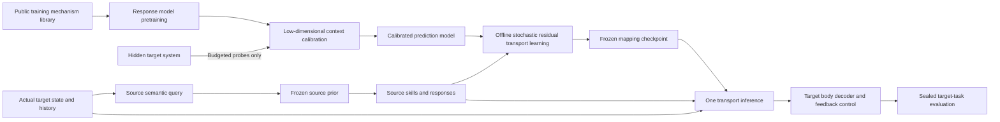

# Cross-Embodiment Multi-Backend Implementation Plan

**2026-10-14 reordering from P3 onward:** reproduce recent complete baselines → four-task development comparisons ↔ method improvements
→ independent formal validation → paper completion. Detailed P3–P7 tasks, criteria, and execution queues follow the
[new phase plan](cross-embodiment-p3-onward-plan.md); it replaces the earlier small-step P3 schedule.

**2026-10-14 research-direction update:** establish mature strong-baseline performance on all four tasks before determining
independent method and theoretical contributions. The current implementation sequence follows the
[four-environment comparison plan](cross-embodiment-baseline-comparison-plan.md).
The main literature pool prioritizes 2025/2026 leading-conference papers and relevant work by Karen Liu and Guanya Shi; older methods remain
basic references. Accepted, published, and preprint-only status are distinguished explicitly.
The [literature survey](cross-embodiment-baseline-survey.md) and
[task-protocol audit](cross-embodiment-four-task-protocol.md) record method and environment details separately.
LaTeX has been restored to a paper draft; development scores and engineering reports are in the
[report archive](cross-ebdm-experiment-reports/README.md).

**2026-10-14 P2:** see the [P2 record](cross-embodiment-p2.md) for current matched-contact GPU model execution,
CPU confirmation, and qualification boundaries. GPU model search and replacement of CPU target physics are qualified separately.

**2026-10-14 current baseline:** P0/P1 on the GPU machine are complete using new artifacts.
See [feasible-support and distribution experiments](cross-embodiment-p1-refinement.md) for
both P1.5–P1.7 development protocols, independent audits, and theoretical revisions.
Current results do not establish an independent advantage of transport over same-model task-only.
Old CPU artifacts are no longer retained; numbers below are historical development records, not currently reproducible results.

Revision date: 2026-10-12. Current research/development branch: `codex/cross-embodiment-transport`; uncommitted changes are retained. Subsequent GPU handoff continues on this project branch.

## Historical CPU Implementation Status (2026-10-12)

**Execution on this machine has stopped; work is transitioning to a GPU machine.** After disk exhaustion, experiments, tests, and dependency installation were stopped at the user's request; the matrix will not be completed on this machine. Follow the [GPU handoff checklist](cross-embodiment-gpu-handoff.md) next: migrate code/artifacts and establish storage limits first, then run current-version regressions and GPU-provider qualification.

See the [CPU mechanism closure](cross-embodiment-validation-closure.md) for the latest scientific record. This round passed state-conditioned .2/.6 s neural response, finite-joint-law validation on new initial states, 50/50 across 5 independent calibration/optimization runs, 16/16 on 3D obstacles, 10/10 on real guide channels, and 10/10 joint manipulation/support success for Go2 + Z1 on the same task; 53 NumPy/native regressions passed. The whole-episode mean-cost network remains unsupported. Strong same-model task-only ties; mobile arm-only prediction fails, but its selected policy also succeeds 10/10, so this does not establish a unique control advantage. Body × mechanism matrix v1 failed; v2 was interrupted during model search and has no final physical evaluation. Final independent auditing and the current full JAX/Torch/MJX regression suite await handoff. GPU, real multi-GPU operation, Torch physics, and Rust remain unqualified.

**The CP0–CP12, 71/77/86-test, and early device-chain results below are historical implementation records, not evidence that all current code has passed again.** Physics providers for the current matched-keyway/TCP signed-wrench, 3D-guide, and Go2 + Z1 research protocols remain NumPy/host implementations. The old MJX protocol cannot substitute for the new one, and merely adding `--device gpu` does not establish successful migration. The GPU handoff checklist governs outstanding items, matrix interruption points, and backend order.

Work proceeded continuously through CP0–CP12. The preceding round passed 71 CPU tests; this round added mechanism regressions and passed the complete 77-test CPU suite, including strict transfer guards for the full fixed-arm/contact device chains. CPU code exists for the common framework, three fixed-arm environments, planar mobile bodies, and floating Go2 + Z1 composition. There are execution entry points for model training, budgeted calibration, stochastic transport, actual closed loops, Torch numerical comparisons, and complete-batch C++ inference. Later sections retain the formal research design; small-model functional acceptance is not a research conclusion.

| Component | Implementation and CPU evidence | Scope boundaries |
| --- | --- | --- |
| CP0–CP2 common execution/data/query | stdlib contracts, lazy registry, solver-style frontend; heterogeneous Panda/xArm7 mechanism batches and full-chunk microbatching; real FK/Jacobian source projection, support rejection, partial reset, fully grouped data | Bucket by physical topology; invalid/unsupported states count as failures |
| CP3 source prior | Mode-conditioned Gaussian MLP, source-reference feedback decoder, train-only normalization, explicit noise, frozen portable artifacts; two actual Panda execution modes | Current small model is a Gaussian baseline, not described as a conditional flow/diffusion model |
| CP4 response | Three-member MLP, complete joint/velocity/TCP/controller/delay carry; contact includes force/admittance/body references; floating extension includes foot anchors, body height, QP warm starts/residuals; multi-step autoregressive carry and sticky predicted risk | Ensemble disagreement is uncalibrated and cannot be treated as safety probability. Public UR5e response is a seen-body engineering control |
| CP5 calibration | Persistent reserve-before-run ledger; failures and pending attempts consume budget; separate fit/validation; freeze response and fit only 3D context; B=0/10/30/100 paths | Current short initial-state probes are weak for contact/mass identification; report this accurately, without claiming successful active identification |
| CP6–CP7 transport/risk/resume | Bounded stochastic residual; matching with the same U_s; global fractional CVaR, ties, two-pass microbatch VJP, one Adam update; whole training-chunk scan; independent optimizer/context/RNG/budget checkpoints and atomic publication | Real multi-GPU collectives, GPU memory, and throughput await GPU qualification |
| CP8–CP10 fixed-arm contact | Per-world complete numerical MJX mechanism models/contact-execution microbatches; real guide surfaces/socket/keyed tool, constraint-measured wrench, substep force peaks, hybrid normal projection, contact release/recovery, 6-DoF UR5e; same prior → query → context → transport → physics chain | Guided alignment still has force-peak failures. Failure detection/recording is implemented; policy robustness remains research work |
| CP11 mobile bodies | Planar ground-supported xArm7 composition and command/drive mapping; Go2 + Z1 with 25 qpos/24 qvel/18 actuators, 4 ms stance inverse-dynamics QP, real foot–ground contact, fall/support/QP failures; reuses frozen Task 3 Panda prior | Planar base constrains roll/pitch/height; Go2 currently performs standing manipulation, without navigation/gaits. Humanoid hardware/control interfaces remain undecided; no fabricated results |
| CP12 portability | Same-weight JAX/Torch forward, input gradients, context, and one transport Adam step; C++ ABI v1 complete-batch MLP and prior replay | Torch CPU learner reference; C++ inference-only, without claims of completed native autodiff/GPU or Rust |

Major existing artifacts are in `tmp/cross_embodiment/` (git ignored): `learned_cpu_v2`, `learned_closed_loop_v4`, `guided_models_cpu_final`, `keyed_models_cpu_final`, `keyed_models_cpu_mobile`, `keyed_models_cpu_floating`, and corresponding dataset/learned-loop/device-guard/qualification directories. See the [CPU validation record](cross-embodiment-cpu-obstacle-transfer-validation.md) for detailed current results and historical failures. Artifacts from different versions remain unchanged; subsequent tests do not overwrite historical failures.

See the [architecture refactor description](cross-ebdm-architecture-refactor.md) for current execution entry points and responsibility boundaries. Paper commands live in `scripts/paper/cross_ebdm/` and execute through the unified experiment runner. CPU acceptance still compiles complete MJX graphs serially, saving logs, JUnit, versions, flags, and actual code fingerprints.

The JAX device path now places source queries, prior, transport, control, and MJX within one outer `scan`. ObstacleTransfer and short contact windows have strict `jax.transfer_guard("disallow")` validation. This establishes CPU device-boundary semantics; GPU/CUDA/DDP device correctness, capacity, throughput, and latency remain independently `not_run`.

## Mechanism Corrections and Theoretical Acceptance (2026-10-12)

The next six paper-evidence tasks follow [theoretical feasibility and CPU research acceptance](cross-embodiment-theory-feasibility.md): qualify matched keyways/TCP wrench first, then strong same-model controls, model bias, distribution transfer, multiple calibrations, and UR5e holdout, followed by Task 1/2 and mobile-body extensions. That plan maps theoretical assumptions to implementation and failure criteria item by item. New artifacts reside in `theory_feasibility/` and do not overwrite the older frozen evaluations below.

The latest matched-keyway CPU study completed strong equal-budget search: xArm7 Direct 0/10, calibrated 10/10, task-only search 10/10, nominal-response 5/10. Calibrated and task-only use identical parameters, **providing no evidence for an additional anchoring advantage**. Tool TCP wrench, geometry alignment, and side-contact/axial-support events were corrected; 2/1 ms physics-timestep checks succeeded 8/8. Added provider-style candidate MPC, actual sampled-law/noise ablations, finite policies, and paired-cost audits. The new learned episode-response model was marked unsupported after failing independent-validation thresholds. The six-task acceptance document governs implementation, actual results, and outstanding claims; GPU physics for the new protocol is explicitly unsupported, without silent fallback to legacy.

A further 25 completely new paired reset clusters, averaging both modes within each cluster, yielded Direct 0/50 and calibrated 50/50. Mean improvement in the preregistered [0,1] task cost was .80203, with one-sided 95% lower bound .31248. This evidence is conditional on one calibration, not a uniform-model/across-calibration guarantee. Completed 5 identification repeats, unknown-contact + readout-noise occupancy checks, payload-mismatch rejection, independently calibrated UR5e 6/6 with an equally successful Direct control, and frozen xArm7-map transfer to UR5e at 0/2. The complete CPU regression suite passed 86/86; independent acceptance of 332 saved actual/model trajectories found 0 mismatches. Formal Task 1/2 mechanism statistics, learned-response qualification, Task 4 learned/WBC coupling, and novelty continue through the six go/no-go stages.

This round added an independent mechanism-research route on the same branch while retaining old CP0–CP12 functional artifacts. The old 71-test pass no longer represents the test count after these changes; final full regression passed 77/77 according to `mechanism_revision/qualification_final/report.json`. Initial/final source snapshots are stored in the report and `final_source_manifest.json`, and each research artifact records the version actually executed. Research acceptance must sequentially pass source behavior, probe identification, independent response validation, restricted transport, and sealed physical evaluation; interface tests cannot substitute.

### Identified and Corrected Gaps

- All original contact probes ended in free space without observing contact. Added `probe_policy`, charging feedback approach, complete commands, failures, and validation together while saving actual initial states and controller carry. Recovery does not permit free replay of lost charged records.
- Original source data duplicated the same trajectories across train/validation. New data uses feasible randomized task-space initial states, complete independent trajectories, and genuine recovery modes. Added an event-conditioned Gaussian reference prior with actual SE(3) feedback. It is a restricted prior, not a flow or a validated large generative model.
- Original residuals could not correct source-stationary axes. The common `TransportSpec` now has configurable residual floors and task-reference losses, synchronized across JAX/Torch; default behavior of old artifacts is retained.
- Original context could exceed physical support. Added model-declared context bounds: structured-twin gains lie in `[.4,1.3]`, delay is discretized into 0–4 control periods, and tool mass is fixed at known 0.5 kg. No claim is made that these probes identify unknown friction, mass, or compliance.
- Unused normal-position references accumulated during force control and caused impacts on release. NumPy/MJX/floating references now project this reference; raw unloading intent immediately removes the contact-maintenance requirement, while actual force still obeys the original rate limits and delay.
- Known native xArm7 joint stiction limits approach/orientation capability. The research protocol consistently uses a 4 Nm angular-wrench cap, 15 mm/s approach, and bounded .03 m approach integration, shared by all target controls. Actual actuator limits, velocity, collision, and force failures remain active.
- Original CPU insertion depth was approximately 46 mm, with no orientation check. Retained legacy configuration and added `research_contact_config`: 16 mm seating target, position error <2 mm (ensuring depth >14 mm), orientation <2°, .3 s hold, total peak force ≤25 N, lateral-resultant peak force ≤10 N, and total time ≤15 s. All force peaks are computed at physics substeps.

### First Research Closed Loop

`train_phase_prior.py` → `calibrate_contact_twin.py` → `validate_mechanism_chain.py` → `complete_chain_baselines.py`.

1. Independently train and freeze a Gaussian reference law over 8 phase/mode conditions from nominal Panda source data. Mode 0 withdraws straight; mode 1 withdraws laterally. Controls share an event-feedback decoder.
2. Use 5 actual-target-interface probes: 3 fit (free space, 3 N/7 N loading), 2 independent validation (4 N loading, free space). Each lasts at most 2 s; failures and execution needed to reach contact are charged. “Actual target” here means a hidden CPU MuJoCo instance; there is no real-robot evidence yet.
3. Construct a physics twin from public body structure. Free-space probes use translational/angular excitation .025/.012 m/s and .12 rad/s. First profile free-space gain/delay, then jointly fit contact response within a local ±.002 gain range. Use a fixed finite-search budget without validation-based parameter selection. Independent thresholds are position RMSE <1 mm, normal-force RMSE <.25 N, and force-peak RMSE <1 N. Failure stops training and saves an unsupported report.
4. Freeze the source law and optimize phase-conditioned affine transport at calibrated-twin training initial states 130/131: only final-insertion normal-force scale `[.5,2.5]` and tangential-velocity bias `±.02 m/s`. Fix 12 candidates and 48 twin rollouts; costs include task, actual source-force anchoring, mode, failure, peaks, and change magnitude. Coarse search and response correction do not claim global optimality.
5. Direct, calibrated transport, system-ID inverse, and wrong context share the same actual physics instance/initial states/noise/decoder. Nominal-response transport uses the same body model, the same 48-rollout twin optimization budget, and frozen test initial states, with a separate report. `wrong_context_transport` is a simple sanity control using gain instead of inverse gain, not a retrained wrong-model control; it cannot replace the nominal-response baseline.

This restricted transport passed actual JAX/Torch/C++ artifact-forward comparisons. Phase-feature expansion executes in each tensor backend, and JAX supports JIT. Physics-twin parameter search and current research scripts are serial CPU diagnostic providers, **not yet GPU hot paths**. `PhysicsTwinResponse` is a lazy frontend; the actual MuJoCo/SciPy implementation resides in `backends/numpy/structured_response.py`, delegated through `TwinResponseBackend` and explicit backend/device selection. Unimplemented providers reject requests. Existing generic JAX device collectors/learners remain. Next, vectorize twin candidate/mechanism axes by topology and scan time, then integrate Torch/native through unified capability protocols. Host SciPy or NumPy loops must not be silently deployed in the main GPU workflow.

### Theoretical Revisions and Interpretation

LaTeX adds probe non-identifiability boundaries, finite-mechanism separation conditions, an inverse-separation bridge for continuous structured families, and hybrid-event margins. If the probe signature has inverse-separation constant κ, fitting residual r, and noise/model bias η/εp, parameter error is bounded by (r+η+εp)/κ. Only with uniform mechanism Lipschitz continuity of the joint closed-loop kernel and model error can this imply transport cost error. Model-cost improvement exceeding twice the uniform cost error guarantees actual improvement.

These are **proofs under assumptions**. Current numerical results do not certify global κ, Lipschitz constants, support coverage, or safety confidence bounds. Event boundaries must be handled beyond local contact modes. Code and narrow-mechanism experiments can validate part of the conditional chain; they do not establish general cross-embodiment transfer, the necessity of stochastic transport, or paper novelty.

Before any execution, `evaluate_frozen_mechanism.py` writes source/transport SHAs, configuration, mechanisms, test seeds, and code fingerprints. It uses 20 new reset clusters with two modes each, adding force-only ablation and an equal-budget nominal-response map. A public nominal map may be cached/reused under the same configuration/prior. Compute intervals by reset cluster and provide an exact binomial interval for “both modes succeed,” avoiding misleading zero-width bootstraps under all-success outcomes. Final-segment force errors use valid physics steps only, excluding terminal padding.

Current contact observations remain constraint-load aggregates: the normal channel is `sum(abs(F_contact,z))`, and lateral load is aggregated world-xy load. Torque components of `measured_wrench` have not yet been transformed to the TCP. Unilateral floor support during seating hold supports this round's normal-load validation, but the field is not a calibrated wrist F/T measurement. Before formal contact models/real robots, complete geom directions, TCP moment arms, and full sensor semantics, then revalidate multi-contact branches.

### Research Acceptance Conclusions for This Round

Across three frozen gain/delay mechanisms, each with 20 new resets and two modes per reset, Calibrated achieved 120/120 insertions and 120/120 mode matches. Independent acceptance found no mismatch in all 600 trajectories across five methods. Direct and simple inverse-gain both achieved 0/120; force-only scored 40/40, 0/40, 0/40; nominal-response scored 40/40, 40/40, 36/40. This establishes a joint task/response-compensation loop under a restricted structured model, but not a general success-rate advantage over nominal-response (stress paired p=.125). Relative to nominal, final-segment 5 N load RMSE fell from 2.292/2.438/2.437 N to .389/.636/1.527 N. Duration involves tradeoffs; no speed advantage is claimed. Complete numbers, confidence intervals, and retained failures are in the [validation record](cross-embodiment-cpu-obstacle-transfer-validation.md#frozen-evaluation-final-results).

### Subsequent Research Gates

Frozen-result visualization is complete: `render_mechanism_gifs.py` exports three GIF groups for Panda's two modes, three xArm7 methods, and stress-failure controls. Artifacts and a local preview page reside in `tmp/cross_embodiment/mechanism_revision/gifs/`. Seven samples replay the originally frozen prior/transport and identical resets, with zero error in all original trajectory channels, then record joint angles at each control step. The display model restores native appearance meshes, with zero TCP FK error. Transparent hole walls, tool connecting rods, and support platforms are display-only. This adds no evaluation denominator and refits no parameters; see commands in the [validation record](cross-embodiment-cpu-obstacle-transfer-validation.md#frozen-trajectory-gif-replay).

- Inspect all failures and controls from this round first without tuning final-test parameters; add independent calibration seeds, mechanism combinations, confidence intervals, and strong classical-search/residual-policy baselines.
- After establishing the restricted-twin closed loop, substitute a learned response ensemble under the same frozen protocol and report model bias/occupancy support; success of the former does not imply success of the latter.
- Then examine multimodal laws, noise strength, and stochastic/deterministic transport; add unknown friction/compliance and a 6-DoF UR5e body holdout.
- Task 4 inherits the same strict insertion semantics, then separately qualifies body control. Retain current Go2 failure artifacts; fixed-arm success does not establish mobile-body success.

## Research Goal and Implementation Boundaries

The four tasks form one evidence chain: 3D constrained approach under load tests execution-response changes; fixture-assisted alignment distinguishes execution from contact response; keyed-connector insertion/recovery tests whether contact sequences and mode probabilities change appropriately; Task 4 retains Task 3 manipulation semantics to test same-task transfer with mobile-body/contact coupling. The central approach calibrates task-relevant responses from limited target interventions, then transfers the skill distribution from a frozen source prior into a target-executable skill distribution.

The method has four independent objects: source skill prior `SourcePrior`, robot-specific executor `RobotDecoder`, calibrated response model `ResponseModel`, and stochastic skill mapping `SkillTransport`. Environments provide known body geometry and actual simulated responses. Priors, calibrated models, and final transport require separately versioned artifacts; a single large trained policy cannot be retroactively interpreted as these components.

The first version fixes the following choices:

- Panda 7-DoF is the source; xArm7 is the first target; UR5e 6-DoF is an independent-robot test requiring explicit new integration.
- Task 4 reuses the frozen Panda Task 3 prior and 13D skills, successively adding a wheeled base + xArm7, the armed-quadruped candidate Go2 + Z1, and humanoid candidate G1 with gripping/force interfaces. Composite assets and WBC require new validation; standalone robot models are not complete systems.
- Transfer short skills in a common task space. Target joint states enter only the target executor, feasibility features, and transport conditioning, without directly aligning joint vectors across robots.
- A stochastic residual MLP is the first transport. Establish the efficacy of calibration and response matching before deciding whether to upgrade to a conditional flow.
- Pretrain response models across simulated mechanisms; fit only low-dimensional context in the target domain. Assess stochastic contact-model error through independent validation and model ensembles.
- Contact simulation generates and validates data; differentiable short-horizon surrogates supply the main transport gradients. Differentiating physics steps is not a prerequisite for the training path.
- The first delivery stage has two exits: CPU functional acceptance and GPU qualification. CPU may complete small-scale training and closed loops first; before formal-scale collection, training, and main-table runs, pass relevant GPU device, shape, synchronization, and throughput gates.
- Common layers store task, shape, unit, budget, and capability contracts. JAX/Torch tensors, autodiff, compilation, and parallel code remain in their respective backends. Rust/C++ first integrate independent kernels and inference, then extend to full backends as capabilities allow.

The project does not promise causal-graph discovery or automatic identification of unchanged modules. Interventions improve identification of task-relevant response; low-dimensional context coordinates need not equal uniquely identifiable true friction, delay, or stiffness. Mobile bodies are included in Task 4 development, but navigation, gait learning, and universal whole-body manipulation are not learning objectives of this method. Report Task 1–3 mechanism evidence separately from Task 4 scope validation.



## Reuse and Gaps in the Existing Repository

| Component | Existing evidence | Treatment in this project |
| --- | --- | --- |
| Robot descriptions | `RobotProfile` and `RobotBinding` in `genedynamics/robots/profile.py` resolve joints/frames at construction | Reuse; add UR5e profile and task-scene composition |
| Cross-arm foundation | `genedynamics/robots/README.md` records Panda/xArm7 surface-scan 10D primitive composition checks | Reuse assets/binding conventions; independently validate the new 13D interface |
| Candidate mobile-body assets | Standalone Go2, Z1, and G1 models in Menagerie provide modeling starting points only | Add mobile mounting/inertia/support/tool composition, complete joint binding, and WBC; do not assume compatible compositions or force/stiffness capability already exist |
| Source prior | `StructuredPrior.sample_horizons` in `genedynamics/learning/priors/base.py` returns trajectories, log probabilities, and expert IDs | Reuse pytree/batch-sampling conventions; add task-space conditioning adapters, without assuming old checkpoint compatibility |
| Batched rollout | `genedynamics/solvers/common/env_rollout.py:26–121` uses candidate `vmap`, temporal `scan`, and cached stepping | Reuse pure-function design; create multi-environment training, calibration, and evaluation kernels |
| MGA transport | `genedynamics/solvers/common/transport/base.py` is the DDPM/DDIM/FM reverse-update interface | Leave it intact; place new `SkillTransport` in learning, without replacing reverse steps |
| Experimental evidence | `genedynamics/experiments` already manages configurations, seeds, metrics, failures, and artifacts | Reuse output protocols; add batched task adapters and GPU-qualification reports |
| Reliability fitting | `genedynamics/learning/reliability.py` is an acceptance-risk/reliability model | May assist qualification, but cannot impersonate a motion/contact-predicting `ResponseModel` |
| Deployment | `genedynamics/deploy` has separate I/O, controller, and adapter boundaries | Preserve; add arm TCP/wrench/impedance interfaces for real-robot work |

GPU auditing shows that existing MGA is not an end-to-end multi-environment GPU program. Near `mga_jax.py:2891`, `plan_batch` serially calls a planner on the same initial state using different random keys, without vectorizing independent environments. Near `genedynamics/experiments/framework/experiment.py:888–903`, suite/level/seed execution is sequential. MGA `_replan_stepwise` synchronizes and converts to NumPy at each reverse step near `mga_jax.py:1090–1100`; stepwise acceptance materializes values and branches in Python near `1184–1188` and `1359–1371`; recovery paths also contain loops and `device_get`. These are facts about particular paths, not a claim that every MGA path computes on CPU.

The new framework therefore needs independent `train_step`, `collect_chunk`, and `evaluate_chunk` interfaces rather than a Python loop around single-environment MGA as the main training path. The old runner may still schedule independent experiments and output records, but does not enter a rollout's physics-step or candidate loop.

## Follow Existing Backend Interfaces

### Common Orchestrator and Method-Specific Protocols

Following the [MGA orchestrator](../../genedynamics/solvers/single/mga/mga.py), [MGA backend protocol](../../genedynamics/solvers/single/mga/backend_impl.py), and [RL prior orchestrator](../../genedynamics/learning/priors/rl/rl_prior.py), public entry points validate configuration, use lazy factories, load artifacts, and delegate; numerical implementations reside in `backends/`. Follow this organization to declare method-specific learning, calibration, and batched-execution capabilities, rather than rewriting the algorithm as a generic array wrapper that merely swaps `jnp` and `torch`.

The existing [compute Backend protocol](../../genedynamics/core/backends/base.py) provides tensors, RNG, `vmap/jit`, and other basic operations, but lacks the training-gradient, complete-rollout-carry, optimizer, and distributed-reduction contracts needed here. Add method-specific inference, training, and collection capability protocols in `backend_impl.py`, rather than continually adding arm-learning details to the basic `Backend`.

Reuse [BaseRegistry](../../genedynamics/registry_base.py) factory/entrypoint registration for typed component backend registries; the existing prior registry continues to manage source priors. `RuntimeBackendManager` still hardcodes JAX/NumPy/Torch: calling `register_backend("rust", ...)` alone does not make the manager support Rust. The new orchestrator explicitly resolves and retains backend instances at construction. Add a minimal registry bridge only when integrating a complete native runtime, avoiding global-backend switches during training.

The existing experiment runner calls `RuntimeBackendManager.set_backend(config.backend)` before constructing a method, so a method-local factory cannot bypass this gate. B3 uses `backend=jax/torch` with `native_kernel_backend`, or loads artifacts directly through a separate `deployment_runtime`. B4 first completes the minimal manager-to-existing-registry resolution bridge and runner compatibility tests before enabling `backend=rust/cpp`. Entrypoints refer to lightweight factories that lazily import concrete implementations, avoiding loading every numerical framework during registry enumeration.

`contracts.py` uses framework-independent fixed-structure records for shapes, units, masks, statuses, and schemas. JAX registers pytrees locally; Torch/native provide their own tensor flatten/unflatten. Public modules do not import `jax.Array`, `PRNGKey`, `mjx.Data`, Torch modules, or FFI handles; physics state remains opaque to adapters. The Python frontend retains light dependencies/lazy imports. The repository still has base JAX dependencies, so genuinely trimming Torch/native deployment dependencies requires separate packaging/import tests.

Deployment may add a thin `CrossEmbodimentSolver` consuming frozen artifacts through existing `Solver.solve → Trajectory` or `MethodPlugin` surfaces. `solve` explicitly performs one skill sample; it must not inherit default energy-based selection in `SamplingSolver.solve` and change the behavior law. Existing `BaseModelBasedDiffusionSolver` includes JAX imports and NumPy output conversion, so it is not a base class for the new cross-backend implementation. Device-resident batch interfaces do not pass through host `Trajectory` lists.

### Select Compute, Physics, Control, and Native Kernels Separately

Keep `ExperimentConfig.backend/device` authoritative for compute backend/device, without adding a potentially conflicting global `learning_backend`. Task/method parameters select physics and kernels and resolve to a unique `ExecutionSpec` at construction. The table below proposes new configuration contracts, not yet runnable configurations.

| Selection | Responsibility | Initial version and upgrade path |
| --- | --- | --- |
| `backend` | Prior, response, transport, autodiff, optimizer | `jax` first, `torch` second; `rust/cpp` optional full native inference backends |
| `device` | Actual compute device and ordinal | Explicit CPU/CUDA resolution; fail if requested GPU is unavailable |
| `env_params.physics_backend` | Contact execution, resets, simulation data | MJX-JAX first, MJX-Warp candidate, MuJoCo CPU reference; separately qualify Torch-compatible GPU engines |
| `env_params.controller_backend` | Low-level execution/WBC from 13D skills to arm/base/legs | Fixed-arm controller first; register Task 4 wheeled/legged WBC by device/capability, independently of compute/physics backends |
| `method_params.native_kernel_backend` | Local IK/FK, decoder, constraints, or risk computation | `builtin` first; Rust/C++/CUDA providers integrated through FFI |
| `method_params.execution_mode` | Required capability set | `train`, `collect`, `infer`, `evaluate`; do not infer capability from names |
| `method_params.deployment_runtime` | Artifact loading and deployment execution | Python first; Rust/C++ may independently consume portable inference bundles |

Capabilities include at least `inference`, `autodiff_inputs`, `autodiff_parameters`, `train_step`, `batched_rollout`, `compiled_chunk`, `strict_device`, `distributed_reduction`, `explicit_noise`, `artifact_schema`, and supported dtype/layout/device. Validate required combinations at construction. An inference-only native backend is marked `inference_only` and cannot fake a training interface. Non-differentiable physics does not prevent surrogate training; however, native operators in the training-gradient chain require input gradients or an explicit differentiable implementation.

Task 4 additionally validates controller `task_twist`, `task_stiffness`, `normal_force`, `whole_body`, `support_control`, `batched_step`, `compiled_step`, `device_resident`, supported update periods, and dtype/device. These are proposed controller capabilities; a WBC name does not imply all are supported. At construction, also validate device/data-exchange compatibility among compute, physics, and controller. Host WBC may first support CPU functionality and deployment replay, but cannot enter formal GPU collection until device-resident batch qualification passes. Collection/inference-only WBC does not require autodiff; if its operators enter surrogate gradients, provide input gradients or an explicit differentiable alternative according to declared training capabilities.

The current [Torch runtime](../../genedynamics/core/backends/runtime/torch_backend.py) returns the original function from `vmap`, uses TorchScript for `jit`, derives `split_rng` from object hashes, and may fall back to CPU when GPU is requested. Preserve the interface pattern while adding project-specific capability checks, deterministic sampling, and real batch/compile implementations. Existing class names are not evidence of Torch GPU qualification.

Some JAX ↔ Torch conversions in existing `BackendArray` go through `to_numpy()`, potentially causing host synchronization, CPU copies, and detachment. Such convenience wrappers may support artifact/offline I/O, but are not default interoperability for new GPU hot paths. M0 transfer checks must cover invoked adapters, not just top-level training functions.

### Required Backend Batch Interfaces

```python
class InferenceBackend(Protocol):
    def capabilities(self): ...
    def load_inference_bundle(self, bundle): ...
    def infer_batch(self, task_states, body_states, contexts, random_request, noise_batch=None): ...
    # -> device-resident SkillBatch; inputs are independent batched states
    def synchronize(self): ...
    def export_inference_bundle(self): ...

class TrainingBackend(InferenceBackend, Protocol):
    def initialize_training(self, config, bundle, random_request): ...
    def train_step(self, train_state, batch, noise_batch): ...
    # -> next_train_state, device_metrics
    def fit_context(self, probe_batch, initial_context, random_request): ...

class CollectionBackend(Protocol):
    def collect_chunk(self, execution_state, active_policy, random_request, noise_batch=None): ...
    def evaluate_chunk(self, execution_state, active_policy, random_request, noise_batch=None): ...
    # -> fixed-structure carry, responses, terminal records
```

These are draft protocols for a future `backend_impl.py`; training/collection are optional capabilities. Public callers delegate once per batch/chunk, without Python dispatch for every tensor operation. Component-level priors/responses/transports remain replaceable, but construction must ensure a shared autodiff runtime or explicitly declare a verifiable cross-runtime gradient bridge.

`random_request` describes the run seed and global sample IDs; `noise_batch` explicitly contains source/transport noise, model noise, and uniform tensors for discrete sampling. Production paths generate random numbers in batches inside the backend; cross-backend acceptance injects identical explicit noise, without assuming equal JAX/Torch seeds produce equal values. Object hashes, Python thread RNGs, or physical device IDs cannot define sample random identity.

This random contract belongs to the new method interface. Existing public protocols such as `Prior.act(..., key=...)` remain unchanged; project prior adapters convert requests to appropriate backend keys/generators or explicit samples internally, avoiding changes to other solver consumers.

### Torch Upgrade Path

The Torch implementation preserves network definitions, normalization, effective actions, losses, and data permissions. First align prior, source/target surrogates, transport, and 13D Bound with identical weights/inputs/noise; then verify action-input gradients, parameter gradients, and one optimizer/multiplier update. Freezing prior/response parameters must preserve response gradients with respect to `U_t`; wrapping the whole segment in `no_grad()` must not sever transport training.

Use explicit tensor batches and applicable `torch.func.vmap` for batch axes; backend compilation or dedicated rollout kernels handle fixed H/S/L loops. Qualify selected `torch.compile` regions, graph breaks, and recompilation; use `fullgraph=True` where supported to expose graph breaks. DDP data parallelism separately checks valid-sample counts and risk reduction; replacing JAX `scan` text with Python loops is insufficient. [PyTorch compilation interface](https://docs.pytorch.org/docs/stable/generated/torch.compile.html)

Torch model training first consumes the same offline records and uses a Torch surrogate to preserve the full gradient chain. If retaining a JAX/MJX collector, prefer exchanging data or validated model artifacts at dataset/chunk boundaries. Per-control-step interaction between a Torch policy and JAX physics is a separate candidate implementation requiring measurement of the entire closed loop. Another route integrates a batched physics adapter compatible with Torch tensors and requalifies contact tasks; simulator changes cannot be conflated with pure compute-backend replacement.

DLPack device-data sharing still requires verification of buffer ownership, streams, lifetime, and aliasing. Data exchange is not a cross-framework autodiff bridge and cannot assume zero synchronization. By default, forbid Torch ↔ JAX ↔ NumPy conversion at every physics substep. [PyTorch DLPack interface](https://docs.pytorch.org/docs/stable/generated/torch.from_dlpack.html)

### Rust and C++ Upgrade Path

Start with independent kernels whose costs are established by profiling, such as batched FK/Jacobians, IK, 13D decoder/Bound, constraints, or risk reductions. Next load frozen MLP artifacts for complete native inference; only then decide whether a full training backend is needed. Rust/C++ follow the same versioned numerical contract and may share C ABI/CUDA implementations; language differences do not require rewriting the experiment runner.

Each FFI request handles a complete batch/chunk and includes ABI/schema version, dtype, shapes/strides, device ordinal, input/output ownership, mutation policy, stream/event conventions, and error status. CPU kernels must not dereference CUDA pointers; reject GPU requests explicitly without a CUDA implementation. Rust/C++ provide the relevant numerical/execution capability, while the same orchestrator/runner manages budgets, splits, results, and failures.

On JAX, use an FFI adapter matching the pinned version; register required VJPs/JVPs for operators in training. On Torch, register shape/fake, autograd, and batch rules through custom operators and run operator conformance; collection/inference-only operators need no backward implementation. If a new JAX API conflicts with current version constraints, qualify it in a candidate environment rather than directly upgrading the entire repository. [JAX FFI](https://docs.jax.dev/en/latest/ffi.html), [PyTorch C++/CUDA operators](https://docs.pytorch.org/tutorials/advanced/cpp_custom_ops.html)

Qualify compilation/batching/gradient combinations and multi-GPU sharding for native operators together. Each GPU handles only its local shard. Implement necessary partition/batching rules explicitly and inspect traces for accidental all-gather of the global batch followed by duplicate computation. One correct FFI forward pass does not establish preserved GPU parallel efficiency.

A full native backend uses the same `InferenceBackend` and solver facade. Future native training may reuse a qualified autodiff runtime; accept `execution_mode=train` only after training capability exists. Rust/C++ language choice alone implies neither GPU acceleration nor autodiff.

### Portable Artifacts and Conformance

A portable inference bundle stores schema version, named tensors, network/activation definitions, normalization, 13D masks/Bounds, context, mode rules, control dt/H, body/asset hashes, and training provenance. Task 4 additionally stores controller signature/parameter hash, WBC clocks, mounting transforms, body-feature schema, support rules, and risk normalization. Workpiece/ground mechanism labels cannot be target-inference inputs. Linear weights use `[in,out]` consistently, with explicit conversion in Torch/native loaders; ensemble order and SE(3) conventions cannot remain implicit in framework checkpoints. Native backends first support this finite operator set for the initial residual MLP, without promising arbitrary generative-model export.

Full training resume separately stores optimizer, multipliers, sampler/RNG cursors, and backend/version. Converting only inference artifacts across backends is not exact training resumption. Reinitializing the optimizer is recorded as a new adaptation/training run.

| Acceptance scope | Pass criterion |
| --- | --- |
| Common layer/loading | Contracts/registry import independently; lazy imports; unsupported backend/device/capabilities fail before execution |
| Forward/semantics | Prior/response/transport/Bound/decoder align under fixed weights, inputs, and noise; SI units, masks, statuses, and termination denominators agree |
| Gradients/updates | Training-backend input/parameter gradients, directional finite differences, and one optimizer/multiplier update agree within declared tolerances; frozen parameters remain unchanged while action gradients survive |
| Risk/distributions | Identical CVaR definition, valid weights, tail fractions, ties/subgradient rules; scalar/batch/microbatch/multi-GPU risk agrees |
| Randomness/artifacts | Same sample identity reproduces within a backend; explicit noise fixtures across backends; all implementations verify save/load/conversion outputs, and implementations declaring autodiff/training also verify gradients/updates |
| Physics/closed loop | Replay retains resets/commands/clocks/geometry; compare engines with predefined task tolerances and physics labels; separately qualify contact success/modes/forces |
| GPU/native | Include compilation, warm-up, transfers, FFI/interop, synchronization, and batch=1 latency; sustained runs have no bounds violations, overflows, or expired buffers |

Verify JAX/Torch compute conformance first on identical offline fixtures; physics-backend replacement is separately qualified. Test nonsmooth clipping, thresholds, and quantile ties for their specified values and valid subgradients; do not require bitwise agreement of long contact trajectories across engines. Native implementations passing forward checks expose inference only; expose training only after gradients and training updates qualify.

## Data and Execution Contracts

### Common Skills and Robot Executors

Skill `U` has fixed shape `[H, 13]`: 6D TCP twist, 6D diagonal log stiffness (3 translational, 3 rotational), and a 1D normal-force setpoint. All quantities are expressed in the task frame; poses use SE(3), angular velocity uses radians, positions meters, and forces newtons. Network inputs use training-set-fixed scale normalization; physical logs always retain SI units.

Start the first version with `physics_dt=2 ms`, `control_dt=20 ms`, and `H=10`, giving 0.2-second skills and 10 physics substeps per control step. These initial settings await stability tests; do not arbitrarily reduce contact accuracy for throughput. Zero and mask the normal-force channel for approach tasks; contact tasks declare normals, impedance ranges, and twist projections.

`RobotDecoder` handles task-frame transforms, target integration, Jacobian/impedance mapping, damping/gravity compensation, joint/torque limits, and null-space posture control. Use explicit hybrid force/position control in the normal direction: force and position loops must not compete on the same axis. Put switching logic, gains, and saturation rules in configuration. All methods share the target controller; the decoder performs no hidden task replanning.

Effective-action masks update by declared phase and enter the data. Position mode uses full twist/stiffness with a zero force channel. Force mode removes normal twist using `P_n = n nᵀ` and projects positional stiffness onto the tangential subspace; a limited force loop controls the normal direction, with rotational stiffness retained as task-defined. Raw 13D outputs are not final commands. `Bound`, command-change loss, surrogates, and logs use commands after masking, projection, and rate limits, while saving raw outputs separately for diagnosis. Baselines receive the same normal/phase rules; control integrators use common anti-windup/reset rules on switching.

Update actual controller state at every physics step. Delay buffers, filters, force-loop integrators, and observation histories belong to rollout carry; a history-free TCP position alone cannot be expected to identify delays. Initially allow at most 4 control steps of delay in a preallocated fixed-length ring buffer; longer delays are explicit OOD conditions.

Task 4 realizes the same 13D commands through `WholeBodyController`. Base velocities, leg joints, and support adjustments are internal execution variables, not extra source-skill dimensions. Low-level WBC constraints/projections must not search insertion/recovery sequences on behalf of transport. All methods on the same target body share WBC, stance references, support switching, and limits. Save raw/bounded skills, WBC-projected references, actuator commands, and actual response; projected references or commanded force are not measured TCP/wrench.

Record skill boundaries, task-reference control ticks, WBC ticks, and physics substeps separately. Fixed-arm low-level feedback still updates every physics step. If mobile WBC uses another period, declare and validate its integer scheduling relationship with `physics_dt` at construction, updating by clock phase/mask inside a fixed scan. Explicitly state which outputs are zero-order held between updates and which feedback continues every step. Support/gait phase, previous actuator commands, WBC warm starts/filters/integrators, and clock phases are carry, cleared together at reset. Methods share actual clocks; extra WBC/leg-controller steps cannot be hidden.

### Body State and Source-Prior Queries

Split state into shared `q_sem` and body-specific `x_e`. The former includes TCP/workpiece pose relative to goals, goal/obstacle geometry, task progress, and external-contact phase; the latter includes actual TCP twist/wrench, joint states, fixed-length command/response histories, controller integrators, and filter states. Target-body features also include joint margins, full-arm/payload clearance, Jacobian-conditioning information, and known capability descriptions. Arm joint features for 6/7 DoFs may pad to 7 with masks; this convention does not cover whole-body mobile state, and physical `mjx.Data` itself is not padded into one robot shape.

Task 4 extends `x_e` with base SE(3)/twist, whole-body joints, workcell-relative body posture, wheel/foot support contact and slip, body clearance/stability/execution margins, and WBC memory. Bucket whole-body states by topology; group common learning features into base/arm/support/margins using declared capacities/masks or a fixed-output body encoder. Shapes and missing-field conventions enter the schema. M0a establishes extension boundaries, then Task 4 adds concrete bodies. Frozen-transport protocols require compatible body-feature schemas and frozen encoder weights. Adding/retraining an encoder or transport is adaptation, not context-only fitting. Mobile-body states do not directly enter the frozen Panda prior; `SourceQueryAdapter` continues to output its declared semantics and valid virtual states.

Resolve source-query state meaning explicitly: xArm or UR5e `qpos` cannot serve as Panda state input. For paired resets, construct a collision-checked Panda source virtual state with the same workpiece, goal, and TCP task pose; record IK alternatives under fixed selection rules or independent sampling. At each online skill boundary, `SourceQueryAdapter` produces source-semantic queries and valid virtual states from current actual task state. If no matching source state exists, mark source-support failure, apply common stop/recovery fallback, and count it in task failures.

If source queries require IK, use fixed iteration counts, warm starts, device-resident Jacobians, and collision/clearance calculations; no CPU IK inside batches. An initial task-semantic prior may reduce dependence on source joints, but source-response references still validate virtual states. Inference timing includes actual source queries and support checks; quantify this implementation risk early in M0/M1.

IK constructs poses, not contact history. Pairing strictly matches workpiece/fixture relationships, task poses, and phases in `q_sem`; if initial TCP/workpiece velocities are specified, the source must realize them or be unsupported. Retain each body's wrench, controller integrators, delay queues, and history independently, or reconstruct them with short approach/warm-up under the same specification. Do not copy target force/history into the source. Contact-response costs start from the common semantic phase while recording both initial body responses. Test source-initialization error separately so reconstruction error is not mistaken for mechanism differences.

The source-response reference `Y_s` results from executing the source skill at that source virtual state. Target response results from executing `U_t` at the actual target state. Body poses may differ, but initial task conditions must match. Known body capabilities are feasibility conditions; the target need not copy Panda elbow motion.

Task 4 source-response matching continues to compare workpiece/TCP, task contact, progress, and Task 3 search/withdrawal modes. Base/torso stability, wheel/foot slip, and support boundaries enter target risk; fixed-source-base and mobile-target-body trajectories need not match, and gait events are not manipulation-mode coverage. Constraints use the same global CVaR reduction with platform-declared dimensional normalization frozen during training.

In the first version, a frozen source surrogate predicts `Y_s` corresponding exactly to the current `U_s` during transport updates, with errors validated in independent source-physics rollouts. Store paired `(query,U_s,Y_s)` source-physics tuples for training/checking this surrogate. Cached references may only sample matching complete tuples, never pair newly sampled skills with old responses. Source-physics collection uses the Panda bucket and has separately reported cost; source-surrogate error also limits interpretation of response matching.

### Interface Draft

These are planned component interfaces, not currently callable APIs. Public interfaces use fixed-structure records with leading batch axes. JAX registers them as pytrees; Torch/native use their own tensor/carry representations. Construction-time strings/model objects do not enter runtime tensors.

```python
SourceQueryAdapter.build(task_state, source_signature, random_request, noise_batch=None)
# -> source_query, source_virtual_state, support_mask

SourcePrior.sample(source_query, random_request, n_samples, noise_batch=None)
# -> U_s[B,K,H,13], source_mode[B,K], proposal_logp[B,K]

RobotDecoder.step(robot_state, controller_state, skill_step, known_body)
# -> actuator_command, next_controller_state, saturation_flags

WholeBodyController.step_batch(body_state, controller_state, task_command, body_reference, clock_state)
# -> actuator_commands, next_controller_state, next_clock_state, projected_reference, status, device_metrics
# Task 4 controller protocol; whole-batch delegation without host tensor conversion

TaskResponse.extract(trace, task_spec)
# -> Y, terminal_status, realized_mode, valid_mask

ResponseModel.predict(params, task_state, body_features, U, context, random_request, noise_batch=None)
# -> distribution over next full surrogate carry and response summaries

Calibrator.fit(probe_dataset, prior_context)
# -> context_estimate, context_uncertainty, heldout_diagnostics

SkillTransport.sample(params, U_s, target_state, goal, context, random_request, noise_batch=None)
# -> bounded_U_t[B,K,H,13], transport_metadata
```

`TaskResponse` stores at least task progress, relative-pose change, tracking residuals, peak/cumulative contact forces, and contact phases. Extract mode classifications from actual trajectories. Networks may predict soft contact/mode probabilities for training, but final metrics must come from actual simulation trajectories. Separate force setpoints from measured wrenches; commanded force is not actual contact force.

## Training, Calibration, and Inference Workflow

### A. Source-Prior and Response Pretraining

First verify nonzero successful support for both source modes. For approach tasks, a geometric planner with time parameterization and a fixed tracker may generate source examples; fixture/insertion tasks first use two explicit closed-loop control experts. Geometric plans require complete physical-execution filtering; kinematic feasibility is not success under load.

The first prior may be a small mode-conditioned Gaussian sequence policy fit to successful skills through imitation learning, with source conditions also determining mode-mixture probabilities. Any PPO improvement occurs only in source simulation, and all transfer methods share the frozen prior. Existing PPO architecture/prior wrappers may be reused, but the new interface requires retraining. Conditional diffusion is a later capacity control, not a prerequisite.

Response pretraining should first use 4–8 mechanism configurations for functional checks, then expand to a library covering single factors and training combinations for formal research. More random seeds do not replace mechanism coverage. All simulation samples record robot/task signatures, known bodies, latent mechanisms, actual commands, TCP/wrench/workpiece trajectories, and failures. True mechanism labels are simulation-training/diagnostic-only; target calibration and final policies cannot read them.

The response model predicts one-step/short-window task-space dynamics and contact-phase probabilities; multi-step `scan` produces skill responses. Initially use no more than 8–12 context dimensions, encoding effective translational/rotational gains, delay, compliance, contact response, and related effects; identifiability experiments determine exact physical meaning. Use a shared task trunk with known body conditioning and, if needed, robot-specific execution-residual heads. The main UR5e protocol uses neither its source-task demonstrations nor response-pretraining data. Any engineering control using UR5e response pretraining is explicitly seen-body/unseen-mechanism, separate from unseen-body main results.

Surrogate carry must include predicted joint positions/velocities, workpiece states, controller memory, delay/observation queues, contact phases, and accumulated response. Task 4 additionally includes predicted base posture/twist, support/slip, whole-body execution state, WBC memory, and clocks. Known decoders/kinematics update references, FK/Jacobians, joint margins, and full-arm/whole-body clearance; learned components predict execution/contact residuals and uncertainty. Recompute body features at each step. Holding initial clearance/Jacobians or stability margins constant across H steps cannot establish future-risk validation. Construct each fixed-arm/mobile body's physics state separately; common learning features use declared schemas/masks.

Training combines normalized pose/twist/wrench prediction, short-window rollout error, and contact/failure-probability calibration. Initial ensemble size is `E=5`, with independent bootstrap datasets and initialization. Record held-out multi-step errors, risk ranking, and coverage, not just training MSE.

Strictly separate pretraining mechanisms from hidden target mechanisms and save configuration IDs/split hashes, avoiding persistent association of robot identity with one friction/delay. With no UR5e response-pretraining data but post-calibration transport updates, call it unseen-body few-shot adaptation. Only frozen transport with context-only fitting tests stronger generalization. Report source-task demonstrations, response pretraining, and target adaptation as three separate data permissions.

### B. Target Calibration

Fix target-interaction budgets `B_probe ∈ {0,10,30,100}`. One probe episode is a short command sequence with a reset. Also report actual control steps, execution seconds, resets, and wall time. All interface probing, failures, early stops, and held-out validation consume budget.

Preallocate approximately 70/30 to fit/validation: `B=10` may use 7/3, `B=30` uses 21/9, and `B=100` uses 70/30. `B=0` uses only a source/simulation context prior and must not be presented as calibrated. With few validation samples, ensemble intervals do not imply reliable probability guarantees.

Add probes progressively by task:

1. Free space: positive/negative multi-axis pulses, short chirps at different frequencies, braking segments, and payload-orientation changes. Combine commands with actual TCP history to distinguish gains from delays.
2. Fixtures: small normal loading, tangential sliding, and small-angle pivots from matched initial contact positions. Measure TCP, wrench, and workpiece pose together so force curves alone do not confound friction with initial misalignment.
3. Insertion: shallow rim contact, short slides under different normal loads, and small withdrawal/re-approach motions. Complete successful target demonstrations are not calibration.
4. Mobile bodies: end-effector pulses/braking, small wheeled-base translations/turns or torso adjustments within stable legged support, and coupled force-limited rim pressing/tangential micromotions. Body probes are identification interventions, not extra 13D deployment action dimensions. Each target body/mechanism/budget cell has one total `B_probe`, not three budgets for arm/base/contact.

Pretrained models may support task-dependent selection from fixed candidate probes; random probes and task-agnostic information gain are controls. Probe-selection comparisons vary data, while transport/model ablations share identical data. Repeated use of post-calibration full-task success/failure for tuning cannot escape interaction accounting.

Strict frozen-transport/context-only protocols freeze shared models, encoders, and transport weights and fit only preregistered context. If a small affine-calibration head is directly part of context, declare its parameterization, dimension, and prior beforehand. Otherwise, head-weight updates are a separate adaptation protocol, not context-only. Handle delay candidates through discrete enumeration or probabilistic mixtures while retaining history; do not assume ordinary gradients directly fit integer delays. Determine context sufficiency from held-out response error, risk misclassification, and parameter equivalence. If data cannot distinguish two mechanisms but predicts the same task response, retaining an equivalence class is acceptable.

Public Task 4 development mechanisms may support WBC/response pretraining and composite-asset qualification, with cost and seen-body status separately reported. Interface execution, support probing, WBC adjustment, failures, and held-out validation on hidden targets all consume the same budget. Target-domain WBC retraining is extra adaptation, outside the fixed-WBC main table. Report frozen-transport/context-only separately from few-shot adaptation allowing transport/encoder updates. Validate context-capacity changes on public development domains before protocol freezing; final target evaluation cannot select dimensions.

### C. Offline Transport Learning

Freeze the source prior, calibrated response model, and target context, then train

`U_t = Bound(U_s + Δφ(U_s, target_state, goal, context, mode, noise))`.

`Bound` includes physical amplitude/rate limits; training losses use final bounded commands. Evaluate task success and force constraints in the target surrogate. Source correspondence uses task-relevant response distances, not differences between source/target joint trajectories. The first objective includes goal progress/success, response-semantic distance, command changes, and model-conditional risk constraints; record Lagrange multipliers separately.

Retain only supported source modes in training: known geometry and the calibrated model determine availability/uncertainty. A feasibility oracle using exact target mechanisms is test-diagnostic-only. If the source lacks a needed target mode, report insufficient support and separately test added source support, rather than attributing it to calibration.

Implementation must isolate `HiddenTargetEnv` from `CalibratedExecutionModel`. The former holds invisible true mechanisms and may only generate probes through budget counters or run sealed final evaluation. The latter is constructed solely from public training data and budgeted calibration records for transport training/calibrated MPC. Latent calibrated context need only define a predictive surrogate, not uniquely map to physical-simulation parameters. GPU convenience does not justify rollouts in the true target model. Record final evaluation episodes separately with no tuning feedback; they are not calibration data.

Training data first covers probe neighborhoods and progressively expands toward policy occupancy. Each round checks surrogate exploitation with additional known training-simulation mechanisms; these checks cannot read hidden test mechanisms. Any additional target-test-domain probes consume the preset budget or form a separately reported budget-expansion curve.

At contact transitions, compare surrogate-gradient directions against small-perturbation physical finite differences in known training domains, and check whether lower training objectives accompany improved actual simulation success. Persistent failure calls first for shorter prediction windows, better contact-phase models, and training support. If calibrated parameters instantiate a physics twin, separately evaluate black-box/actor-critic transport optimization there. With only a latent surrogate, changing optimizers remains subject to the same prediction errors and cannot bypass model-validity checks. Do not silently change the training algorithm while retaining the same ablation interpretation.

### D. Closed-Loop Inference

At each skill boundary, read actual target state/history, construct a source query, sample a source skill, run transport once, decode, and execute the short skill. Start with `K_infer=1` to test the stochastic distribution rather than online best-candidate selection. If adding `K>1` with model scoring, all corresponding baselines receive equal budgets and added latency is reported.

Every 20 ms, update skill references and target integration; every 2 ms physics substep, recompute low-level impedance/force feedback and actuator commands from current state. Log both timescales and explicitly declare the layer where target delay acts. Stopping and common recovery conditions are part of the task contract. Context/model weights remain fixed during evaluation unless an experiment explicitly enables and budgets updates. Default target execution does not run MGA reverse search or online trajectory optimization; planner references have separately declared compute/information budgets.

Mobile bodies use these initial task-reference/physics clocks and schedule WBC by controller signature. Also record sensor sampling periods, observation timestamps/age, delay layer, execution time, and deadline misses. Deployment latency includes source query, prior, transport, WBC, I/O, and necessary synchronization; network forward time is not full-body closed-loop cost. Monitor contact peaks and support anomalies at the relevant physics/sensor resolution, without missing them due to slower WBC updates. Declare simulation and real-robot timestamp sources separately.

## CPU Development Scope and GPU Handoff

### What Can Be Completed on CPU

CPU completion means validated functionality, numerical semantics, and small-scale closed loops, not converged formal training or established research hypotheses. All four tasks retain complete 3D bodies, real contact, and original scientific protocols. Reduce development batches, data volume, and update counts, without replacing tasks with 2D versions. ObstacleTransfer completes the first handoff; GuidedContactAlignment/KeyedInsertionRecovery and Task 4 each undergo incremental CPU → GPU acceptance.

| Work | CPU deliverable | Requalification on GPU |
| --- | --- | --- |
| Common architecture | Contracts, backend protocols, registry, capabilities, artifact schemas, configurations, failure statuses | Device residency on the specified GPU, cross-device artifact loading/execution |
| Robots/scenes | Panda/xArm7, UR5e, ObstacleTransfer, GuidedContactAlignment, KeyedInsertionRecovery; MobileKeyedInsertionRecovery additionally validates composition mounting/inertia, whole-body bindings, support, resets; ObstacleTransfer first | GPU support, contact capacity, independent-world isolation, and throughput for each complete body/scene/controller |
| 13D executors/source queries | Task frames, SE(3), FK/Jacobian/IK, impedance/force control, masks/rate limits, complete controller carry | Actual device paths and GPU latency for in-batch queries/decoders |
| Probes/data access | Probe generation, fit/held-out splits, failure/reset accounting, hidden-target/calibrated-model separation | Batched collection efficiency with unchanged access protocols |
| Learning algorithms | Small priors, response ensembles, context fitting, transport, losses/input and parameter gradients, optimizer/multiplier updates | Large-data training and larger ensemble/sample-batch execution/memory |
| Within-batch semantics | Scalar/batch agreement, distinct initial states/random streams, partial resets, done masks, terminal denominators | Same semantics on accelerators, compilation/synchronization behavior |
| Task 4 WBC | CPU standing/wheeled support, force-limited contact, WBC clocks/carry/partial resets, small coupled probes/replay | Device-resident WBC batching/FFI, wheel/foot-contact capacity, support transitions, full-loop latency, sustained execution |
| Risk/microbatching | Global CVaR values/gradients for full batches versus two-pass microbatches on fixed fixtures, noise replay, simulated-shard aggregation | Real cross-GPU collectives, sharding, communication costs, concurrency |
| Baselines/metrics | Small end-to-end Direct/no-calibration/deterministic/full-transport chains, statistics, result export | Sufficient samples, multiple seeds, complete budget curves, formal ablations |
| Torch upgrade | Same-weight/input/noise CPU forward, input/parameter gradients, context fitting, one training update | Torch CUDA, selected compiled regions, DDP, collector interoperability |
| Rust/C++ upgrade | Versioned CPU ABI, shape/stride/ownership/error handling, CPU inference, applicable gradient rules | CUDA kernels, streams/lifetimes, GPU FFI, sharding, performance |

Formal-scale learning/ablations do not mathematically require GPUs; this project schedules them on GPU to control runtime cost. Small CPU experiments diagnose bugs and feasibility, without establishing effective calibration, improved mode coverage, or cross-body generalization.

### Retain Two CPU Paths

1. **MuJoCo CPU diagnostic path**: scene visualization, geometry/joint/force-control debugging, probe collection, expert trajectories, and independent physical replay. Host single-step debugging is allowed, but a single-environment Python loop is not the formal batch collector.
2. **JAX CPU formal-kernel path**: execute on CPU the same numerical `reset/decoder/collect_chunk/train_step/evaluate_chunk` source, `jit/vmap/scan`, and fixed carry intended for MJX-JAX GPU. Start with 1/2/4 environments. Passing only MuJoCo CPU and later rewriting a separate GPU algorithm is insufficient.

The same JAX numerical code can compile for CPU/GPU, enabling CPU validation of batch/JIT structure without guaranteeing another device's performance or bitwise numerical identity. [JAX JIT documentation](https://docs.jax.dev/en/latest/jit-compilation.html) MJX-JAX supports JAX devices and targets batched simulation; single-scene debugging may be slower than MuJoCo CPU, so the two paths have different acceptance roles. [MuJoCo MJX documentation](https://mujoco.readthedocs.io/en/stable/mjx.html)

Existing `core/backends/adapters/mjx_adapter.py` implements `step_batch` with NumPy conversions and per-environment Python stepping; its name alone does not establish a device-resident batch kernel. The new collector connects to real batched pure functions through the project physics adapter. The old adapter may remain for host diagnostics, outside formal hot paths. Diagnostic and formal kernels share task/command/response/budget definitions to avoid separate success and force-violation criteria.

Compare MuJoCo/MJX replay by task tolerances and contact/mode criteria, without bitwise requirements for long contact trajectories. CPU/GPU JAX numerical comparisons first fix the same MJX-JAX physics adapter; adopting MJX-Warp is separate physics-backend qualification.

### Suggested CPU Development Configuration

These are proposed development profiles, not current runnable commands. `backend=jax, device=cpu` explicitly selects CPU; choose separate `physics_backend` values for MuJoCo diagnostics and MJX-JAX compiled smoke tests, retaining labels in artifacts.

| Parameter | Initial CPU value | Notes |
| --- | --- | --- |
| `B_env` | 1, then 2/4 | Batches must contain different initial states and cover only some environments being done/reset |
| `B_train` | 8/16/32 | Start with small models and a few public training mechanisms, not formal statistical conclusions |
| dtype | FP32 by default for JAX learning/batch kernels | Align CPU/GPU early; separately label high-precision mathematical references and native MuJoCo dtypes so defaults do not hide problems |
| `K` | 1, then 2/4 | Verify independent source/transport noise; use sufficient samples separately for mode distributions |
| `E` | 1 for debugging, 3 for integration; small fixture at formal size 5 | E=1 risk checks do not qualify ensemble max |
| `H/S/dt` | Retain initial H=10, S=10, control_dt=20 ms, physics_dt=2 ms | Change consistently after stability tests, not by increasing timesteps/disabling critical collisions for speed |
| `L` | 2/4/8 | Retain true skill/control/physics clocks, covering cross-chunk continuation and skill boundaries |
| Training updates | One per component first, then approximately 50–200 smoke updates | Check finite losses/gradients, frozen parameters, save/resume; no promise of convergence in a fixed count |
| Evaluation | A few fixed initial states and failure examples | Seal formal tests; separate development target mechanisms from final target splits |

Dedicated fixed fixtures cover CVaR tails, ties, different worst ensemble members, and extreme samples; small development batches do not justify replacing risk with a mean. Probe `B=0/10/30/100` belongs to the experimental protocol and does not shrink with training batches. CPU may first implement all accounting rules, validate one fit/validation cycle at B=0/10 on development mechanisms, then increase budgets.

JIT may be disabled temporarily for line-by-line debugging, but C2/C3 acceptance must re-enable compilation; passing with `JAX_DISABLE_JIT=1` is not a compiled-kernel pass. Formal kernels cannot introduce `.item()`, `np.asarray`, SciPy IK, host callbacks, or dynamic lists; CPU obeys the same batching boundaries.

### CPU Delivery Sequence and Exit Criteria

The table retains CP0–CP12 acceptance contracts. Current implementation evidence follows the opening status table and CPU validation records. Qualify CPU functionality separately from formal research results; CPU success does not automatically qualify GPU.

| Step and dependencies | Concrete deliverable | CPU acceptance exit | GPU boundary/status |
| --- | --- | --- | --- |
| **CP0 naming and baseline freeze**; existing execution layer | `ObstacleTransferConfig`, `obstacle_transfer` manifest, `cpu_obstacle_transfer_smoke.py`; consistent docs/tests; unchanged historical replay | Public imports/scripts/manifests use semantic names; success/failure smoke tests under new names replay; original artifact checksums unchanged | **CPU passed**; first handoff reuses renamed fixtures, GPU not_run |
| **CP1 heterogeneous execution/collection**; CP0 | Per-world payload/gain/delay within a topology; fixed batch carry, sample identities, independent reset streams; source/transport noise added in CP3/CP6; mechanism truth only in physics/data provenance | Scalar/batch comparisons; reordering/splitting/resumption preserve each world's behavior; mechanisms produce distinct actual responses without entering policy features; failures retained | **CPU passed**: heterogeneous batching/execution microbatching; GPU throughput/memory still not_run |
| **CP2 source-semantic queries/data**; CP1 | Target task state → Panda query/valid virtual state; fixed-iteration batched IK, collision/support flags; two-route Panda source records, public multi-mechanism response records, grouped splits, failure ledger | No target joints as source-query input; matched TCP/goal/frame; explicit unreachable/collision/unsupported-velocity failures; loadable data, actual trajectory-mode evidence, no episode/mechanism group crosses splits | **CPU passed**, limited to fixed workcell/phase 0, scripted source demonstrations, and data foundations; 4 successful full-length source trajectories. Learning chain integrated; see CP3–CP9 |
| **CP3 small source prior**; CP2 | Conditional 13D stochastic prior; training/validation scripts, normalization, explicit sample noise, frozen weights, portable bundle | Finite one-step/short training updates; identical inputs/noise replay; both routes have valid mass at fixed conditions; frozen source-model hash unchanged; failure denominator retained | Formal source training on GPU; CPU need not establish research-level convergence; see opening CPU implementation/qualification status |
| **CP4 response ensemble**; CP2/CP3 | Small shared task trunk/body conditioning, public multi-mechanism data, controller/delay carry, response features, ensemble uncertainty | Separate held-out episode/mechanism-combination prediction; finite input/parameter gradients; known small-perturbation direction checks; mechanism labels do not replace unknown context; carry updates states/margins each step | Expand data/ensemble/long horizons on GPU; training does not require differentiating contact physics; see opening CPU implementation/qualification status |
| **CP5 budgeted probes/context**; CP4 | Public probe library, persistent reserve-before-run ledger, fit/held-out split, low-dimensional context optimizer; B=0/10 first, then 30/100 rules | Count all successes/failures/resets/interfaces/validation; reject over-budget access; target exposes only budgeted data; no final-evaluation feedback; accurately report fitted/unfitted predictions | GPU changes scale/speed, not access/budget semantics; see opening CPU implementation/qualification status |
| **CP6 stochastic residual transport**; CP3–CP5 | Thin frontend + backend `train_step`, response/task/risk/change losses, independent source/transport noise, frozen model parameters/context inputs | Finite transport input/parameter gradients and effective one-step update; prior/response frozen; post-Bound commands in losses/traces; diagnosable transport-noise/mode effects at fixed source skills | One call covers the entire training chunk; no host tensor readback or per-sample learners; see opening CPU implementation/qualification status |
| **CP7 risk, microbatching, resume**; CP4/CP6 | Global ensemble worst-case/CVaR, two-pass microbatch/gradient accumulation, fixed random streams, training chunks, portable inference, separate resume checkpoints | Full-batch/chunked losses/gradients agree within tolerance; tail/ties/different worst-member fixtures; optimizer/RNG/context/multipliers/step/budget survive resume; value changes do not recompile | CPU shards qualify reduction logic only; separately test actual memory, multi-GPU collectives/communication, larger batches; see opening CPU implementation/qualification status |
| **CP8 minimal force-limited contact fixture**; CP1, parallel with CP3–CP7 | Single-guide loading/release and tangential micromotions; normal-force channel, hybrid masks/projection, measured wrench, contact whitelist, anti-windup, substep peaks | Commanded/measured forces separated; replay loading/release, contact loss, excessive-force failures, and cross-chunk carry; MuJoCo/MJX compared by task tolerances | Representative contact-kernel qualification, not complete GuidedContactAlignment; fixture available before first GPU handoff; see opening CPU implementation/qualification status |
| **CP9 first complete learning closed loop**; CP3–CP8 | ObstacleTransfer source → query → prior → calibration → transport → actual execution; Direct/no-calibration/deterministic/full methods with shared initial states/decoder/budget; package GPU golden fixtures | One-command CPU small-model chain; complete actual trajectory modes/statuses/valid steps/costs/target access; surrogate loss does not replace physical success; bundle reload preserves results | **First GPU exit**: replay B=1/small batches, then qualify full collector + learner + contact paths; see opening CPU implementation/qualification status |
| **CP10 complete contact/recovery environments**; CP9/CP8 | Two contact sequences for GuidedContactAlignment; then KeyedInsertionRecovery socket, jam/reset, recovery events, UR5e 6-DoF profile; each reuses the same learning chain | Fixture geometry/reachability/force-timestep convergence and success criteria; reproducible recoverable initial states; actual mode classifiers; cross-DoF bindings/masks/source support | CPU may complete environments/small-model loops; each new topology/contact capacity needs renewed GPU qualification, without blocking CP9 handoff; see opening CPU implementation/qualification status |
| **CP11 mobile-body increment**; interfaces audited early, full chain depends on CP10 | MobileKeyedInsertionRecovery: fixed/wheeled xArm7 first, then Go2 + Z1, finally humanoids with required interfaces; composite inertia/mounting, support, WBC clocks/carry, coupled response/probes | Independent CPU stability/force-limit/partial-reset/same-task loops per body; joint denominator for whole-body/manipulation failures; frozen Panda connector prior; WBC does not search recovery sequences | Host WBC supports CPU diagnostics; qualify GPU support and complete-loop latency/device exchange separately. Assets alone do not qualify WBC; see opening CPU implementation/qualification status |
| **CP12 Torch/native CPU conformance**; CP9 frozen models/fixtures, parallel with CP10/CP11 | Torch same-weight forward → input/parameter gradients → context/one update; Rust/C++ versioned ABI, finite-operator inference loader, full batch/chunk delegation | Identical inputs/noise/weights; explicit shape/stride/ownership/errors; reject unsupported capabilities early; no rewrite of orchestrator/tasks/budgets | Register Torch CUDA/DDP, native CUDA/FFI streams/performance separately; CPU inference qualification does not qualify training/collection; see opening CPU implementation/qualification status |

CP2 separates source data from response data: the former comprises public Panda source-task demonstrations; the latter comprises responses from declared public development mechanisms. Hidden targets cannot supply extra successful demonstrations or uncounted training data. Retain source-support, teacher-route, and mechanism-collection failures. When training the prior on successful subsets, also save filtering rules and the full failure denominator. Two deterministic routes are merely initial teachers; verify route labels against actual trajectories rather than inferring multimodal success from input scripts.

The first CPU completion gate is CP0–CP9. CPU work then continues through CP10–CP12 while GPU qualification and scale experiments may proceed in parallel. Every increment delivers code/config/model hashes, inputs/noise, data splits, passing/failing examples, actual commands, and `cpu_functional`/`gpu_qualification` statuses. New scene/model/controller signatures or training semantics require regenerated golden fixtures; do not reuse conclusions under old hashes.

| Order | Deliverable | CPU completion criterion |
| --- | --- | --- |
| C0 | Neutral API, registry/capabilities, artifacts, seed/noise/sample IDs | Missing capabilities/wrong devices fail early; artifact round trips; independent public-module imports |
| C1 | Panda/xArm7 ObstacleTransfer scenes, 13D decoder, source queries, data recording | Direct execution/failure examples replay; correct units/frames/masks/controller memory; no target-budget leakage |
| C2 | Canonical JAX CPU batch kernels, including representative small contact scenes | Eager/JIT and scalar/batch agreement; partial resets; chunk continuity; changes to state/context/seed do not create new signatures |
| C3 | Small prior → response → calibration → transport | Full development-mechanism chain for data generation, fitting, held-out diagnosis, action gradients/updates, frozen artifacts; accurately record model errors/method effects |
| C4 | Minimal ObstacleTransfer closed loop and core controls | Run Direct/no-calibration/deterministic/full methods with identical initial states/probe data/decoder; save termination reasons, modes, forces, budgets, duration; create GPU replay fixtures |
| C5, incremental after C4 | Complete GuidedContactAlignment/KeyedInsertionRecovery scenes; Torch CPU conformance/native CPU bundles may proceed in parallel | Register capabilities independently; do not block ObstacleTransfer GPU qualification or prematurely rewrite native performance paths without profiling evidence |
| C6, Task 4 increment | First qualify mobile composition/support/WBC on public development domains; after freezing the KeyedInsertionRecovery prior, run same-connector CPU closed loops | Wheels first, legged bodies individually; pass full 13D capability, WBC clocks/carry, coupled probes, failure denominators, artifact replay; do not block first C4 handoff |

Move to GPU after C4 without waiting for GuidedContactAlignment/KeyedInsertionRecovery, Task 4, or Torch/Rust/C++. Each later scene/mobile body repeats its relevant CPU/GPU qualification. Freeze configurations/assets/schemas/inputs/noise/reference outputs/environment inventories; replay B=1 and small batches on GPU before scanning larger batches. Switching the same MJX-JAX path mainly changes device, batch, and performance settings, but device/compiler issues still require fixes/regressions; zero code changes are not guaranteed.

Report `cpu_functional=passed/failed` separately from `gpu_qualification=not_run/passed/failed`. CPU tests may pass without GPUs. Explicit GPU qualification fails when the required device is absent; no silent CPU fallback. CPU may simulate shards to test risk/gradient aggregation or logical multi-device behavior, but this does not qualify real multi-GPU communication/scaling.

## GPU Parallel Design

The following `vmap/scan/jit` design is specific to the first JAX reference implementation. Public protocols promise batching, clocks, data access, and result semantics; Torch/native implement the same contracts through their own compilers/kernels and independently meet performance gates.

### Backend Selection and Version Policy

The current repository JAX/JAXlib contract is `>=0.6.2,<0.7`; MGA CUDA qualification remains incomplete. See the [compatibility matrix](../reference/compatibility.md). Start the new project with an isolated reproducible environment pinning Python, JAX/JAXlib, CUDA, MuJoCo/MJX, training libraries, and asset revisions. Do not upgrade repository-wide dependencies merely to try the newest simulator.

The first compatible implementation uses MJX-JAX GPU batch physics and JAX model training. In parallel, assess MJX-Warp in an isolated candidate environment, particularly fixture/insertion contact throughput. Official documentation positions MJX-Warp as an NVIDIA GPU implementation for contact/constraint performance, without autodiff. This design separates physics sampling from surrogate differentiation, allowing backend selection by actual benchmarks. [MuJoCo MJX documentation](https://mujoco.readthedocs.io/en/stable/mjx.html)

If Warp conflicts with existing dependencies, retain an independent qualification report before deciding on a project-specific environment or repository upgrade; do not maintain untested mixed installs. Each backend validates batched resets, contact/wrench access, and buffer capacities, with special structures inside adapters. GPU batch training may use any qualified backend; MuJoCo CPU remains for single-scene controls/replay.

### Batch Axes and Static Compilation Boundaries

| Axis | Meaning | Initial scan range | Implementation |
| --- | --- | --- | --- |
| `B_env` | Physics worlds with the same topology | 1/8/32/128/256/512, then larger if memory permits | `vmap(reset/step)` or native backend batch interface |
| `B_train` | Independent training states/skill records | 128/512/1024 | Device-resident minibatches |
| `K` | Source/transport samples per state | 1/4/8/16 | Explicit vectorized sample axis |
| `E` | Response ensemble | 1/3/5 | `vmap` over model parameters, without copying all physics worlds |
| `H` | Control steps per skill | Initially 10 | `lax.scan` |
| `S` | Physics substeps per control step | Initially 10 | Inner `lax.scan` |
| `L` | Control chunk per collection call | 16/32/64 | Outer `scan`, fixed bounds/done masks |
| `D` | GPU count | One GPU first, then 2/4 | Data parallelism or independent-experiment scheduling |

Separate `B_env` and `B_train`. `B_train×K×E` is surrogate computation; each ensemble member does not require another set of real physics worlds. Target-calibration `B_probe` is also not training batch size.

Compilation signatures include robot topology, task-geometry topology, backend, dtype, H/S/L, batch/microbatch shapes, and fixed contact capacity. Compile Panda, xArm7, and UR5e in separate buckets; `mjx.Data` with different `nq/nv`, geom counts, and model structures cannot share one `vmap`. Within a bucket, randomize gain, delay, mass, friction, and reset poses only through supported dynamic array fields. Changes to structural NumPy fields in MJX trigger recompilation and must explicitly enter signatures. [MuJoCo MJX structures](https://mujoco.readthedocs.io/en/stable/mjx.html#structs)

Task 4 buckets by complete base + arm/legs/tool/support topology; signatures additionally include controller implementation/capabilities, WBC clocks, and fixed support/contact capacity. Contact/support phases may change dynamically within one compiled state structure; new joints, wheels/feet, geoms, constraint layouts, or controller-state structures require new signatures. Bucketing only by arm model is insufficient, and all Go2 + Z1/G1 states cannot be padded into 7 DoFs. Shared features may enter a unified surrogate batch while physical/WBC carry retains bucket-specific structure.

For updates involving multiple robots, additive losses may produce gradients/sufficient statistics per bucket and aggregate one optimizer update by valid-sample counts. If CVaR is defined over the global cross-bucket mixture, first combine risk scores and obtain each ensemble member's global threshold, then recompute/aggregate bucket gradients. Bucket order must not implicitly alter update counts. Physics states require buckets; fixed-dimensional task surrogates may mix bodies in one feature/mask-aware batch. Fix task loss scales on training data and record task-sampling weights.

### Device-Resident Hot Path

```text
Construction-time host
  MJCF composition → RobotBinding → static signature → device_put → compile/warmup

Physics collection collect_chunk (whole chunk JIT)
  scan L: sample prior+transport at skill boundaries; obtain current skill_step
          → scan S: batch feedback decoder → physics → controller/history update
          → task response
          → masked terminal bookkeeping → backend-safe batched reset
  chunk boundary: compact metrics / selected traces → host output

Transport train_step (whole update JIT)
  prior.sample[B,K] → source surrogate.scan[H] → matching source response
                  → transport[B,K] → target surrogate.scan[H] × ensemble[E]
  → per-sample task/response/risk → masked global reduction → grad/update

Inference
  actual state → one prior+transport forward → fixed controller → physical step
```

Physics carry includes simulator state, controller/ring buffers, active skill, skill index, key, episode ID, done flags, accumulated metrics, and termination reasons. Resample skills only when the skill index reaches H; reset clears these fields together. All leaf structures/shapes are fixed, with masks for failed/finished samples. Save terminal responses before automatic resets and count each complete episode once; post-termination padding must not dilute force violations or success rates.

The same Task 4 chunk also updates WBC clocks/states, full base/support feedback, and termination reasons. Qualify host QPs, external controllers, and native FFI separately before including them in formal GPU collection, and only if batching/device/synchronization conditions pass. Otherwise retain them as CPU/deployment controls with complete handoff costs, without claiming an entire GPU rollout is qualified. Torch/native paths follow the same controller contract; a local CUDA-model forward pass cannot replace WBC/physics qualification.

Hot paths forbid `np.asarray`, `device_get`, `.item()`, host callbacks, per-sample Python branches, per-step printing, and CPU collision checks. Use JAX transfer guards to detect accidental transfers; file writing/video occurs only at chunk boundaries. [JAX transfer guard](https://docs.jax.dev/en/latest/transfer_guard.html)

Derive random keys hierarchically through `fold_in/split` from run seed, global episode/environment/sample IDs, ensemble, time, and component IDs; duplicated keys cannot generate correlated candidates. Compute keys are independent of physical device/process allocation, preserving random streams when global samples move to another GPU. Device/process IDs serve only producer naming and unique-ID allocation.

Keep compiled callables and static-object lifetimes stable. Support persistent compilation caches and report cold/warm cache status. Changes to models, shapes, devices, or compiler options cannot be claimed compilation-free. [JAX compilation cache](https://docs.jax.dev/en/latest/501/compilation-cache.html)

### GPU Memory and Risk Reduction

Physics training does not retain complete `mjx.Data` time series; by default keep carry, required responses, and sampled traces only. Prefer a small number of real-scale convex pieces/primitives for insertion collision geometry. Relevant full-arm, fixture, payload, and insertion-rim collisions cannot be disabled for speed.

The main surrogate temporary axis is `[B_train,K,E,H,d_response]`. A single FP32 `[1024,8,5,11,64]` tensor is approximately 110 MiB, excluding network activations, gradients, optimizers, physics states, and compilation temporaries. Choose each phase's batch size from measured peaks, not GPU-capacity promises based on this estimate.

First microbatch over `B_train`, with temporal rematerialization/checkpointing. Let `Z[b,k,e]` be the maximum constraint violation in a skill. The initial definition is strictly `max_e CVaR_(b,k)(Z[:,:,e])`, matching the paper's model-sup risk; do not substitute `CVaR_(b,k)(max_e Z)`. Accumulate additive losses by valid-sample counts. Fix valid CVaR weights, tail fractions, and ties/subgradient rules; the mean of microbatch CVaRs cannot replace global CVaR.

When memory is limited, a score pass saves small risk-score arrays, computes thresholds/scalar CVaR over all samples for each e, then determines the maximal member and tie weights. A gradient pass replays exactly the same source/transport/model noise, dropout, masks, and model states, aggregating gradients with fixed member weights. Do not resample or take elementwise maxima of parameter gradients. Numerically compare with full losses/gradients before cross-bucket or multi-GPU versions.

Stress-test contact/constraint capacities in crowded and jammed scenarios. Overflow must fail and record the run, not truncate high-force contacts while producing favorable metrics. Recheck success, forces, and mode classification after speed optimizations so solver-accuracy changes do not alter scientific conclusions.

Every GPU-batched world retains independent state, resets, contacts, and random streams. If the backend represents multiple environments in one large scene, additionally validate cross-environment collision isolation. For fixtures/insertion, independently replay with halved timestep and higher solver accuracy to check stability of mode/success decisions.

For mobile bodies, additionally stress simultaneous multi-foot/wheel-ground and tool contacts, support transitions, tilt/slip/instability, and WBC saturation. Do not confuse whole-body/ground-contact buffers with tool-contact statistics; overflow still fails the run. Halved-timestep checks cover both body stability and insertion-force criteria. Disabling body collisions or fixing the base cannot stand in for mobile-platform throughput.

### Multiple GPUs

Distinguish two uses: parallel independent seeds/robot buckets, and batch data parallelism for one model. The former uses independent processes/output directories per GPU without shared mutable checkpoints, usually first to expand coverage. The latter qualifies two GPUs on one machine before scaling to multiple machines.

For JAX model data parallelism, replicate prior/response/transport parameters and shard `B_train` over `Mesh`/`NamedSharding`; Torch uses corresponding data-parallel collectives. Aggregate gradients and valid-sample counts once per update. Keep complete K/E axes per GPU to reduce cross-GPU risk communication. Global CVaR requires common thresholds or exact aggregation over the complete B/K set for each e, followed by ensemble max. Validate sharding APIs against the pinned JAX version rather than copying newer documentation. [JAX multiprocessing](https://docs.jax.dev/en/latest/multi_process.html)

Different robot buckets cannot masquerade as one equal-shaped physical batch. Each GPU may collect from one or more fixed buckets; training samples by task/body labels, with equal total transitions/update counts for fair comparisons. Report both strong scaling at fixed global batch and weak scaling at fixed per-GPU batch; throughput gains from larger batches are not all communication efficiency.

## Acceptance and Performance Reports

M0a qualifies full 3D arm workcells and representative small-contact scenarios on CPU; M0b performs initial GPU qualification. M2/M3 add fixture/connector topologies and M4 adds mobile bodies/WBC, each requiring incremental acceptance. Before formal-scale training, each scene must pass reset, decoder/WBC, physics, response, surrogate forward/backward, and complete train/eval chunk tests. Each of the four formal task results retains its own CPU/GPU qualification evidence. A large matrix multiplication does not substitute for simulation throughput. The table below defines GPU qualification gates; CPU criteria appear above.

| Gate | Required evidence |
| --- | --- |
| Correct device | Qualification explicitly fails or is not_run on non-CUDA/GPU devices; record GPU/driver, versions, dtype, signature |
| Numerical agreement | Scalar/vmap/microbatch loss/gradient/mask agreement; start pure FP32 networks at `rtol=1e-5, atol=1e-6`, with separate task tolerances for long physics trajectories |
| Compilation stability | Changing states/context/seeds within a signature does not recompile; compilation counts/times across signatures are explained |
| No accidental synchronization | No host transfers inside steady kernels; traces show rollout, update, and logging boundaries |
| Stable memory | At least 30 minutes of representative contact without growth/buffer overflow; suggested 20% memory reserve |
| Effective throughput | At equal physics/samples/accuracy, at least one practical batch reaches 2× equivalent host-loop throughput; otherwise continue diagnosing bottlenecks |
| Inference meets control period | Warm batch=1 p50/p95/p99; suggested p95 for source query + prior + transport + decode below 0.5 skill periods |
| Complete mobile-body execution | Separately report each WBC tick/physics-substep time, sensor age, deadline misses, QP/FFI/interop, and entire-loop latency; being below the skill period does not qualify low-level WBC deadlines |
| Multi-GPU agreement | For every training backend, two-GPU and one-GPU statistics/gradients agree within declared tolerances at identical global batches/noise; report communication fraction/scaling |

These numbers are proposed engineering targets, not measured results. Freeze the round's performance protocol after identifying GPU hardware. In addition to throughput thresholds, report all batch points rather than only the best one.

Compile/warm up before timing; list tracing/compilation, first run, steady state, data exchange, and FFI separately. JAX measurements end with `block_until_ready`; Torch/native use corresponding device events or completion synchronization, including cross-runtime handoffs. Asynchronous dispatch without completion waits underestimates compute time. [JAX asynchronous dispatch](https://docs.jax.dev/en/latest/async_dispatch.html)

Report physics steps/s, control steps/s, episodes/s, surrogate samples/s, updates/s, and comparable training wall time. Report single-sample deployment latency separately; it cannot be inferred from inverse large-batch throughput. Physics steps include substeps; do not hide 10 physics substeps to make two control frequencies appear equivalent.

## Experimental Implementation and Scientific Acceptance

The LaTeX experiment section is the protocol source for dimensions, error ranges, and success thresholds. First run pilots confirming both modes are executable, mechanism changes discriminate methods, and force scales are reasonable; then lock configurations/split hashes before viewing final tests.

| Stage | Scenario and main changes | Checks required first | Key conclusion |
| --- | --- | --- | --- |
| ObstacleTransfer | Carry a rigid payload around tooling into a 3D service pose; delay/gain/braking response | Full-arm + payload collisions, two routes, common workspace, payload dynamics | Does calibration improve same-body/cross-body closed-loop execution beyond IK conversion? |
| GuidedContactAlignment | Slide or pivot a workpiece along a guide fixture; compliance/friction/small offsets | Distinct execution/contact-probe responses, contact modes classified from actual trajectories | Can it identify contact-response differences under similar TCP motion and adjust contact sequences? |
| KeyedInsertionRecovery | Seat a rigid keyed connector, with reproducible jam initial states/recovery | Recoverable initial states and force/depth criteria resistant to penetration/soft-contact loopholes | Does it change withdrawal/search/realignment/seating probabilities, beyond correcting endpoint error? |
| MobileKeyedInsertionRecovery / Task 4 | Same connector/recovery task, fixed arm → wheels → armed quadruped/humanoid; body/contact coupling | Complete 13D/WBC capability, paired source support, support/force interfaces, whole-body risk, CPU/GPU qualification | Does limited calibration improve coupled responses and constrained task/recovery distributions under the same WBC? |

### Concrete Task 4 Implementation Packages

MobileKeyedInsertionRecovery takes LaTeX `sec:task4` as its protocol source and reuses KeyedInsertionRecovery connector/socket, tool, insertion thresholds, force limits, operation timeout, and search/withdrawal modes, without retraining a mobile-body source-task prior. Force-limited GuidedContactAlignment contact only qualifies support/force interfaces. Each package below delivers configurations, asset/controller hashes, fixtures, and failure records:

| Package | Development content | Exit |
| --- | --- | --- |
| Mobile-0 body composition | Same-arm/tool comparison of fixed xArm7 and wheeled + xArm7; then Go2 + Z1 and gripper-equipped single-arm G1 candidates | Mounting, mass/inertia, full bindings, whole-body/tool collisions, ground contact, and WBC pass; candidates are not yet usable systems |
| Mobile-1 same-task reset | Paired workpiece/socket, TCP poses/velocities, phases, and source virtual states near the workcell; body states/support may differ | Validate source support/contact warm-up; source-support failures remain in the denominator; separate T3 manipulation modes from T4 support events |
| Mobile-2 execution/prediction | 13D → whole-body decoder, WBC clocks/carry, body features, coupled response surrogate, body risk | Small-batch CPU closed loops with fixed WBC/interfaces, then complete-topology GPU qualification; missing interfaces require common dimensionality reduction/reruns and separate variants |
| Mobile-3 calibration/controls | Mixed arm/base/contact probes, body-history/coupling ablations, same-model MPC/MPPI | One total B; fixed WBC, sensors, low-level feedback, total offline simulation/updates, evaluation initial states; no target ground truth in training |
| Mobile-4 formal evaluation | Joint manipulation/body-constraint success, prediction error, recovery/modes, force/support risks, full latency | Separate frozen/context-only from few-shot adaptation and seen/unseen response bodies; complete failure denominators per body |

Main results use matched support: the fixed source arm need not accomplish unsupported distant starts, and the target base need not remain stationary. Long-distance arrival or tasks requiring motion to become reachable belong to extended-workspace experiments. All methods share one known navigation/stance-positioning module; report arrival, manipulation, and whole-episode success/duration separately, retaining arrival failures in the total denominator.

The mechanism matrix first isolates body-control response and wheel/foot-ground contact, then combines these with wrist/fixture-contact changes. Nominal body models, mounting, WBC, and support rules are known; actual tracking gains/delays, wheel/foot friction, and payload mass/CoM deviations are unknown context. Pilot wheel/foot-ground parameters independently in public development domains, without copying connector-friction ranges. Prioritize cells with similar free-space TCP tracking but different body responses under contact reaction forces, rather than only obvious endpoint-gain errors.

Core methods share WBC. Add equal-budget arm-only/coupled calibration controls, removal of high-level body/support history, and removal of response coupling. Body-history ablations remove only high-level conditioning; common WBC/constraint checks retain identical feedback. Base locking/release diagnoses coupling; locked-base success does not enter mobile-body main results. Ground-truth models/oracles do not feed training.

Overall success simultaneously requires KeyedInsertionRecovery seating/force limits and platform-declared support, stability, slip, and whole-body execution bounds. Falls, tipping, limit violations, stops, timeouts, and stable non-insertion remain in the denominator. Also report jams/recovery, actual mode frequencies, TCP disturbance responses, base/torso displacement, wheel/foot slip, stability/execution margins, WBC projection/saturation, and end-to-end latency. Stability margins follow the relevant body/support phase, without using zero base motion of a fixed arm as the reference goal.

If ordinary action calibration or public WBC explains all gains, MobileKeyedInsertionRecovery supports interface transfer only. A mechanism extension requires both improved coupled-response prediction and improved constrained task/recovery distributions under the same WBC. Claim transfer across mobile support types only after valid wheeled and at least one legged result; deliver humanoids incrementally according to available interfaces. Task 4 belongs to the paper's experiment plan, not an undefined future direction.

### Shared Scientific Acceptance Across Four Tasks

By default, the main table compares methods without successful target demonstrations at equal `B_probe`. Share one frozen source prior, decoder, probe data, source support, post-calibration simulation transitions, optimization steps, and evaluation initial states. End-to-end ASID-style methods may use their own identification/training pipelines with complete costs listed. Methods with extra target demonstrations or target RL receive separate tables. FORGE and similar approaches may be explicitly adapted from force-aware DR ideas, without treating a paper name as an automatically reproducible ready-made implementation.

Minimal mechanism controls are Direct, no-calibration transport, ordinary context/residual adaptation with identical probes, deterministic transport, removal of response matching, and full stochastic transport. Add MPC/MPPI using the same calibrated model and source-candidate initialization. Compare task effects, mode coverage, and call costs separately against amortized transport. Known-mechanism diagnostics are separate. Run these controls before expanding all external methods, so third-party engineering does not obscure core hypotheses.

Cross body and mechanism in reporting: same Panda with changed control response, changed target body with matched response, and simultaneous body/response changes. Formal splits hold out mechanism combinations/ranges and provide all paired initial states. UR5e main results separate unseen-body few-shot adaptation and frozen-transport generalization; validate the former before the stronger frozen variant. Any engineering control with seen UR5e response but no source-task demonstrations is reported separately.

Scientific failure criteria and corresponding actions:

- If changing the body alone is fully solved by known geometric planning, retain it as an interface check and move core evidence to unknown execution/contact changes.
- If `B=0` and calibrated results do not differ, check target-configuration leakage in pretraining, uninformative probes, or transport ignoring context.
- If stochastic/deterministic versions tie, do not claim randomness is necessary. First examine whether conditional mode coverage, target-mode redistribution, and failure recovery require conditional multiple solutions.
- If success comes only from lower speed, higher force, or longer time, enforce common speed/force/time budgets and plot success–time–force tradeoffs.
- If response distance falls without actual success improving, reexamine task metrics, model support, and contact prediction; surrogate loss is not a conclusion.
- If a target mode is infeasible, penalize invalid-mode mass only, without requiring source-mode proportions. Feasibility oracles do not feed training.
- If insertion jams arise only from simulation penetration or unstable force solving, fix the scene and refreeze the protocol before treating them as recovery challenges.
- If MobileKeyedInsertionRecovery succeeds only with a locked base or ignored support failures, do not claim mobile-body transfer. Inspect WBC/interfaces/model support and retain overall failures.

The simulation plan calls for at least 5 independent training seeds and at least 50 independent task episodes per target condition per seed, pairing initial states/disturbances across methods. Cluster intervals by seed/mechanism group, not by treating many episodes after one training run as independent training replicates. Report each group, worst group, overall mean, and every stopping/failure denominator. Beyond target success, report held-out response prediction, actual trajectory-response gaps, feasible-mode coverage/invalid mass, conditional recovery success, excessive-force peaks/duration, cycle time, and total calibration cost.

## Module Layout and Milestones

The currently implemented layout is below. Future complete Torch collectors/native GPU/runtime bridges integrate incrementally through the same frontends, keeping the MGA recipe independent.

```text
genedynamics/solvers/single/cross_ebdm/
  cross_ebdm.py / contact_planner.py
  backends/jax/ / backends/numpy/
  learning/                 # Cross-EBDM models, fitting and checkpoints
genedynamics/envs/domains/manipulation/transfer_workcell/
  workcell.py / contact_workcell.py / floating_workcell.py
  queries/ / backends/
genedynamics/tasks/transfer/
  runtime.py / specs.py / protocol.py / contact.py / behavior.py
  controllers/cross_ebdm/
scripts/paper/cross_ebdm/   # thin paper entrypoints
test/transfer/              # task/environment contracts and physics
test/transfer_methods/      # method and baseline contracts
```

| Milestone | Deliverable | Exit condition | Preliminary effort estimate |
| --- | --- | --- | --- |
| M0a CPU functionality | C0–C4: neutral contracts, registry/capabilities, artifacts, 3D ObstacleTransfer, 13D decoder, JAX CPU batch kernels, small-model learning/closed loops | CPU functionality/gradients/budgets/artifacts pass; frozen GPU replay fixtures; GPU explicitly not_run | Estimate after module acceptance; GuidedContactAlignment/KeyedInsertionRecovery and backend upgrades may run in parallel |
| M0b GPU qualification | Reuse M0a numerical kernels/fixtures; GPU profiling for workcells/representative contact scenes | Single-GPU numerical/compilation/transfer/throughput/memory gates; actual device/contact capacity pass | Estimate after hardware/dependency selection |
| M1 ObstacleTransfer closed loop | Panda/xArm7 workcells, source queries/prior, response, context fit, residual transport, portable bundles | Budget curves, Direct/deterministic controls, artifact round trips; frozen reference fixtures for Torch forward conformance | 2–3 weeks |
| M2 GuidedContactAlignment contact | Fixtures, contact probes, ensembles, actual-trajectory mode classifiers | Distinguishable execution/contact-change controls; surrogate-gradient/model-exploitation checks pass | 2–3 weeks |
| M3 KeyedInsertionRecovery recovery | Keyed connectors, jam/reset, recovery metrics, UR5e integration | Reproducible recovery initial states, force/depth validation, aligned 6-DoF target protocol/global budgets | 2–4 weeks |
| M4a wheeled MobileKeyedInsertionRecovery | Same-arm fixed/mobile compositions, whole-body adapters, support states, coupled surrogates/probes; reuse frozen KeyedInsertionRecovery prior | Wheeled composition CPU → GPU qualification, complete 13D, shared-WBC mechanism controls, failure denominators pass | Estimate after mounting/controller pilots |
| M4b legged MobileKeyedInsertionRecovery | Go2 + Z1 candidate, whole-body/support/WBC carry, coupled calibration, same-connector manipulation | At least one legged CPU → GPU qualification and same-task evaluation; together with wheeled evidence supports cross-mobile-support claims | Estimate after model/tool/WBC availability validation |
| M4c humanoid MobileKeyedInsertionRecovery increment | Single-arm G1 candidate with grip/force interfaces, standing contact, same-task protocol | Register body/interface capability and complete results separately; accurately list not_run/unsupported if requirements fail | No advance estimate; does not block qualified wheeled/quadruped results |
| M5 formal research | Frozen four-task splits, 5 seeds, multiple budgets, main baselines/ablations, performance artifacts | Task 1–3 mechanism evidence and Task 4 scope validation; full disclosure of unrun bodies/protocols and target access | 2–3 weeks, partially overlapping M2–M4 |
| M6 real robots | Confirm model and F/T, TCP/impedance/WBC I/O, timestamps, support feedback, emergency stops, reset protocols | Charge real-robot interface probes; separate sim2sim/sim2real/cross-body-real; mobile bodies require additional qualification | Estimate after hardware confirmation |

Effort estimates are planning estimates, not GPU-hours or completion promises. Third-party baselines, composite assets, WBC, and real-robot interfaces affect the critical path. Core dependency: `M0a CPU → M0b GPU → M1 → M2 → M3 → M4a/M4b → M5 formal four-task results`. M1's algorithm prototype should first run end to end at small scale in M0a; the small CPU learning chain is implemented. M1 focuses on data scale, budget curves, and scientific acceptance. Mobile assets/WBC and GuidedContactAlignment support/force-interface qualification may start in parallel. Formal MobileKeyedInsertionRecovery source-support/calibration/mode evaluation depends on M3's frozen Task 3 prior, without filling gaps using successful target demonstrations. M4c humanoids and M6 real robots depend on interface/hardware availability. UR5e profiles, literature baselines, and visualizations proceed in parallel after interface freezing. Multi-GPU model training follows M1 single-GPU validation; independent-seed multi-GPU scheduling may arrive earlier.

Backend upgrades run alongside task development. Interfaces/initial golden fixtures are completed in M0a and extended with formal models in M1; register each capability only after passing its gate:

| Upgrade stage | Dependencies/deliverables | Acceptance boundary |
| --- | --- | --- |
| B0 common interfaces | M0a: neutral contracts, artifact/FFI schemas, capabilities, lazy factories | CPU-completable; no JAX types in public APIs; missing backends/devices fail explicitly |
| B1 Torch forward | Initial M0a fixtures, expanded in M1: models, source queries, Bound, response/loss, bundle conversion | Identical weights/inputs/noise agree; CPU numerical acceptance first, GPU status separate |
| B2 Torch training/GPU | After B1: CPU action gradients, one update, context fit first; then GPU compiled chunks/DDP | Register training capabilities by device; separately qualify GPU/memory/multi-GPU/risk; list collector interoperability separately |
| B3 native kernels/inference | B0 schemas + bundles: Rust/C++ CPU ABI/inference first; choose performance kernels by device-specific profiling | `backend=jax/torch` plus native kernels, or separate deployment runtimes; fixed-input/noise CPU replay; separate GPU stream/lifetime/latency checks; initially `inference_only` |
| B4 optional full native backend | After B3, connect manager → existing-registry resolution bridge and solver facade before `backend=rust/cpp`; extend training separately | Runner compatibility tests; independently qualify inference, collection, training; reject train without autodiff |

Torch/native implementation reuses the same task configurations, budgets, and result structures. Model-architecture or physics-engine changes require separate experiments. Task 4 WBC likewise follows orchestrator → protocol → backend/provider, with each compute/physics/controller/native combination separately qualified. Torch-model/native-inference passes do not inherit JAX WBC/GPU-collector capabilities. The first paper's main results use a qualified reference backend; cross-backend support arrives incrementally through B0–B4. M0 must establish these boundaries first so later implementations follow the same API.

Each milestone delivers configurations, asset/checkpoint hashes, data splits, failure records, and a minimal report. GPU reports include `signature/device/compile/throughput/memory/latency`; scientific reports include `probe budget/target data access/baseline update budget/seed/condition`. Task 4 adds `controller_signature/WBC_clock/body_seen/support_phase/source_support/deadline_miss/full_body_failure`, separately reporting workpiece contact and wheel/foot support per platform rather than hiding support failures in averages. Do not close a phase with only a success-rate table.

## Subsequent Scaling and Scientific Acceptance Order

CPU C0–C4 delivered neutral `contracts.py/backend_impl.py`, thin orchestrators/registries, capabilities/artifact schemas, and implemented 13D decoders, workcell composition, MuJoCo CPU diagnostics, and formal JAX CPU `collect_chunk/train_step/evaluate_chunk`. Small batches in the same complete arm scene compare scalar, `vmap+scan`, and microbatch execution; small source priors, response, context fitting, and transport complete the minimal ObstacleTransfer closed loop and core controls.

Next, `gpu_qualification` reuses frozen inputs/noise/weights/reference results for GPU replay before increasing batches, retaining numerical/profiling artifacts and proceeding to formal-scale training only after passing. Torch CPU conformance may run in parallel with scenes. Native implementations first consume the same inference artifacts; actual target-device profiling selects performance kernels. CPU entry points are listed in README. GPU qualification, native CUDA, and complete Torch collectors still require separate implementation/acceptance.

After freezing KeyedInsertionRecovery source prior/modes and connector criteria, deliver Task 4 through Mobile-0–Mobile-4. Compare fixed/wheeled xArm7 first, then qualified armed quadrupeds, adding humanoids according to interfaces. Each body first passes CPU composition/support/WBC/small-model loops, then complete GPU-path qualification and formal statistics. M0a reserves body/controller schemas and capability boundaries, without making completed legged WBC a prerequisite for starting ObstacleTransfer.

The first paper plans four simulation tasks, the main Panda → xArm7 protocol, a 6-DoF UR5e extension, same-connector mobile-body protocols, limited calibration, and key mechanism ablations. Task 4 wheeled plus at least one legged result supports scope claims across mobile support types; humanoids and real robots are reported according to actual completion. Mobile-body demonstrations do not replace mechanism evidence from the first three tasks, nor imply navigation, gait learning, or arbitrary whole-body policies.
