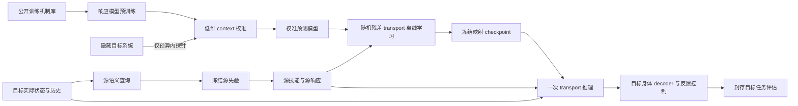

# Cross embodiment 多后端实施计划

**2026-10-14 P3 起重排：** 复现近期完整 baseline → 四任务开发比较 ↔ 方法增强
→ 独立正式验证 → 论文定稿。P3–P7 的具体任务、门槛与执行队列以
[新阶段计划](cross-embodiment-p3-onward-plan.md) 为准；此前 P3 小步骤安排已替代。

**2026-10-14 研究路线调整：** 先建立成熟强 baseline 在四任务的表现，再确定
方法与理论的独立贡献。当前实施顺序以
[四环境比较计划](cross-embodiment-baseline-comparison-plan.md) 为准；
主文献池优先 2025/2026 顶会与 Karen Liu、Guanya Shi 的相关工作，旧方法保留
为基础参照；已录用、已出版和仅预印本明确区分。
[文献筛选](cross-embodiment-baseline-survey.md) 与
[任务协议审计](cross-embodiment-four-task-protocol.md) 分别记录方法与环境细节。
LaTeX 已恢复为论文草稿，开发成绩与工程报告见
[报告归档](cross-ebdm-experiment-reports/README.md)。

**2026-10-14 P2：** 当前匹配接触的 GPU 模型执行、CPU 确认与资格边界见
[P2 记录](cross-embodiment-p2.md)。GPU 模型搜索与替代 CPU 目标物理分别验收。

**2026-10-14 当前基线：** GPU 机器上的 P0/P1 已从新工件完成，
P1.5–P1.7 两版开发协议、独立审计与理论修订见
[可行支持与分布实验](cross-embodiment-p1-refinement.md)。
当前结果未建立 transport 相对同模型 task-only 的独立优势。
旧 CPU 工件不再保留，下文数值为历史开发记录，不充当当前可复核结果。

修订日期：2026-10-12。当前研究开发分支：`codex/cross-embodiment-transport`，未提交改动保留；后续GPU交接继续使用此项目分支。

## 历史 CPU 实施状态（2026-10-12）

**本机执行已停止，转为 GPU 机器交接。** 磁盘耗尽后按用户要求停止实验、测试和依赖安装；不在本机继续补齐矩阵。下一阶段按 [GPU 交接清单](cross-embodiment-gpu-handoff.md) 执行，先完成代码/工件迁移和存储限额，再做当前版本回归与 GPU provider 验收。

最新科学记录见 [CPU机制闭环](cross-embodiment-validation-closure.md)。本轮已通过状态条件 .2/.6s neural response、有限联合law新初态验证、5次独立校准＋优化50/50、3D障碍16/16、真实导槽10/10、Go2+Z1同任务操作/支撑联合10/10；53项NumPy/native回归通过。整段均值cost网络仍unsupported；强同模型task-only持平，移动arm-only预测失败但选出的策略也10/10，不能据此声称独有控制优势。身体×机制矩阵v1失败，v2中断于模型搜索，尚无最终物理评估；最终独立审计和当前整套JAX/Torch/MJX回归待交接后完成。GPU、真实多卡、Torch物理和Rust仍未验收。

**下列 CP0–CP12、71/77/86 项及早期设备链结果是历史实施记录，不代表当前全部代码重新通过。** 当前匹配键槽/TCP signed wrench、3D导槽和Go2+Z1研究协议的物理provider仍为NumPy/host实现；不能使用旧MJX协议替代新协议，或仅添加`--device gpu`宣称迁移成功。具体未完成项、矩阵断点及后端顺序以GPU交接清单为准。

工作按 CP0–CP12 连续实施；前轮 71 项 CPU 测试通过，本轮增加机制回归后完整 77 项 CPU 测试通过，固定臂/接触完整设备链的 strict transfer guard 通过。公共框架、三种固定臂环境、平面移动身体和 Go2+Z1 浮动组合均已有 CPU 代码；模型训练、预算校准、随机 transport、实际闭环、Torch 数值对照和 C++ 整批推理均已有运行入口。本文后续部分保留正式研究设计；小模型功能验收不等于研究结论。

| 组件 | 实现与 CPU 证据 | 适用边界 |
| --- | --- | --- |
| CP0–CP2 公共执行/数据/query | stdlib contracts、lazy registry、solver 风格 frontend；Panda/xArm7 异构机制 batch 与完整 chunk microbatch；真实 FK/Jacobian 源投影、支持拒绝、partial reset、完整分组数据 | physical topology 分桶；非法/不支持状态计入失败 |
| CP3 source prior | 模式条件 Gaussian MLP、源参考反馈 decoder、train-only normalization、显式 noise、冻结 portable artifact；真实 Panda 两种执行模式 | 当前小模型是 Gaussian 基线；没有把它叫作 conditional flow/diffusion |
| CP4 response | 三成员 MLP，完整关节/速度/TCP/controller/delay carry；接触含 force/admittance/body reference；浮动扩展含足锚点、身体高度、QP warm start/residual；多步 autoregressive carry 与 sticky predicted risk | ensemble disagreement 未校准；不能当安全概率。公开 UR5e response 属已见 body 工程对照 |
| CP5 calibration | reserve-before-run 持久 ledger；失败与 pending 占预算；fit/validation 分开；冻结 response，仅拟合三维 context；B=0/10/30/100 路径 | 目前初态短探针对接触/质量辨识偏弱；效果如实报告，不宣称主动辨识成功 |
| CP6–CP7 transport/risk/resume | bounded stochastic residual；同一 U_s 匹配；全局 fractional CVaR、ties、两遍 microbatch VJP、一次 Adam；whole training-chunk scan；独立 optimizer/context/RNG/预算 checkpoint 与原子发布 | 真实多卡 collective、GPU 显存和吞吐待 GPU 验收 |
| CP8–CP10 固定臂接触 | 逐世界完整 numeric MJX 机制模型/接触执行 microbatch；真实导面/socket/keyed tool、约束 measured wrench、子步力峰值、hybrid normal projection、接触释放/恢复、UR5e 6DoF；同一 prior→query→context→transport→physics 链 | 导向对齐仍有力峰值失败；失败检测及记录已实现，策略鲁棒性仍是研究工作 |
| CP11 移动身体 | xArm7 平面地面支撑组合与命令/驱动映射；Go2+Z1 25qpos/24qvel/18actuator、4ms stance inverse-dynamics QP、真实足地接触、跌倒/支撑/QP 失败；复用冻结 Task 3 Panda prior | 平面底座约束 roll/pitch/height；Go2 当前为站立操作，未实现导航/步态。人形硬件/控制接口待定，不伪造结果 |
| CP12 portability | JAX/Torch 同权重前向、输入梯度、context、transport 单步 Adam；C++ ABI v1 整批 MLP 与 prior replay | Torch CPU learner reference；C++ inference-only，无 native autodiff/GPU 或 Rust 完成声明 |

已有主要工件位于 `tmp/cross_embodiment/`（git ignored）：`learned_cpu_v2`、`learned_closed_loop_v4`、`guided_models_cpu_final`、`keyed_models_cpu_final`、`keyed_models_cpu_mobile`、`keyed_models_cpu_floating`，以及对应 dataset / learned-loop / device guard / qualification 目录。具体当前结果和历史失败见 [CPU 验证记录](cross-embodiment-cpu-obstacle-transfer-validation.md)。版本不同的工件保持原样；后续测试不覆盖历史失败。

运行说明、后端能力和全部 CPU 入口见 [README](../../genedynamics/learning/cross_embodiment/README.md)。`qualify_cpu.py` 按模块启动独立进程、顺序释放 MJX 编译缓存内存，保存每阶段日志、JUnit、版本、flags 与实际代码 fingerprint。CPU 验收期间并行编译多个完整 MJX 图曾触发 OOM；重跑采用串行大图编译，不把 OOM 隐藏成通过。

JAX 设备路径已经把 source query、prior、transport、控制和 MJX 放在同一个外层 `scan` 中。ObstacleTransfer 和接触短窗均有严格 `jax.transfer_guard("disallow")` 验证；这证明 CPU 设备边界语义，GPU/CUDA/DDP 的设备正确性、容量、吞吐和时延仍独立为 `not_run`。

## 机制修正与理论验收（2026-10-12）

后续六项论文证据工作按 [理论可行性与 CPU 研究验收](cross-embodiment-theory-feasibility.md) 推进：先验收匹配键槽/TCP wrench，再做同模型强控制对照、模型偏差、分布迁移、多校准与UR5e留出，最后扩展Task1/2与移动身体。该计划将理论假设逐项映射到实现和失败判据；新工件位于 `theory_feasibility/`，不覆盖下述旧冻结评估。

最新匹配键槽CPU study已完成同预算强搜索：xArm7 direct0/10、calibrated10/10、task-only search10/10、nominal-response5/10；calibrated与task-only参数相同，**不支持额外anchoring优势**。已修正工具TCP wrench、几何对齐与侧触/轴向支撑事件；2/1ms物理步长检查8/8成功。新增provider式candidate MPC、实际采样law/噪声消融、有限策略与配对成本审计；新learned episode-response模型因独立验证不达阈值判unsupported。实现、真实结果及未完成主张以六项验收文档为准；GPU物理新协议显式unsupported，不静默退回legacy。

后续25个全新配对reset clusters（两模式在cluster内平均）为direct0/50、calibrated50/50；预声明[0,1] task cost平均改善.80203，单侧95%下界.31248。该证据条件于一次校准，不是uniform模型/跨校准保证。已完成5次辨识重复、未知contact+readout noise occupancy、载荷错配拒绝、UR5e独立校准后6/6及同样成功的direct对照；冻结xArm7 map在UR5e为0/2。完整CPU回归86/86通过；332条actual/model保存轨迹独立验收0 mismatch。Task1/2正式机制统计、learned response资格、Task4 learned/WBC耦合和新颖性仍按六项go/no-go逐级推进。

本轮在同一分支增加独立的机制研究路线，保留旧 CP0–CP12 功能工件。旧的 71 项通过不再代表本轮修改后的测试数量；最终完整回归 77/77 通过，以 `mechanism_revision/qualification_final/report.json` 为准；开始/最终源码快照分别保存在 report 与 `final_source_manifest.json`，各研究工件另保存实际运行版本。研究通过必须依次通过源行为、探针辨识、独立响应验证、受限 transport 和封存物理评估，不能用接口测试代替。

### 已定位并修正的缺口

- 原接触探针全部在空中结束，没有观测接触。新增 `probe_policy` 把反馈接近、完整命令、失败和验证一起计费，保存实际初态与控制器 carry；恢复不允许免费重放丢失的 charged record。
- 原源数据有相同轨迹的 train/validation 副本。新源数据使用可行任务空间随机初态、完整独立轨迹和真实恢复模式；新增事件条件 Gaussian reference prior，并加入实际 SE(3) 反馈。它是受限先验，不称为 flow 或已验证的大型生成模型。
- 原残差在源静止轴上没有纠偏能力。公共 `TransportSpec` 增加可配置 residual floor 和任务参考损失，JAX/Torch 同步；旧工件默认行为保留。
- 原 context 可越过物理支持。增加模型声明的 context bounds；结构 twin 的增益限制在 `[.4,1.3]`，delay 离散为 0–4 个控制周期，工具质量固定为已知 0.5 kg。没有声称从这些探针辨识未知摩擦、质量和顺应性。
- 力控制时未使用的法向位置参考会积累，并在释放时产生冲击。NumPy/MJX/浮动参考均投影该参考；raw 卸载意图立即解除接触保持要求，实际施力仍经原有速率限制与延迟执行。
- 已知 xArm7 native joint stiction 限制接近/姿态能力。研究协议统一使用 4 Nm 角向 wrench 上限、15 mm/s 接近与有界 .03 m 接近积分，全部目标对照共享。真实 actuator limits、速度、碰撞与力失败继续生效。
- 原 CPU 插入深度约 46 mm，且未检查姿态。保留 legacy 配置，新增 `research_contact_config`：16 mm 入座目标，位置误差 <2 mm（保证深度 >14 mm）、姿态 <2°、保持 .3 s、总力峰值 ≤25 N、侧向合力峰值 ≤10 N、总时间 ≤15 s。力峰值均逐物理子步计算。

### 第一层研究闭环

`train_phase_prior.py` → `calibrate_contact_twin.py` → `validate_mechanism_chain.py` → `complete_chain_baselines.py`。

1. nominal Panda 源数据独立训练并冻结 8 个 phase/mode 条件的 Gaussian reference law；mode0 直撤、mode1 侧撤，对照共用事件反馈 decoder。
2. 5 次真实目标接口探针：3 fit（自由空间、3 N/7 N 加载），2 独立验证（4 N 加载、自由空间）。每次最多 2 s；失败和进入接触所需执行包含在预算中。这里的“真实目标”是 CPU MuJoCo 隐藏实例，尚无实机证据。
3. 根据公开身体结构建立 physics twin；自由空间探针的平移/角向激励为 .025/.012 m/s 与 .12 rad/s，先做自由空间 gain/delay profile，再在局部 ±.002 gain 范围联合拟合接触响应。固定有限搜索预算，不使用 validation 选参数。独立验证阈值为位置 RMSE <1 mm、法向力 RMSE <.25 N、力峰值 RMSE <1 N。不通过则终止训练并保存 unsupported 报告。
4. 固定源 law，在校准 twin 的训练初态 130/131 上优化阶段条件 affine transport：仅最终插入阶段的法向 force scale `[.5,2.5]` 与切向速度 bias `±.02 m/s`。固定 12 个候选、48 次 twin rollout；成本含任务、实际 source-force anchoring、模式、失败、峰值和改变量。粗搜索及响应纠偏不声称全局最优。
5. direct、calibrated transport、system-ID inverse、错误 context 使用相同真实物理实例/初态/噪声/decoder。nominal-response transport 使用同一身体模型、同样 48 次 twin 优化预算和冻结测试初态，另存独立报告。`wrong_context_transport` 是使用 gain 而非 inverse gain 的简单 sanity control，并非重新训练的错误模型对照，不能用它替代 nominal-response baseline。

上述受限 transport 已通过真实 JAX/Torch/C++ artifact forward 对照；阶段特征扩展在各自张量后端执行，JAX 可 jit。physics-twin 参数搜索和当前研究脚本是串行 CPU 诊断 provider，**尚非 GPU 热路径**。`PhysicsTwinResponse` 是 lazy frontend，实际 MuJoCo/SciPy 实现位于 `backends/numpy/structured_response.py`，通过 `TwinResponseBackend` 协议和显式 backend/device 选择委托；尚未实现的提供方直接拒绝。已有通用 JAX 设备 collector/learner 继续保留；后续应把 twin 候选轴/机制轴按拓扑 vmap、时间 scan，再以统一 capability 协议接入 Torch/native。不得把 host SciPy 或 NumPy 循环悄悄部署到 GPU 主流程。

### 理论修改及判定

LaTeX 新增 probe 不可辨识边界、有限机制分离条件、连续结构族的 inverse-separation 桥接，以及 hybrid-event margin。若 probe signature 的逆分离常数为 κ、拟合残差为 r、噪声/模型偏差为 η/εp，则参数误差 ≤(r+η+εp)/κ；再加联合闭环 kernel 的统一机制 Lipschitz 性与模型误差，才可推出 transport 的成本误差。模型成本改进超过两倍统一成本误差才保证真实改进。

这些是**带假设的证明**，当前数值结果不认证全局 κ、Lipschitz 常数、支持覆盖或安全置信界。局部接触模式之外必须处理事件边界。代码与窄机制实验可以验证条件链的一部分；不能据此宣布通用 cross-embodiment、随机 transport 必要性或论文原创性已经成立。

`evaluate_frozen_mechanism.py` 在任何执行前写入 source/transport SHA、配置、机制、测试 seeds 和代码 fingerprint；使用新的 20 个 reset clusters，每个含两种模式，加入 force-only ablation 与同预算 nominal-response map。公共名义 map 可在同一配置/prior 下缓存复用。区间按 reset cluster 计算，并给出“两个模式都成功”的 exact binomial interval，避免全成功时 bootstrap 零宽区间造成误导；末段力误差只使用 valid 物理步，不包括 terminal padding。

当前接触观测仍是 constraint load aggregate：法向通道为 `sum(abs(F_contact,z))`，侧向为合计 world-xy load；`measured_wrench` 的转矩分量尚未变换到 TCP。入座保持阶段的单向 floor 支撑可用于本轮法向载荷验证，但不能把该字段称为已校准 wrist F/T。正式接触模型/实机前须补齐 geom 方向、TCP moment arm 与完整传感语义，并重新验证多接触分支。

### 本轮研究验收结论

冻结的三组 gain/delay 机制各20个新reset、每reset两模式，Calibrated合计120/120插入且120/120模式匹配；全部5方法合计600条轨迹独立验收无mismatch。Direct与简单inverse-gain均0/120；force-only分别40/40、0/40、0/40；nominal-response分别40/40、40/40、36/40。因此已建立受限结构模型下的联合任务/响应补偿闭环，尚未建立相对nominal-response的普遍成功率优势（stress配对p=.125）。相对nominal的末段5N载荷RMSE分别由2.292/2.438/2.437N降至.389/.636/1.527N；耗时存在交换，不声明更快。完整数值、置信区间和保留失败见 [验证记录](cross-embodiment-cpu-obstacle-transfer-validation.md#冻结评估最终结果)。

### 后续研究门槛

冻结结果可视化已完成：`render_mechanism_gifs.py` 输出 Panda 两模式、xArm7 三方法和 stress 失败对照三组 GIF，工件及本地预览页面位于 `tmp/cross_embodiment/mechanism_revision/gifs/`。7条样本使用原先冻结 prior/transport 和相同 reset 重放，全部原始轨迹通道误差为0，再记录逐控制步关节角；显示模型恢复原生外观网格，TCP FK误差为0。孔壁透明、工具连接杆和支撑台仅用于显示。该过程不增加评估分母、不重新拟合参数；具体命令见 [验证记录](cross-embodiment-cpu-obstacle-transfer-validation.md#冻结轨迹-gif-回放)。

- 先检查本轮全部失败与对照，不调 final-test 参数；增加独立校准种子、机制组合、置信区间与强 classical search/residual-policy baseline。
- 受限 twin 闭环成立后，用相同冻结协议替换为 learned response ensemble，报告模型偏差和 occupancy 支持，不能从前者成绩推断后者已成功。
- 再检查多模式 law、noise 强度和随机/确定性 transport；加入未知摩擦/顺应性以及 UR5e 6DoF 身体留出。
- Task 4 继承同一严格插入语义，再独立验收身体控制；当前 Go2 失败工件继续保留，不把固定臂成功外推为移动身体成功。

## 研究目标与实现边界

四项任务形成同一条证据链：负载下的三维受限接近验证执行响应变化；夹具辅助对齐验证执行与接触响应的区别；带键连接器插入和恢复验证接触序列及模式概率是否正确改变；Task 4 保持 Task 3 的操作语义，检验移动身体与接触耦合后的同任务迁移。主线是用少量目标干预校准任务相关响应，再把冻结源先验产生的技能分布迁移成目标可执行的技能分布。

方法包含四个独立对象：源技能先验 `SourcePrior`、机器人专属执行器 `RobotDecoder`、校准响应模型 `ResponseModel`、随机技能映射 `SkillTransport`。环境提供已知身体几何及真实仿真响应。先验、校准模型与最终 transport 都需要单独保存版本，不能把一个大策略训练完后再解释成这些组件。

第一版固定以下选择：

- Panda 7DoF 为源；xArm7 为首个目标；UR5e 6DoF 为独立机器人测试，并明确需要新接入。
- Task 4 复用冻结的 Panda Task 3 prior 与 13D 技能，依次接入轮式底盘+xArm7、带臂四足候选 Go2+Z1、具备夹持和力接口的人形候选 G1。组合资产和 WBC 均需新增验证，不能把单独机器人模型当成完整系统。
- 在公共任务空间迁移短技能；目标关节状态只进入目标执行器、可行性特征和 transport 条件，不把不同机器人的关节向量直接对齐。
- 随机残差 MLP 为首个 transport；先证明校准与响应匹配有效，再决定是否升级为 conditional flow。
- 多机制仿真预训练响应模型，目标域只拟合低维 context。随机接触模型的误差通过独立验证和模型 ensemble 衡量。
- 接触仿真负责生成与检验数据；可微短时 surrogate 负责主要 transport 梯度。是否能对物理步求导不是训练路径的前提。
- 第一个交付阶段包含 CPU 功能验收与 GPU 资格测试两个出口。CPU 可先完成小规模训练和闭环；正式规模采集、训练和主表运行前，通过相应 GPU 设备、形状、同步和吞吐门槛。
- 公共层保存任务、形状、单位、预算和能力契约；JAX/Torch 的张量、自动微分、编译与并行代码留在各自 backend。Rust/C++ 先接入独立内核和推理，再按能力扩展完整 backend。

本项目不承诺因果图发现或未变化模块的自动识别。干预用于改善任务相关响应的辨识；低维 context 的坐标未必等于唯一可辨识的真实摩擦、延迟或刚度。移动身体已纳入 Task 4 开发线；导航、步态学习及任意身体的通用全身操作不作为本方法的学习目标。Task 1–3 的机制证据与 Task 4 的适用范围验证分别报告。



## 现有仓库的复用与缺口

| 组件 | 已有证据 | 本项目的处理 |
| --- | --- | --- |
| 机器人描述 | `genedynamics/robots/profile.py` 的 `RobotProfile`、`RobotBinding` 在构建期解析关节和 frame | 复用；新增 UR5e profile 与 task scene composition |
| 跨机械臂基础 | `genedynamics/robots/README.md` 记录 Panda/xArm7 的 surface-scan 10D primitive 组合检查 | 复用资产和绑定方式；新 13D 接口需要独立验证 |
| 移动身体候选资产 | Menagerie 中的独立 Go2、Z1、G1 模型只能提供建模起点 | 新增移动安装/惯性/支撑/工具组合、完整 joint binding 与 WBC；不默认已有兼容组合或 force/stiffness 能力 |
| 源先验 | `genedynamics/learning/priors/base.py` 的 `StructuredPrior.sample_horizons` 返回轨迹、log probability、expert id | 复用 pytree/批采样约定；增加任务空间条件适配，旧 checkpoint 不默认兼容 |
| 批量 rollout | `genedynamics/solvers/common/env_rollout.py:26–121` 使用候选 `vmap`、时间 `scan` 和缓存 step | 复用纯函数设计；新建多环境训练、校准与评估内核 |
| MGA transport | `genedynamics/solvers/common/transport/base.py` 是 DDPM/DDIM/FM 反向更新接口 | 保留现状；新 `SkillTransport` 放入 learning，不替换 reverse step |
| 实验证据 | `genedynamics/experiments` 已有配置、seed、指标、失败状态与工件管理 | 复用输出协议；增加批量 task adapter 与 GPU qualification 报告 |
| 可靠性拟合 | `genedynamics/learning/reliability.py` 是接受风险/可靠性模型 | 可辅助验收，不能冒充预测运动和接触的 `ResponseModel` |
| 部署 | `genedynamics/deploy` 有独立 I/O、controller 和 adapter 边界 | 保留；实机阶段新增机械臂 TCP/wrench/阻抗接口 |

GPU 审计表明，现有 MGA 不是从头到尾的多环境 GPU 程序：`mga_jax.py:2891` 附近的 `plan_batch` 按随机 key 串行调用同一初态的 planner，没有向量化独立环境；`genedynamics/experiments/framework/experiment.py:888–903` 附近按 suite/level/seed 顺序执行。MGA `_replan_stepwise` 在 `mga_jax.py:1090–1100` 附近逐 reverse step 同步并转换为 NumPy；stepwise acceptance 在 `1184–1188`、`1359–1371` 附近有 materialization 和 Python 分支；恢复路径也有循环和 `device_get`。这些是特定路径的事实，不意味着所有 MGA 路径都在 CPU 上计算。

因此新框架需要独立的 `train_step`、`collect_chunk`、`evaluate_chunk`，不以 Python 循环包住单环境 MGA 作为训练主路径。旧 runner 仍可调度独立实验与输出记录，但不进入一个 rollout 的物理步或候选循环。

## 沿用既有 backend 接口

### 公共 orchestrator 与方法专属协议

参考 [MGA orchestrator](../../genedynamics/solvers/single/mga/mga.py)、[MGA backend 协议](../../genedynamics/solvers/single/mga/backend_impl.py) 和 [RL prior orchestrator](../../genedynamics/learning/priors/rl/rl_prior.py)：公共入口负责配置校验、lazy factory、工件加载和委托，数值实现位于 `backends/`。沿用这一组织模式，为学习、校准和批量执行声明本方法需要的能力；不把算法改写成只替换 `jnp` 与 `torch` 的通用数组包装层。

已有 [计算 Backend 协议](../../genedynamics/core/backends/base.py) 提供 tensor、RNG、`vmap/jit` 等基础表面，但没有本项目需要的训练梯度、完整 rollout carry、优化器和分布归约契约。`backend_impl.py` 应增加方法专属的 inference、training、collection 能力协议，而不是不断向基础 `Backend` 塞入机器臂学习细节。

注册复用 [BaseRegistry](../../genedynamics/registry_base.py) 的 factory/entrypoint 机制，建立本组件的类型化 backend registry；已有 prior registry 继续管理源 prior。`RuntimeBackendManager` 当前仍硬编码 JAX/NumPy/Torch，单纯调用 `register_backend("rust", ...)` 不会使 manager 自动支持 Rust。新 orchestrator 在构建期显式解析并持有 backend 实例；未来接入完整 native runtime 时再增加最小 registry bridge，避免训练期间切换全局 backend。

现 experiment runner 在构建 method 前调用 `RuntimeBackendManager.set_backend(config.backend)`，因此 method 内的 factory 不能绕过这道门禁。B3 使用 `backend=jax/torch` 加 `native_kernel_backend`，或直接由独立 `deployment_runtime` 加载工件；B4 先完成 manager 到既有 registry 的最小解析桥及 runner 兼容测试，才开放 `backend=rust/cpp`。entrypoint 指向轻量 factory，延迟导入具体实现，避免枚举 registry 时加载所有数值框架。

`contracts.py` 使用不依赖框架的固定结构记录，描述 shape、单位、mask、status 和 schema；JAX 实现自行注册 pytree，Torch/native 自行提供 tensor flatten/unflatten。公共模块不导入 `jax.Array`、`PRNGKey`、`mjx.Data`、Torch module 或 FFI handle；物理状态视为 adapter 的不透明对象。Python frontend 保持轻依赖与 lazy import；仓库当前仍有 JAX 基础依赖，真正裁剪 Torch/native 部署依赖还需单独完成 packaging 与 import 测试。

部署端可添加薄 `CrossEmbodimentSolver`，通过已有 `Solver.solve → Trajectory` 或 `MethodPlugin` 表面消费冻结工件。`solve` 明确执行一次技能采样，不能继承 `SamplingSolver.solve` 的默认 energy 择优而改变行为 law。现有 `BaseModelBasedDiffusionSolver` 含 JAX 导入和 NumPy 结果转换，不作为新跨后端实现的基类；设备内批接口不经过 host `Trajectory` 列表。

### 计算、物理、控制与原生内核分开选择

沿用 `ExperimentConfig.backend/device` 作为计算后端与设备的权威配置，不再增加一个可能与它冲突的全局 `learning_backend`。物理与内核选择由任务/方法参数提供，构建时解析成唯一的 `ExecutionSpec`；下表为拟新增配置契约，尚非可运行配置。

| 选择项 | 职责 | 首版与升级路线 |
| --- | --- | --- |
| `backend` | prior、response、transport、自动微分、optimizer | `jax` 首版；`torch` 次实现；`rust/cpp` 可选完整 native 推理 backend |
| `device` | 实际计算设备和 ordinal | 明确解析到 CPU/CUDA 设备；请求 GPU 而不可用时失败 |
| `env_params.physics_backend` | 接触执行、reset、仿真数据 | MJX-JAX 首版，MJX-Warp 候选，MuJoCo CPU 对照；Torch 兼容 GPU 引擎另验收 |
| `env_params.controller_backend` | 13D 技能到 arm/base/legs 的低层执行及 WBC | 固定臂 controller 首版；Task 4 的轮式/腿式 WBC 按设备与能力注册，和计算/物理 backend 独立选择 |
| `method_params.native_kernel_backend` | 局部 IK/FK、decoder、约束或风险计算 | `builtin` 首版；Rust/C++/CUDA provider 通过 FFI 插入 |
| `method_params.execution_mode` | 所需能力集合 | `train`、`collect`、`infer`、`evaluate`，不以名字推断能力 |
| `method_params.deployment_runtime` | 工件加载与部署执行 | Python 首版，Rust/C++ 可独立消费 portable inference bundle |

能力描述至少包含 `inference`、`autodiff_inputs`、`autodiff_parameters`、`train_step`、`batched_rollout`、`compiled_chunk`、`strict_device`、`distributed_reduction`、`explicit_noise`、`artifact_schema` 及支持的 dtype/layout/device。构建时校验所需组合；只实现推理的 native backend 标记 `inference_only`，不能伪造训练接口。物理引擎不支持微分并不阻止 surrogate 训练；但进入训练梯度链的 native 算子必须支持输入梯度或提供明确的可微实现。

Task 4 另验证 controller 的 `task_twist`、`task_stiffness`、`normal_force`、`whole_body`、`support_control`、`batched_step`、`compiled_step`、`device_resident`、支持的更新周期和 dtype/device。这些是拟新增的 controller 能力，不把 WBC 的名字等同为全部支持。构建时同时验证 compute/physics/controller 的设备与数据交换兼容性；host WBC 可先用于 CPU 功能及部署回放，未通过设备内批量验收前不能接入正式 GPU collector。仅负责采集/推理的 WBC 不要求 autodiff；如果其算子进入 surrogate 梯度链，则按所声明训练能力提供输入梯度或明确的可微替代实现。

当前 [Torch runtime](../../genedynamics/core/backends/runtime/torch_backend.py) 的 `vmap` 直接返回原函数，`jit` 使用 TorchScript，`split_rng` 依赖对象 hash，请求 GPU 还可能退回 CPU。计划保留现有接口模式，同时为本项目增加能力检查、确定性采样和真实 batch/compile 实现；不能把已有类名当作 Torch GPU 已验收的证据。

已有 `BackendArray` 的部分 JAX↔Torch 转换经 `to_numpy()` 中转，可能发生 host 同步、CPU 复制与 detach。这类便捷包装可用于工件/离线 I/O，不能作为新 GPU 热路径的默认互操作方案；M0 transfer 检查需要覆盖所调用的 adapter，而非只检查顶层训练函数。

### 后端实现需要提供的批接口

```python
class InferenceBackend(Protocol):
    def capabilities(self): ...
    def load_inference_bundle(self, bundle): ...
    def infer_batch(self, task_states, body_states, contexts, random_request, noise_batch=None): ...
    # -> device-resident SkillBatch；输入是独立批量状态
    def synchronize(self): ...
    def export_inference_bundle(self): ...

class TrainingBackend(InferenceBackend, Protocol):
    def initialize_training(self, config, bundle, random_request): ...
    def train_step(self, train_state, batch, noise_batch): ...
    # -> next_train_state, device_metrics
    def fit_context(self, probe_batch, initial_context, random_request): ...

class CollectionBackend(Protocol):
    def collect_chunk(self, execution_state, active_policy, random_request, noise_batch=None): ...
    def evaluate_chunk(self, execution_state, active_policy, random_request, noise_batch=None): ...
    # -> fixed-structure carry, responses, terminal records
```

这些是未来 `backend_impl.py` 的协议草案，训练/采集是可选能力。公共 caller 只做一次 batch/chunk 委托，不在 Python 对每个 tensor op dispatch。组件级 prior/response/transport 仍可替换，但构建时须保证处于同一自动微分运行时，或显式声明可验证的跨运行时梯度桥。

`random_request` 描述 run seed 与全局样本 ID；`noise_batch` 显式包含 source/transport 噪声、模型噪声及离散抽样所需 uniform 张量。生产路径由 backend 内部批量生成随机数；跨后端验收注入相同显式 noise，不假定 JAX 与 Torch 的相同 seed 产生相同数值。禁止以对象 hash、Python 线程 RNG 或物理 device ID 作为样本随机身份。

上述随机契约属于新方法接口。既有 `Prior.act(..., key=...)` 等公共协议保留，由本项目的 prior adapter 在 backend 内把请求转换为相应 key/generator 或显式样本，避免修改其他 solver 的消费者。

### Torch 升级路径

Torch 实现保持网络定义、归一化、有效动作、损失和数据权限一致。先用相同权重/输入/noise 对齐 prior、source/target surrogate、transport 与 13D Bound，再验证动作输入梯度、参数梯度及一个 optimizer/乘子更新。冻结 prior/response 的参数时，保留 response 对 `U_t` 的梯度；不能用整段 `no_grad()` 切断 transport 的训练链。

批轴使用显式 tensor batch 与适用的 `torch.func.vmap`；固定 H/S/L 循环由 backend 编译或专属 rollout kernel 处理。验收 `torch.compile` 的选定计算区域、graph breaks 和重编译，支持时用 `fullgraph=True` 暴露断图。DDP 数据并行单独检查有效样本计数与风险归约，不能仅把 JAX `scan` 文本替换成 Python loop。[PyTorch 编译接口](https://docs.pytorch.org/docs/stable/generated/torch.compile.html)

Torch 模型训练首先消费同一批离线记录，使用 Torch surrogate 保持完整梯度链。若保留 JAX/MJX collector，优先在 dataset/chunk 边界交换数据或已验证的模型工件；Torch policy 与 JAX physics 的逐控制步交互只作为独立候选实现，必须实测整个闭环。另一条路线是接入兼容 Torch tensor 的批量物理 adapter，重新验证接触任务；换 simulator 的结果不能与纯计算后端替换混为一类对照。

DLPack 共享设备数据仍需验证 buffer ownership、stream、lifetime 和 aliasing；数据交换不能视为跨框架自动微分桥，也不能预设零同步。默认禁止每个物理子步做 Torch↔JAX↔NumPy 转换。[PyTorch DLPack 接口](https://docs.pytorch.org/docs/stable/generated/torch.from_dlpack.html)

### Rust 与 C++ 升级路径

第一步从 profiler 证明有成本的独立内核开始，例如 batched FK/Jacobian、IK、13D decoder/Bound、约束或风险归约；第二步加载冻结 MLP 工件实现完整 native 推理；第三步再决定是否需要完整训练 backend。Rust/C++ 使用同一版本化数值契约，可共用 C ABI 与 CUDA 实现，不因语言不同重写实验 runner。

FFI 请求一次处理完整 batch/chunk，包含 ABI/schema version、dtype、shape/strides、device ordinal、输入/输出 ownership、mutation policy、stream/event 约定和错误状态。CPU 内核不得解引用 CUDA 指针；没有 CUDA 实现时明确拒绝 GPU 请求。Rust/C++ 负责相应数值/执行能力，预算、split、结果和失败记录仍由同一 orchestrator/runner 管理。

JAX 侧按锁定版本使用 FFI adapter；若算子进入训练链，注册所需 VJP/JVP。Torch 侧通过 custom operator 注册 shape/fake、autograd 和 batch 规则，并做 operator conformance；仅用于数据采集或推理的算子不要求 backward。新 JAX API 若不兼容现有版本约束，先在候选环境资格测试，不直接升级全仓。[JAX FFI](https://docs.jax.dev/en/latest/ffi.html)、[PyTorch C++/CUDA 算子](https://docs.pytorch.org/tutorials/advanced/cpp_custom_ops.html)

原生算子同时验收编译、batch、梯度的组合及多卡分片。每卡只处理本地 shard；为需要的 partition/batching 规则提供明确实现，并通过 trace 检查未意外 all-gather 全局 batch 后重复计算。只有单次 FFI 前向正确，不足以证明它保留了 GPU 并行效率。

完整 native backend 使用同一 `InferenceBackend` 与 solver facade；若未来增加 native training，可复用已验收的自动微分运行时，只有具备训练能力后才接受 `execution_mode=train`。Rust/C++ 语言本身不构成 GPU 加速或自动微分能力。

### 可移植工件与一致性验收

portable inference bundle 保存 schema version、命名 tensor、网络与激活定义、normalization、13D mask/Bounds、context、模式规则、控制 dt/H、身体/资产 hash 与训练 provenance。Task 4 另保存 controller signature/参数 hash、WBC 时钟、安装变换、body-feature schema、支撑规则和风险归一化；工件/地面机制标签不得作为目标推理输入。线性权重约定统一为 `[in,out]`，Torch/native loader 显式转换；ensemble 顺序和 SE(3) 约定不可隐含在 framework checkpoint 中。native 后端优先支持首版 residual MLP 的这一有限算子集合，不提前承诺任意生成模型导出。

完整训练 resume 另存 optimizer、乘子、sampler/RNG cursor 和 backend/version；跨后端只转换推理工件不等于精确恢复训练。若重新初始化 optimizer，记录为新的适应/训练 run。

| 验收范围 | 通过标准 |
| --- | --- |
| 公共层与加载 | contracts/registry 可独立导入；lazy import；不支持的 backend/device/capability 在执行前失败 |
| 前向与语义 | 固定权重、输入、noise 下 prior/response/transport/Bound/decoder 对齐；SI 单位、mask、status、终止分母一致 |
| 梯度与更新 | 训练 backend 的输入/参数梯度、方向有限差分、一个 optimizer/乘子更新在声明容差内一致；冻结参数不更新但动作梯度保留 |
| 风险与分布 | 同一 CVaR 定义、有效权重、tail fraction、ties/subgradient 规则；scalar/batch/microbatch/多卡风险一致 |
| 随机与工件 | 本 backend 同样本身份可重现；跨 backend 使用显式 noise fixtures；所有实现验证 save/load/conversion 输出，声明 autodiff/training 能力的实现另验证梯度与更新 |
| 物理与闭环 | 保持 reset/命令/时钟/几何的回放；不同引擎用预设任务容差比较，保留 physics 标签，接触成功/模式/力另验收 |
| GPU 与 native | 编译、预热、数据传输、FFI/interop、同步与 batch=1 延迟均计入；长期运行无越界、溢出或持有失效 buffer |

JAX/Torch 计算一致性首先在同一离线 fixture 上验证；物理后端替换独立验收。非光滑 clipping、阈值和 quantile ties 按约定测试其值与合法次梯度，不能用长时间接触轨迹逐位一致作为跨引擎要求。通过前向的 native 实现只发布推理能力，通过梯度与训练更新验收后再发布训练能力。

## 数据与执行契约

### 公共技能与机器人执行器

技能 `U` 的形状固定为 `[H, 13]`：6D TCP twist、6D 对角 log stiffness（3 平移、3 转动）、1D 法向力 setpoint。所有量在 task frame 表达；位姿使用 SE(3) 运算，角速度采用弧度，位置采用米，力采用牛顿。网络输入做训练集固定尺度归一化，物理日志始终保存 SI 单位。

第一版建议从 `physics_dt=2 ms`、`control_dt=20 ms`、`H=10` 起步，即技能时长 0.2 秒。每个控制步执行 10 个物理子步。它们是待稳定性试验确认的初始配置，不能为吞吐任意降低接触精度。接近任务的法向力通道置零并 mask；接触任务的法向、阻抗范围和 twist 投影由任务声明。

`RobotDecoder` 负责 task-frame 转换、目标积分、Jacobian/阻抗映射、阻尼/重力补偿、关节及力矩限幅和 null-space 姿态控制。法向采用明确的混合力/位控制：法向力回路与位置回路不同时争夺同一轴，切换逻辑、增益与饱和规则写入配置。相同 target controller 供所有方法使用，decoder 不运行隐含的任务重规划。

有效动作 mask 随声明阶段更新并进入数据：position mode 使用完整 twist/刚度、力通道为零；force mode 用 `P_n = n nᵀ` 去掉法向 twist，并把位置刚度投影到切向子空间，法向由限幅力回路控制，转动刚度按任务保留。13D 原始输出不是最终命令；`Bound`、command-change loss、surrogate 和日志均以 mask、投影及 rate limit 后的命令为准，另存原始输出供诊断。法向与阶段规则相同地开放给所有 baseline，切换时控制积分使用统一 anti-windup/reset 规则。

每个物理步更新实际控制器状态。延迟缓冲、滤波器、力回路积分和观测历史都属于 rollout carry；不能只给网络一个无历史的 TCP 位置，再希望它辨识延迟。建议最大 4 个控制步延迟，预分配固定长度 ring buffer；更长延迟作为明确 OOD 条件处理。

Task 4 使用 `WholeBodyController` 落地相同的 13D 命令，底盘速度、腿关节和支撑调整属于其内部执行变量，不加入源技能维度。WBC 的低层约束/投影不能替 transport 搜索插入或恢复序列。相同目标身体的所有方法共享 WBC、站位参考、支撑切换及限幅；保存原始/有界技能、WBC projected reference、actuator command 与实际响应，不能把投影参考或命令力当成 measured TCP/wrench。

把技能边界、task-reference control tick、WBC tick 和 physics substep 分开记录。固定臂仍按每个物理步更新低层反馈；移动 WBC 若采用另一更新周期，构建期声明并验证与 `physics_dt` 的整数调度关系，在固定 scan 中以 clock phase/mask 更新，间隔内明确 zero-order hold 哪些输出、哪些反馈仍每步更新。支撑/步态 phase、上次 actuator command、WBC warm start/滤波/积分和时钟相位均属于 carry，reset 一起清理。各方法使用相同实际时钟；不能将 WBC 或腿式 controller 的额外步数隐去。

### 身体状态与源先验查询

状态分为共享 `q_sem` 和身体专属 `x_e`。前者包括 TCP/工件相对目标位姿、目标与障碍几何、任务进度及外部接触阶段；后者包括实际 TCP twist/wrench、关节状态、固定长度命令/响应历史、控制器积分及滤波状态。目标身体特征还包括关节余量、全臂及负载 clearance、Jacobian 条件信息和已知能力描述。6/7DoF 的机械臂关节特征可 pad 到 7 并带 mask；该约定不适用于移动身体的全身状态，物理 `mjx.Data` 本身也不 pad 成同一机器人。

Task 4 的 `x_e` 增加基座 SE(3)/twist、全身关节、工位相对身体姿态、轮/足支撑接触和滑移、身体 clearance/稳定及执行余量、WBC memory。全身状态按 body topology 分桶；公共学习特征按基座/机械臂/支撑/余量分组，使用声明容量与 mask 或固定输出 body encoder，shape 和缺失字段约定进入 schema。M0a 先确定这些扩展边界，Task 4 再接入具体身体。冻结 transport 协议要求 body-feature schema 兼容且 encoder 权重也冻结；新增/重训 encoder 或 transport 权重时标为 adaptation，不能称仅拟合 context。移动身体状态不直接传给冻结 Panda prior，`SourceQueryAdapter` 继续输出它声明的语义和合法 virtual state。

必须解决源先验查询的状态含义：不能把 xArm 或 UR5e 的 `qpos` 当成 Panda 的状态输入。配对 reset 时，用相同工件、目标与 TCP 任务位姿，为 Panda 构造经过碰撞检查的 source virtual state；IK 多解按固定规则或独立抽样记录。在线每个技能边界，`SourceQueryAdapter` 根据当前真实任务状态生成源语义查询及有效 source virtual state。若不存在匹配的源状态，标记 source-support failure，按统一 fallback 停止或恢复，并计入任务失败统计。

源查询若需要 IK，使用固定迭代数、warm start、设备内 Jacobian 和碰撞/clearance 计算，不能在 batch 内调用 CPU IK。初版任务语义先验可减少对源关节状态的依赖，但生成源响应参考时仍验证 virtual state。推理计时必须包含实际执行的 source query 与 support check；这是实现风险，M0/M1 应尽早量化。

IK 只构造位姿，不能重建接触历史。配对时严格匹配 `q_sem` 中的工件/夹具关系、任务位姿和阶段；若指定初始 TCP/工件速度，源状态也需实现它或标为不支持。各身体的 wrench、控制器积分、延迟队列和历史分别保留或通过相同规范的短时 approach/warmup 重建，不复制 target 的力/历史到 source。接触 response cost 从共同语义阶段开始，同时记录两者起始身体响应；source initialization error 单独检验，避免将重建误差算作机制差异。

源响应参考是在该 source virtual state 执行源技能得到的 `Y_s`。目标响应则从实际 target state 执行 `U_t` 得到；两者可以身体姿态不同，但任务起始条件必须匹配。已知身体能力作为可行性条件处理，不要求目标复制 Panda 的肘部运动。

Task 4 的 source response matching 继续比较工件/TCP、任务接触、进展与 Task 3 的搜索/回撤模式。基座/躯干稳定、轮足滑移及支撑边界进入目标风险，不要求源固定基座与目标身体轨迹相等，也不把步态事件当作操作模式覆盖。其约束沿用相同全局 CVaR 归约，并采用平台声明、训练时冻结的量纲归一化。

第一版在 transport 更新中由冻结的 source surrogate 预测与本次 `U_s` 精确对应的 `Y_s`，并在独立源物理 rollout 上验证误差；源物理数据的 `(query,U_s,Y_s)` 成对保存，用于训练/核对该 surrogate。若使用缓存参考，只能抽取匹配的整条 tuple，不能拿新采样技能配旧响应。源物理采集使用 Panda 桶，成本单列；source surrogate 的误差也计入响应匹配的解释边界。

### 接口草案

以下为计划中的组件接口，不是当前可调用 API。公共接口使用固定结构记录，数组首轴为 batch；JAX backend 将其注册为 pytree，Torch/native 使用各自的 tensor/carry 表示。构建期字符串与模型对象不混入运行期 tensor。

```python
SourceQueryAdapter.build(task_state, source_signature, random_request, noise_batch=None)
# -> source_query, source_virtual_state, support_mask

SourcePrior.sample(source_query, random_request, n_samples, noise_batch=None)
# -> U_s[B,K,H,13], source_mode[B,K], proposal_logp[B,K]

RobotDecoder.step(robot_state, controller_state, skill_step, known_body)
# -> actuator_command, next_controller_state, saturation_flags

WholeBodyController.step_batch(body_state, controller_state, task_command, body_reference, clock_state)
# -> actuator_commands, next_controller_state, next_clock_state, projected_reference, status, device_metrics
# Task 4 controller protocol；whole batch delegate，输出不经 host tensor 转换

TaskResponse.extract(trace, task_spec)
# -> Y, terminal_status, realized_mode, valid_mask

ResponseModel.predict(params, task_state, body_features, U, context, random_request, noise_batch=None)
# -> distribution over next full surrogate carry and response summaries

Calibrator.fit(probe_dataset, prior_context)
# -> context_estimate, context_uncertainty, heldout_diagnostics

SkillTransport.sample(params, U_s, target_state, goal, context, random_request, noise_batch=None)
# -> bounded_U_t[B,K,H,13], transport_metadata
```

`TaskResponse` 至少保存任务进度、相对位姿变化、跟踪残差、峰值/累计接触力和接触阶段；模式分类从实际轨迹提取。网络可预测软接触/模式概率用于训练，最终指标必须由真实仿真轨迹计算。force setpoint 与 measured wrench 分开，不能把命令力当成实际接触力。

## 训练、校准与推理流程

### A 源先验与响应预训练

先验证两个源模式都具有非零成功支持。接近任务可由几何规划器加时间参数化和固定跟踪器生成源示例；夹具与插入先用两类明确的闭环控制专家生成源轨迹。几何规划输出必须经过完整物理执行筛选，不能把运动学可行直接当成负载下成功。

首个先验可用小型 mode-conditioned Gaussian sequence policy，使用模仿学习拟合成功技能；mode 的混合概率也由源条件决定。若需要 PPO 改进，只在源仿真完成，并对所有迁移方法冻结同一先验。现有 PPO 架构和 prior wrapper 可以复用，但新接口需重新训练。conditional diffusion 是后续模型容量对照，不是开工前提。

响应预训练建议先用 4–8 个机制配置进行功能验证，正式研究再扩展为覆盖各单因素与训练组合的配置库。仅增加随机种子不能替代机制覆盖。所有仿真样本记录 robot/task signature、已知身体、隐含机制、实际命令、TCP/wrench/工件轨迹和失败状态；真实机制标签只用于仿真训练/诊断，目标校准和最终 policy 不可读取。

响应模型采用 task-space 一步/短窗预测及接触阶段概率，多步 `scan` 产生技能响应。初版低维 context 建议不超过 8–12 维，包含有效平移/转动响应增益、延迟、柔顺性及接触响应等编码；精确物理含义由可辨识性试验决定。对每个机器人使用共享任务主干加已知 body conditioning，必要时设置机器人专属执行残差头。UR5e 主协议不使用它的源任务示范或响应预训练数据；若另做使用 UR5e 响应预训练的工程对照，明确标为已见 body、未见机制，不能并入未见身体主结果。

surrogate carry 必须包含预测关节位置/速度、工件状态、controller memory、延迟与观测队列、接触阶段及累计 response。Task 4 再包含预测基座姿态/twist、支撑/滑移、全身执行状态、WBC memory 和时钟。已知 decoder/kinematics 更新参考、FK/Jacobian、关节余量与全臂/全身 clearance，学习部分预测执行/接触残差及其不确定性；各步重新计算 body features。不能把初始 clearance/Jacobian 或稳定裕度固定整个 H 步后声称验证了未来风险。各固定臂和移动身体的物理状态分别构建，公共学习特征使用声明 schema/mask。

训练损失结合归一化位姿/twist/wrench 预测、短窗 rollout 误差和接触/失败概率校准。ensemble 首版 `E=5`，bootstrap 数据和初始化独立。记录 held-out 多步误差、风险排序和 coverage，而不仅是训练 MSE。

预训练机制库与隐藏目标机制严格分离，保存配置 ID 和 split hash，避免机器人身份总与某一摩擦/延迟绑定。UR5e 若没有预训练响应数据、但允许校准后更新 transport，则称未见身体的 few-shot adaptation；只有冻结 transport、仅拟合 context 的版本才检验更强的泛化。源任务示范、响应预训练和目标适应这三种数据权限分别报告。

### B 目标校准

固定目标交互预算 `B_probe ∈ {0,10,30,100}`。一个 probe episode 为一个有 reset 的短命令序列；同时报告实际控制步数、执行秒数、reset 次数及 wall time。所有接口探测、失败、提前停止和 held-out validation 都计入预算。

预先将预算按约 70/30 分为 fit 和验证；`B=10` 可用 7/3，`B=30` 为 21/9，`B=100` 为 70/30。`B=0` 仅使用源/仿真 context prior，不伪装成已经校准。验证样本少时，ensemble 区间也不能解释为可靠概率保证。

探针按任务逐级加入：

1. 自由空间：多轴正负脉冲、不同频率短 chirp、制动段、负载姿态变化；联合命令与实际 TCP 历史区分增益和延迟。
2. 夹具：匹配初始接触位置的小法向加载、切向滑动、小角度 pivot；同时测 TCP、wrench、工件位姿，避免只凭力曲线混淆摩擦与初始错位。
3. 插入：接近口沿的浅接触、不同法向载荷的短滑动、小幅撤回再接近；不把完整目标成功示范作为校准。
4. 移动身体：末端脉冲/制动、轮式基座小幅平移/转向或腿式稳定支撑内的躯干调整，以及孔口限力压靠/切向微移的耦合探针。身体探针属于辨识干预，不增加 13D 部署动作维度。每个目标 body/mechanism/budget cell 只有一个总 `B_probe`，不分别给 arm/base/contact 三份预算。

预训练模型可用于固定候选探针的 task-dependent 选择；随机探针和非任务相关信息增益是对照。比较 probe selection 时改变数据；比较 transport 和模型消融时共享同一份数据。禁止把校准后完整任务的成功/失败结果反复用于调参而不计交互预算。

严格 frozen-transport/context-only 协议冻结共享模型、encoder 与 transport 权重，只拟合预声明的 context。小型 affine calibration head 若直接属于 context，须预先声明其参数化、维度和先验；否则更新 head 权重单列为适应协议，不能称 context-only。为延迟候选做离散枚举或概率混合，并在模型中保留历史；不假定整数延迟能直接用普通梯度拟合。以 held-out response error、风险误判和参数等价性决定 context 是否足够。若数据不能区分两种机制但预测相同任务响应，允许保留等价类。

Task 4 的公开开发机制可用于 WBC/响应预训练和组合资产资格测试，成本与 body 是否已见单列。隐藏目标上的接口执行、支撑探测、WBC 调整、失败与 held-out 验证计入同一预算；目标域重训 WBC 列为额外适应协议，不混入固定 WBC 主表。冻结 transport/context-only 与允许更新 transport/encoder 的 few-shot adaptation 分别报告；context 容量变更先在公开开发域验证，再冻结协议，不通过目标最终评估挑维度。

### C Transport 离线学习

固定源 prior、校准响应模型和目标 context，训练

`U_t = Bound(U_s + Δφ(U_s, target_state, goal, context, mode, noise))`。

`Bound` 包含物理幅值与变化率限制；训练 loss 在最终有界命令上计算。任务成功与力约束在目标 surrogate 中评估；源对应使用任务相关 response distance，不能把 source/target 的关节轨迹相减。第一版目标包括目标进度/成功、响应语义距离、命令改变量及模型条件风险约束；拉格朗日乘子单独记录。

训练只保留有依据的源模式：已知几何及校准模型决定可用性与不确定性；精确目标机制的可行性 oracle 只用于测试集诊断。若源没有目标所需模式，应报告支持不足，并单列增加 source support 的实验，不能把它归咎于 calibration。

实现上必须隔离 `HiddenTargetEnv` 与 `CalibratedExecutionModel`。前者持有不可见真实机制，只能经预算计数器生成 probes，或运行封存的最终评估；后者仅由公开训练数据和预算内校准记录构造，供 transport 训练和 calibrated MPC 使用。校准 context 若是 latent，只需构造预测 surrogate，不强求能唯一转换成物理仿真参数。不能为了 GPU 训练方便直接用真实目标模型 rollout。最终评估 episodes 单列记录且不回流调参，不算作 calibration 数据。

训练数据先覆盖校准探针邻域，再逐渐扩展到 policy 占据区域。每轮用额外的已知训练仿真机制检查 surrogate 被利用的程度；这些回查不能读取隐藏目标测试机制。目标测试域若需要新增 probe，全部计入既定预算或单列预算扩展曲线。

对接触切换处的 surrogate 梯度，用已知训练域上的小扰动物理有限差分核对方向，并检查训练目标降低是否伴随真实仿真成功改善。若持续失败，优先缩短预测窗、增加接触阶段建模和训练支持。若能由已校准参数实例化 physics twin，可单列其中的 black-box/actor-critic transport 优化；只有 latent surrogate 时，换优化器仍受同一预测误差限制，不能据此绕过模型有效性检查。不能默默换训练算法后沿用同一消融结论。

### D 闭环推理

每个技能边界读取实际 target state/history，生成源查询，采样源技能并执行一次 transport，解码后执行短技能。推荐起步 `K_infer=1`，检验随机分布而非在线择优；如增加 `K>1` 和模型评分，必须所有相应 baseline 同预算，并报告额外延迟。

控制步每 20 ms 更新技能参考和目标积分；物理子步每 2 ms 根据当前状态重算低层阻抗/力回路及 actuator command。两层时间尺度分别写入日志，目标延迟作用在哪一层也明确声明。执行中的停机与统一恢复条件是 task contract 的一部分。除非实验明确开启并计预算，context 和模型权重在任务评估中不更新。目标上不运行 MGA reverse search 或在线轨迹优化作为默认方法；需要规划器参考时单列计算和信息预算。

移动身体沿用上述 task-reference/physics 初始时钟，并按 controller signature 调度 WBC；另记录传感器采样周期、观测时间戳/年龄、延迟作用层、执行时间与 deadline miss。部署时延包含 source query、prior、transport、WBC、I/O 和必要同步，不能以网络前向代替全身闭环成本。接触力峰值与支撑异常在相应物理/传感器分辨率监测，不因 WBC 更新较慢而漏计；仿真和实机的时间戳来源分别声明。

## CPU 开发范围与 GPU 交接

### CPU 上可以完成什么

CPU 阶段的完成标准是代码功能、数值语义与小规模闭环得到验证，不是正式训练已收敛或研究假设已成立。四项任务都保留完整 3D 身体、真实接触及原有科学协议；减少的是开发时的 batch、数据量和更新数，不把任务替换成 2D。ObstacleTransfer 先完成首次交接，GuidedContactAlignment/KeyedInsertionRecovery 与 Task 4 各自做增量 CPU→GPU 验收。

| 工作 | CPU 可交付的结果 | GPU 阶段再验收 |
| --- | --- | --- |
| 公共架构 | contracts、backend protocols、registry、capabilities、工件 schema、配置及失败状态 | 指定 GPU 的设备驻留、跨设备工件加载与执行 |
| 机器人与场景 | Panda/xArm7、UR5e 与 ObstacleTransfer、GuidedContactAlignment、KeyedInsertionRecovery；MobileKeyedInsertionRecovery 另验证组合安装/惯性、全身绑定、支撑和 reset；先完成 ObstacleTransfer | 每种完整 body/scene/controller 的 GPU 支持、contact capacity、独立世界隔离与吞吐 |
| 13D 执行器与源查询 | task frame、SE(3)、FK/Jacobian/IK、阻抗/力控制、mask/rate limit、完整 controller carry | batch 内 source query 与 decoder 的实际设备路径、GPU 延迟 |
| 探针和数据权限 | probe 生成、fit/held-out split、失败及 reset 计数、隐藏目标与校准模型隔离 | 批量采集效率；数据权限协议保持一致 |
| 学习算法 | 小型 prior、response ensemble、context fit、transport、loss/输入与参数梯度、optimizer/乘子更新 | 大数据训练、较大 ensemble/sample batch 的运行与显存 |
| 批内语义 | scalar 与 batch 一致、不同初态/随机流、partial reset、done mask、terminal 分母 | 加速器上的相同语义及编译/同步行为 |
| Task 4 WBC | CPU 站立/轮式支撑、限力接触、WBC 时钟/carry/partial reset、小规模耦合 probes 与回放 | WBC 设备内 batch/FFI、轮足接触容量、支撑切换、整条闭环时延和长期运行 |
| 风险与微批次 | 固定 fixture 下全量与两遍 microbatch 的全局 CVaR 值/梯度、噪声重放、模拟 shard 汇总 | 真实跨卡 collective、分片、通信成本与并发行为 |
| baseline 与指标 | 直接执行、无校准、确定性及完整 transport 的小规模端到端链路，统计及结果导出 | 充分样本、多 seeds、完整预算曲线与正式消融 |
| Torch 升级 | 同权重/输入/noise 的 CPU 前向、输入/参数梯度、context fit 和一步训练更新 | Torch CUDA、选定编译区域、DDP、collector interop |
| Rust/C++ 升级 | 版本化 CPU ABI、shape/stride/ownership/error、CPU 推理与适用的梯度规则 | CUDA 内核、stream/lifetime、GPU FFI、分片与性能 |

正式规模的学习与消融并非数学上必须使用 GPU；本项目把它们安排在 GPU 阶段，以控制运行成本。CPU 小实验只用于排错和检验可行性，不能据此宣称校准有效、模式覆盖改善或跨身体泛化成立。

### 保留两条 CPU 路径

1. **MuJoCo CPU 诊断路径**：用于场景可视化、几何/关节/力控制排错、探针采集、专家轨迹与独立物理回放。这里允许 host 单步调试，但单环境 Python loop 不作为正式批量 collector 的实现。
2. **JAX CPU 正式内核路径**：在 CPU 运行未来 MJX-JAX GPU 使用的同一套 `reset/decoder/collect_chunk/train_step/evaluate_chunk` 数值源码、`jit/vmap/scan` 及固定 carry；先以 1/2/4 个环境验证。不能仅跑通 MuJoCo CPU 后再从头改写一份 GPU 算法。

JAX 的同一数值代码可以编译到 CPU/GPU；这使 CPU 上验证 batch/JIT 结构可行，但不能保证另一设备的性能或数值逐位一致。[JAX JIT 文档](https://docs.jax.dev/en/latest/jit-compilation.html) MJX-JAX 支持 JAX 设备且面向批量仿真，单场景调试可能比 MuJoCo CPU 慢，因此两条路径承担不同验收职责。[MuJoCo MJX 文档](https://mujoco.readthedocs.io/en/stable/mjx.html)

已有 `core/backends/adapters/mjx_adapter.py` 的 `step_batch` 使用 NumPy 转换和逐环境 Python step，不能仅凭接口名称将它认作设备内 batch kernel。新 collector 通过本项目 physics adapter 接入真正的批量纯函数；旧 adapter 可继续用于 host 诊断，不进入正式热路径。诊断路径与正式内核共享 task/command/response/budget 定义，避免两套成功和力违规判据。

跨 MuJoCo/MJX 的回放按任务容差和接触/模式判据比较，不要求长接触轨迹逐位一致。CPU 与 GPU 的 JAX 数值对照先固定同一个 MJX-JAX physics adapter；改用 MJX-Warp 是另一项物理后端验收。

### 建议的 CPU 开发配置

以下是拟新增的开发 profile，不是当前可运行命令。`backend=jax, device=cpu` 明确指定 CPU；MuJoCo 诊断与 MJX-JAX compiled smoke 分开选择 `physics_backend`，并在工件中保留标签。

| 参数 | CPU 起步值 | 说明 |
| --- | --- | --- |
| `B_env` | 1，再 2/4 | batch 必须包含不同初态，并覆盖只有部分环境 done/reset |
| `B_train` | 8/16/32 | 先小型模型和少量公开训练机制，不用于正式统计结论 |
| dtype | JAX 学习及批量内核默认 FP32 | CPU/GPU 提前对齐；高精度数学参考与 MuJoCo 原生 dtype 单列，避免默认精度差异掩盖问题 |
| `K` | 1，再 2/4 | 验证独立 source/transport noise；模式分布验证另给足样本 |
| `E` | 调试 1，集成 3；正式配置 5 的小 fixture | 不把 E=1 的风险检查当作 ensemble max 验收 |
| `H/S/dt` | 保持 H=10、S=10、control_dt=20 ms、physics_dt=2 ms 的初始协议 | 稳定性试验后统一修改；不通过增大 timestep 或关闭关键碰撞提速 |
| `L` | 2/4/8 | 保留真正的技能/控制/物理时钟，覆盖跨 chunk 续接与技能边界 |
| 训练更新 | 每组件先一次更新，再约 50–200 次 smoke | 检查有限 loss/gradient、冻结参数及保存恢复；不承诺固定步数收敛 |
| 评估 | 少量固定初态和失败样例 | 封存正式测试集；开发目标机制与最终目标 split 分离 |

CVaR 的尾部、ties、不同最坏 ensemble 成员与极端样本用专门固定 fixture 覆盖；不能因为开发 batch 很小就把风险目标改为均值。probe 的 `B=0/10/30/100` 是实验协议，不随训练 batch 缩小；CPU 可先实现全部计数规则，在开发机制上以 B=0/10 验证一轮拟合/验证流程，再扩大预算。

逐行排错可以暂时关闭 JIT，但 C2/C3 验收必须重新启用编译；`JAX_DISABLE_JIT=1` 下通过不算 compiled kernel 通过。不要在正式内核引入 `.item()`、`np.asarray`、SciPy IK、host callback 或动态列表；CPU 也遵守相同批处理边界。

### CPU 交付顺序与出口

以下保留 CP0–CP12 的验收契约，当前实现证据以文首状态表和 CPU 验证记录为准。CPU 功能与正式研究结果分开验收，GPU 资格不由 CPU 成功自动推得。

| 步骤与依赖 | 具体交付 | CPU 验收出口 | GPU 边界与状态 |
| --- | --- | --- | --- |
| **CP0 命名及基线冻结**；已有执行层 | `ObstacleTransferConfig`、`obstacle_transfer` manifest、`cpu_obstacle_transfer_smoke.py`；统一文档/测试；历史回放保持原样 | 公共 import/脚本与 manifest 使用语义名称；新名字的成功/失败 smoke 可回放；原工件 checksum 不变 | **CPU passed**；首次交接复用新命名 fixture，GPU not_run |
| **CP1 异构执行采集**；CP0 | 同 topology 下每个世界独立 payload/gain/delay；固定 batch carry、sample identity、独立 reset 随机流；source/transport noise 在 CP3/CP6 接入；mechanism truth 只在 physics/data provenance | scalar 与 batch 对照；batch 重排/拆分/续接不改变对应世界；不同机制实际产生不同响应且不进入 policy features；失败不丢弃 | **CPU passed**：异构 batch/执行 microbatch；GPU 吞吐与显存仍 not_run |
| **CP2 源语义查询与数据**；CP1 | target task state→Panda query/合法 virtual state；固定迭代 batched IK、碰撞/支持标记；两通路 Panda source records、公开多机制 response records、分组 split、失败 ledger | 不读取 target joints 作为 source query；匹配 TCP/goal/frame；不可达/碰撞/速度不支持明确失败；数据可加载、模式有真实轨迹证据、同 episode/机制组不跨 split | **CPU passed**，限固定 workcell/phase 0、脚本源示范与数据基础；4 条 full-length source 成功。学习链已接入，见 CP3–CP9 |
| **CP3 小型源先验**；CP2 | 条件化 13D stochastic prior；训练/验证脚本、归一化、显式 sample noise、冻结权重和 portable bundle | 一步及短程更新有限；相同输入/noise 可重放；固定条件下两通路均有有效质量；源模型冻结后 hash 不变；失败样本分母保留 | 正式规模 source training 在 GPU；CPU 无需证明研究级收敛；CPU 实现及资格见文首 |
| **CP4 响应 ensemble**；CP2/CP3 | 小型共享任务主干/body conditioning、公开多机制数据、controller/delay carry、response features、ensemble uncertainty | held-out episode/机制组合预测单列；输入与参数梯度有限；已知小扰动方向对照；不以机制标签代替未知 context；carry 逐步更新状态与余量 | GPU 再扩数据、ensemble 与长窗；训练不依赖对接触物理步求导；CPU 实现及资格见文首 |
| **CP5 预算探针与 context**；CP4 | 公开 probe 库、reserve-before-run ledger 持久化、fit/held-out split、低维 context optimizer；先 B=0/10，再覆盖 30/100 规则 | 成功/失败/reset/接口及验证成本全部计数；超预算拒绝；目标只暴露预算内数据；最终目标评估不可回流；fit 后预测与未拟合结果如实报告 | GPU 负责规模和速度，权限/预算语义不改变；CPU 实现及资格见文首 |
| **CP6 随机残差 transport**；CP3–CP5 | 薄 frontend+backend `train_step`、response matching/任务/风险/变化损失、独立 source/transport noise、固定模型参数与 context 输入 | transport 输入/参数梯度有限且一步更新有效；prior/response 冻结；Bound 后命令用于 loss/trace；固定 source skill 下 transport noise 与 mode 的影响可诊断 | 一次调用覆盖整个训练 chunk，禁止 host tensor 回读和逐样本 learner；CPU 实现及资格见文首 |
| **CP7 风险、microbatch 与恢复**；CP4/CP6 | 全局 ensemble worst-case/CVaR、两遍 microbatch/梯度累积、固定随机流、训练 chunk、portable inference 与独立 resume checkpoint | 全 batch/分块 loss 和梯度在容差内一致；tail/ties/不同最坏成员 fixture；恢复后 optimizer/RNG/context/乘子/step/预算保持；改变数据值不重编译 | CPU shard 只验归约逻辑；真实显存、跨卡 collective/通信与扩大 batch 另验；CPU 实现及资格见文首 |
| **CP8 最小限力接触 fixture**；CP1，可与 CP3–CP7 并行 | 单导面加载/释放与切向微移；法向 force channel、hybrid mask/projection、measured wrench、接触 whitelist、anti-windup 与子步力峰值 | 命令力与测量力分开；加载/释放响应、接触丢失、超力失败及跨 chunk carry 可回放；MuJoCo/MJX 按任务容差对照 | 这是代表性 contact kernel 资格，不冒充完整 GuidedContactAlignment；首个 GPU 交接前具备该 fixture；CPU 实现及资格见文首 |
| **CP9 首个完整学习闭环**；CP3–CP8 | ObstacleTransfer 的 source→query→prior→calibration→transport→真实执行；直接、无校准、确定性、完整方法，共享初态/decoder/预算；打包 GPU golden fixtures | CPU 一键小模型链路；实际轨迹 mode/status/有效步/成本/target access 完整；不能用 surrogate loss 代替物理成功；bundle 重载结果一致 | **首次 GPU 出口**：从 B=1/小 batch 回放，之后验完整 collector+learner+contact 路径；CPU 实现及资格见文首 |
| **CP10 完整接触与恢复环境**；CP9/CP8 | GuidedContactAlignment 两类接触序列；随后 KeyedInsertionRecovery 的 socket、jam/reset、恢复事件和 UR5e 6DoF profile；分别复用同一学习链 | 夹具几何/可达/力时步收敛与成功判据；恢复初态可重复且可恢复；真实 mode classifier；跨自由度绑定、mask 和 source support | 可在 CPU 完成环境及小模型闭环；每项新增 topology/contact capacity 重新 GPU 资格；不阻塞 CP9 交接；CPU 实现及资格见文首 |
| **CP11 移动身体增量**；接口可早审计，完整链依赖 CP10 | MobileKeyedInsertionRecovery：先固定/轮式 xArm7；再 Go2+Z1，最后具备接口的人形；组合惯性/安装、支撑、WBC clock/carry、coupled response/probes | 每个身体独立 CPU 稳定/限力/partial reset/同任务闭环；whole-body 失败与操作失败联合分母；冻结 Panda connector prior；WBC 不搜索恢复序列 | host WBC 可作 CPU 诊断；GPU 支持、完整闭环时延/设备交换另验，资产存在不表示 WBC 已合格；CPU 实现及资格见文首 |
| **CP12 Torch/native CPU conformance**；CP9 冻结模型/fixtures，可与 CP10/CP11 并行 | Torch 同权重前向→输入/参数梯度→context/一步更新；Rust/C++ 版本化 ABI、有限算子 inference loader 与完整 batch/chunk delegation | 同输入/noise/权重对照；shape/stride/ownership/error 明确；不支持能力提前拒绝；主 orchestrator/任务/预算不重写 | Torch CUDA/DDP、native CUDA/FFI stream 与性能独立登记；CPU inference 合格不代表 train/collector 合格；CPU 实现及资格见文首 |

CP2 的 source data 与 response data 分开：前者是 Panda 公共源任务示范，后者是已声明公开开发机制上的响应。隐藏目标不得作为额外成功示范或不计数的训练数据。source support 失败、教师路线失败和机制采集失败均留在记录中；只使用成功子集训练 prior 时同时保存筛选规则及全体失败分母。两条 deterministic route 只是首版教师，路线标签必须与实际执行轨迹核对，不能仅按输入脚本声称多模态成功。

首个 CPU 完成门槛为 CP0–CP9；之后 CPU 工作继续推进 CP10–CP12，GPU 资格与规模实验可以并行。每个增量产出代码/config/模型 hash、输入/noise、数据 split、通过和失败样例、实际命令及 `cpu_functional`/`gpu_qualification`。发现新 scene/model/controller signature 或训练语义变化时重新生成 golden fixture，不复用旧 hash 下的结论。

| 顺序 | 交付 | CPU 完成判据 |
| --- | --- | --- |
| C0 | neutral API、registry/capability、artifact、seed/noise/sample ID | 缺失能力/错误设备提前失败；工件 roundtrip；公共模块独立导入 |
| C1 | Panda/xArm7 ObstacleTransfer 场景、13D decoder、源查询、数据记录 | 直接执行及失败样例可回放；单位/frame/mask/controller memory 正确；目标预算不泄漏 |
| C2 | JAX CPU canonical batch kernel，含代表性接触小场景 | eager 调试与 JIT、scalar/batch 对齐；partial reset；chunk 连续性；状态/context/seed 改变不引入新 signature |
| C3 | 小型 prior → response → calibration → transport | 在开发机制完成数据生成、拟合、held-out 诊断、动作梯度与更新、冻结工件的整条链；模型误差和方法效果如实记录 |
| C4 | ObstacleTransfer 最小闭环及核心对照 | 同一初态/probe 数据/decoder 上运行直接、无校准、确定性和完整方法；保存终止原因、模式、力、预算与耗时；形成 GPU 回放 fixture |
| C5，C4 后增量 | GuidedContactAlignment/KeyedInsertionRecovery 完整场景；Torch CPU conformance、native CPU bundle 可并行 | 对应能力独立登记；不阻塞 ObstacleTransfer 的 GPU 资格测试，不提前做未经 profiler 支持的 native 性能改写 |
| C6，Task 4 增量 | 先做移动组合/支撑/WBC 的公开开发域资格测试；KeyedInsertionRecovery prior 冻结后做同 connector CPU 闭环 | 轮式先行，腿式逐 body 接入；完整 13D 能力、WBC 时钟/carry、耦合探针、失败分母与工件回放通过；不阻塞 C4 首次交接 |

完成 C4 后转到 GPU；不需要等 GuidedContactAlignment/KeyedInsertionRecovery、Task 4 或 Torch/Rust/C++ 完成。后续新场景与移动 body 逐项重复对应 CPU/GPU 资格流程。冻结配置/资产/schema/输入/noise/参考输出及运行环境清单，GPU 先以 B=1 和小 batch 回放，再扫描较大 batch。切换同一 MJX-JAX 路径主要修改 device、batch 和性能设置；设备或 compiler 暴露的问题仍须修复并回归，不能承诺零代码修改。

报告分开记录 `cpu_functional=passed/failed` 与 `gpu_qualification=not_run/passed/failed`。无 GPU 的 CPU 测试允许成功；显式调用 GPU qualification 而没有所需设备时失败，不能静默退回 CPU。CPU 上可模拟多个 shard 检查风险与梯度合并逻辑，也可做逻辑多设备测试，但不算真实多 GPU 通信或扩展性通过。

## GPU 并行设计

下列 `vmap/scan/jit` 是 JAX 首个参考实现的具体方案；公共协议承诺批处理、时钟、数据权限和结果语义，Torch/native 以各自编译及内核实现相同契约，并独立达到性能门槛。

### 后端选择与版本策略

仓库当前 JAX/JAXlib 合约为 `>=0.6.2,<0.7`，MGA 的 CUDA qualification 尚未完成，见 [兼容性矩阵](../reference/compatibility.md)。新项目先建立独立可复现环境，锁定 Python、JAX/JAXlib、CUDA、MuJoCo/MJX、训练库和资产 revision。不得为了试最新仿真器直接升级全仓依赖。

首个兼容实现使用 MJX-JAX 的 GPU 批量物理及 JAX 模型训练；同时在独立候选环境评估 MJX-Warp，尤其关注夹具和插入的接触吞吐。官方文档将 MJX-Warp 定位为 NVIDIA GPU 的接触/约束性能实现，且不支持自动微分；本设计将物理采样和 surrogate 求导分开，允许依据实际 benchmark 选后端。[MuJoCo MJX 文档](https://mujoco.readthedocs.io/en/stable/mjx.html)

若 Warp 与现有依赖不兼容，先保存独立资格报告，再决定项目专属环境或全仓升级；不要维护未经测试的混合安装。两个后端各自验证 batched reset、contact/wrench 读取和缓冲容量，后端特殊结构封装在 adapter 内。GPU 批量训练可用任何已验收后端；CPU MuJoCo用于单场景对照和回放。

### 批轴与静态编译边界

| 轴 | 含义 | 初始扫描范围 | 实现 |
| --- | --- | --- | --- |
| `B_env` | 同一拓扑物理世界 | 1/8/32/128/256/512，显存允许再扩大 | `vmap(reset/step)` 或后端原生批量接口 |
| `B_train` | 独立训练状态/技能记录 | 128/512/1024 | 设备内 minibatch |
| `K` | 每个状态的源/transport 样本 | 1/4/8/16 | 显式 sample axis，vectorize |
| `E` | response ensemble | 1/3/5 | 模型参数轴 `vmap`，不复制所有物理世界 |
| `H` | 一个技能的控制步 | 首版 10 | `lax.scan` |
| `S` | 一个控制步的物理子步 | 首版 10 | 内层 `lax.scan` |
| `L` | 一次收集的控制 chunk | 16/32/64 | 外层 `scan`，固定上限与 done mask |
| `D` | GPU 数 | 先单卡，再 2/4 卡 | 数据并行或独立实验调度 |

`B_env` 与 `B_train` 分开。`B_train×K×E` 是 surrogate 计算；不为每个 ensemble 成员额外生成一套真实物理世界。目标校准预算 `B_probe` 也不等于训练 batch size。

编译 signature 包括 robot topology、task geometry topology、backend、dtype、H/S/L、batch/microbatch shape 和固定 contact capacity。Panda、xArm7、UR5e 分桶编译；不同 `nq/nv`、geom 数和模型结构的 `mjx.Data` 不能直接放入同一个 `vmap`。同一桶内随机化增益、延迟、质量、摩擦和 reset pose；只改变受支持的动态数组字段。MJX 的结构性 NumPy 字段变化会触发重编译，必须显式计入 signature。[MuJoCo MJX 结构说明](https://mujoco.readthedocs.io/en/stable/mjx.html#structs)

Task 4 按完整 base+arm/legs/tool/support topology 分桶，signature 另包含 controller implementation/capability、WBC clock 与固定支撑/contact capacity。同一已编译状态结构中的接触/支撑 phase 可动态切换；新增关节、轮足、geom、约束布局或 controller 状态结构需要新 signature。不能只按末端机械臂型号分桶，也不能把 Go2+Z1/G1 的全部状态 pad 成 7DoF。共享特征可进入统一 surrogate batch，但 physical/WBC carry 保留各桶结构。

同一训练更新涉及不同机器人时，加性损失可由各桶先产生梯度和充分统计量，再按有效样本数汇总一次 optimizer update。若 CVaR 定义在跨桶的全局混合分布，先合并 risk scores，为每个 ensemble 成员求对应的全局阈值，再重算各桶梯度并汇总。不可让桶顺序隐式改变优化步数。物理状态必须分桶；固定维度的任务 surrogate 可在带 body features/masks 的统一 batch 中混合机器人。不同任务的 loss scale 固定于训练集，并记录 task sampling weights。

### 设备内热路径

```text
构建期 host
  MJCF composition → RobotBinding → static signature → device_put → compile/warmup

物理数据收集 collect_chunk（整个 chunk JIT）
  scan L: 技能边界采样 prior+transport；取当前 skill_step
          → scan S: batch feedback decoder → physics → controller/history update
          → task response
          → masked terminal bookkeeping → backend-safe batched reset
  chunk boundary: compact metrics / selected traces → host output

transport train_step（整个 update JIT）
  prior.sample[B,K] → source surrogate.scan[H] → matching source response
                  → transport[B,K] → target surrogate.scan[H] × ensemble[E]
  → per-sample task/response/risk → masked global reduction → grad/update

推理
  actual state → one prior+transport forward → fixed controller → physical step
```

物理 carry 包括 simulator state、controller/ring buffer、active skill、skill index、key、episode id、done、累计指标和终止原因。仅在 skill index 到达 H 边界时重采样技能，reset 同步清理这些字段。所有叶子结构与 shape 固定，失败/结束样本使用 mask。自动 reset 前保存 terminal response，episode 分母只按一次完整 episode 计数；不能因 batch 在任务结束后继续填充而稀释力违规或成功率。

Task 4 的同一 chunk 内还要更新 WBC clock/state、完整基座/支撑反馈和终止原因。host QP、外部 controller 或 native FFI 先分别验收；只有 batch/device/同步条件符合要求才能纳入正式 GPU collector。否则保留为 CPU/部署对照并报告完整交接成本，不宣称整条 GPU rollout 已通过。Torch/native 路径沿用同一 controller 契约；局部 CUDA 模型前向通过不能替代 WBC 与 physics 的资格测试。

热路径不允许 `np.asarray`、`device_get`、`.item()`、host callback、逐样本 Python 分支、每步打印或 CPU 碰撞检查。用 JAX transfer guard 验证意外传输；文件写入与视频只在 chunk 边界处理。[JAX transfer guard](https://docs.jax.dev/en/latest/transfer_guard.html)

随机 key 从 run seed、全局 episode/environment/sample、ensemble、time 与 component ID 逐级 `fold_in/split`，不得复制 key 生成相关候选。计算用 key 与物理 device/process 分配无关，使相同全局样本搬到另一张卡后仍得到相同随机流；device/process ID 仅用于生产者命名和无重号 ID 分配。

编译后保持 callable 和静态对象生命周期稳定。支持 persistent compilation cache，报告 cache cold/warm；换模型、shape、设备或编译选项不能声称零编译成本。[JAX compilation cache](https://docs.jax.dev/en/latest/501/compilation-cache.html)

### 显存与风险归约

物理训练不保存全部 `mjx.Data` 时间序列；默认只保留 carry、所需 response 和抽样 trace。插入的碰撞几何优先采用真实尺度的少量凸件/primitive；全臂、夹具、负载及插入口沿的相关碰撞不能为提速关闭。

surrogate 的主要临时轴为 `[B_train,K,E,H,d_response]`。例如 FP32 的 `[1024,8,5,11,64]` 单个张量约 110 MiB；这不包含网络激活、梯度、optimizer、物理状态或编译临时内存。每个阶段以实测峰值决定 batch，不能据这一估算承诺 GPU 容量。

先在 `B_train` 上 microbatch，模型时间轴使用 rematerialization/checkpoint。令 `Z[b,k,e]` 为一次技能的最大约束违反，首版严格使用 `max_e CVaR_(b,k)(Z[:,:,e])`，与论文的 model-sup risk 对齐；不能换成 `CVaR_(b,k)(max_e Z)`。普通加性 loss 按有效样本数累计；CVaR 的有效权重、尾部比例和 ties/次梯度规则固定，禁止用 microbatch CVaR 的均值替代全局 CVaR。

显存不足时，score pass 保存小型 risk scores，为每个 e 在完整样本集合求阈值及标量 CVaR，再确定最大成员和 ties 权重。gradient pass 重放完全相同的 source/transport/model noise、dropout、mask 与模型状态，按已确定的成员权重汇总梯度；不能重新采样，也不能对参数梯度逐元素取 max。与全量 loss/gradient 做数值比对，再启用跨桶或多卡版本。

接触/约束缓冲容量按拥挤与卡住场景压测。溢出必须令本次 run 失败并记录，不能截掉高力接触继续生成漂亮指标。速度优化之后重新核对成功、力与模式分类，避免改 solver 精度改变科学结论。

GPU batch 中每个世界保持独立的状态、reset、contact 与随机流；若后端采用同一大场景表达多个环境，必须额外验证跨环境碰撞隔离。夹具与插入用减半 timestep、提高 solver 精度的独立回放检查模式和成功判定是否稳定。

移动身体另压测多足/轮地与工具接触同时发生、支撑切换、倾斜/滑移/失稳及 WBC 饱和。全身/地面接触缓冲不得与工具接触统计混淆，溢出仍使 run 失败；减半 timestep 的复查同时覆盖身体稳定与插入力判据，不能关闭身体碰撞或固定基座来冒充移动平台吞吐。

### 多 GPU

分成两个用途：独立 seed/机器人桶的实验并行，以及同一个模型的 batch 数据并行。前者每卡独立进程和输出目录，不共享可变 checkpoint，通常先用于扩大实验覆盖。后者先在单机 2 卡验证，再扩展多机。

JAX 模型数据并行时复制 prior/response/transport 参数，把 `B_train` 轴划分到 `Mesh`/`NamedSharding`；Torch 实现使用对应的数据并行与 collective。一次 update 汇总梯度及有效样本计数。每卡保留完整 K/E 轴，减少风险归约的跨卡通信；全局 CVaR 必须按完整 B/K 集合为每个 e 使用共同阈值或精确聚合，再执行 ensemble max。具体 sharding API 以项目锁定的 JAX 版本验证，不照抄较新文档接口。[JAX 多进程说明](https://docs.jax.dev/en/latest/multi_process.html)

不同机器人桶不能伪装成一个等形状物理 batch。物理采集可由每卡固定一个或多个桶产生数据，训练侧按 task/body 标签采样；公平比较固定总 transitions 和更新数。多 GPU speedup 同时报固定总 batch 的 strong scaling 和固定每卡 batch 的 weak scaling，不把 batch 变大产生的吞吐提升全部算作通信效率。

## 验收与性能报告

M0a 在 CPU 用全 3D 机械臂 workcell 与代表性接触小场景完成功能验收，M0b 在 GPU 完成初始资格测试；M2/M3 新增夹具和连接器拓扑，M4 新增移动身体/WBC 时分别增量验收。每个场景正式规模训练前须通过对应的 reset、decoder/WBC、physics、response、surrogate forward/backward 和完整 train/eval chunk 测试；四项正式结果各自保留 CPU/GPU 资格证据。不以一个大矩阵乘法代替仿真吞吐。下表是 GPU 资格门槛，CPU 的通过标准见上一节。

| 门槛 | 必须留下的证据 |
| --- | --- |
| 设备正确 | qualification 在非 CUDA/GPU 上明确失败或标为未运行；记录 GPU/driver、版本、dtype、signature |
| 数值一致 | scalar、vmap、microbatch 的 loss/gradient/mask 一致；FP32 纯网络起步 `rtol=1e-5, atol=1e-6`，长物理轨迹另定任务容差 |
| 编译稳定 | 同一 signature 改状态、context、seed 不重编译；不同 signature 的编译次数和耗时可解释 |
| 无意外同步 | steady kernel 中没有 host transfer；trace 展示 rollout、更新和日志边界 |
| 显存稳定 | 至少 30 分钟代表性 contact run 无增长、无 buffer overflow，预留建议 20% 显存 |
| 吞吐有效 | 在相同物理/样本/精度下，找到至少一个实用 batch 达到等价 host-loop 吞吐 2 倍；未达到就继续定位瓶颈 |
| 推理满足控制周期 | batch=1 预热后 p50/p95/p99；建议 source query+prior+transport+decode 的 p95 小于 0.5 个 skill period |
| 移动身体完整执行 | 每个 WBC tick/物理子步执行时间、传感器年龄、deadline miss、QP/FFI/interop 和整条闭环延迟单列；小于 skill period 不能替代低层 WBC deadline 验收 |
| 多卡一致 | 每个训练 backend 的 2 卡与单卡同全局 batch/noise 下统计/梯度在声明容差内，报告通信占比与 scaling |

这些数字是拟定的工程验收目标，不是已测结果；确定 GPU 型号后冻结本轮性能协议。吞吐门槛之外仍需报告所有 batch 点，避免只展示最好的一点。

计时前编译并预热，分别列出 trace/compile、first-run、steady-state、数据交换与 FFI。JAX 在测量末尾 `block_until_ready`；Torch/native 使用对应设备 event 或完成同步，并计入跨运行时交接。异步 dispatch 若不等待完成会低估计算时间。[JAX asynchronous dispatch](https://docs.jax.dev/en/latest/async_dispatch.html)

报告单位包括 physics steps/s、control steps/s、episodes/s、surrogate samples/s、updates/s 和可比训练 wall time。单样本部署延迟独立报告；它不能由大 batch 吞吐的倒数推导。物理 steps 包括子步，不能把 10 个物理子步隐去使两种控制频率看起来相同。

## 实验落地与科学验收

具体尺寸、误差范围和成功阈值以 LaTeX 实验章节为协议源。实施时先做 pilot 确认两类模式可执行、机制变化足以区分方法且力尺度合理，再在查看最终测试集前锁定配置和 split hash。

| 阶段 | 场景与主要变化 | 先通过的检查 | 关键结论 |
| --- | --- | --- | --- |
| ObstacleTransfer | 夹持刚性负载，绕工装进入三维服务位；延迟/增益/制动响应 | 全臂+负载碰撞、两个通路、共同工作空间、负载动力学 | 校准是否改善同一身体和跨身体的闭环执行，且不只是 IK 换算 |
| GuidedContactAlignment | 工件沿导向夹具滑动或 pivot 对齐；柔顺性/摩擦/微小偏置 | 执行与接触探针分别有响应，接触模式由实轨迹分类 | 是否在相近 TCP 运动下识别接触响应差异并调整接触序列 |
| KeyedInsertionRecovery | 刚性 keyed connector 入座，包含可重复 jam 初态和恢复 | 初态本身可恢复，力/深度判据不被穿透或软接触漏洞欺骗 | 是否改变撤回、搜索、重对齐与入座的概率，而非只修正末端误差 |
| MobileKeyedInsertionRecovery / Task 4 | 同一 KeyedInsertionRecovery connector/恢复任务，固定臂→轮式→带臂四足/人形；身体与接触耦合 | 完整 13D/WBC 能力、配对源支持、支撑/力接口、全身风险与 CPU/GPU 资格 | 同 WBC 下有限校准是否改善耦合响应和受约束任务/恢复分布 |

### Task 4 的具体实施包

MobileKeyedInsertionRecovery 以 LaTeX `sec:task4` 为协议源，复用 KeyedInsertionRecovery 的 connector/socket、工具、插入阈值、力限、操作 timeout 与搜索/回撤模式，不重新训练一份移动身体任务 source prior。GuidedContactAlignment 限力接触仅用于支撑与力接口资格检查。实现分为以下包，各包交付配置、资产/控制器 hash、fixtures 与失败记录：

| 包 | 开发内容 | 出口 |
| --- | --- | --- |
| Mobile-0 身体组合 | 固定 xArm7 与轮式+xArm7 的相同臂/工具对照；再接 Go2+Z1 候选和带夹持器 G1 单臂候选 | 安装、质量/惯性、完整 binding、全身/工具碰撞、地面接触与 WBC 通过；候选不等于已可用系统 |
| Mobile-1 同任务 reset | 生成工位附近配对的物体/socket、TCP 位姿/速度、阶段与 source virtual state；身体状态和支撑可以不同 | 源支持/接触 warmup 验证；source-support failure 计入分母；T3 操作模式与 T4 支撑事件分开 |
| Mobile-2 执行与预测 | 13D→whole-body decoder、WBC clock/carry、body features、coupled response surrogate 和身体风险 | 固定 WBC/接口下 CPU 小 batch 闭环、随后完整拓扑 GPU 资格；接口缺项时统一降维重跑并单列变体 |
| Mobile-3 校准与对照 | arm/base/contact 混合 probes；body-history/coupling 消融；same-model MPC/MPPI | 只有一个总 B；固定 WBC、传感器、低层反馈、总离线模拟/更新与评估初态；目标真值不参与训练 |
| Mobile-4 正式评估 | 操作与身体约束联合成功、预测误差、恢复/模式、力与支撑风险、完整时延 | frozen/context-only 与 few-shot adaptation、已见/未见 response body 分开；每个 body 报完整失败分母 |

主结果采用 matched-support：不要求源固定臂完成它从未支持的远距离初态，也不要求目标基座静止。远距离到站或必须移动才可触达的情形单列 extended-workspace，所有方法共享同一个已知导航/站位模块，分别报告到站、操作和整段成功/耗时；到站失败不能从总分母剔除。

机制矩阵先做身体控制响应和轮/足地接触单因素，再与 wrist/fixture 接触变化组合。名义身体模型、安装、WBC 和支撑规则已知；实际跟踪增益/延迟、轮足摩擦、载荷质量/质心偏差等为未知 context。轮地/足地参数在公开开发域独立 pilot，不直接复制 connector 摩擦范围。优先构造自由空间 TCP 跟踪接近、接触反作用力下身体响应不同的 cell，避免只测明显的末端增益误差。

核心方法共用 WBC，增加 arm-only 与 coupled calibration 的同预算对照、去掉高层身体/支撑历史及去掉 response coupling 的消融。身体历史消融只移除高层网络条件，公共 WBC/约束检查仍有相同反馈。基座锁定/释放用于耦合诊断，锁定基座的成功不混入移动身体主结果；真值 model/oracle 不反馈训练。

整体成功必须同时满足 KeyedInsertionRecovery 入座/力限和平台声明的支撑、稳定、滑移及全身执行边界。跌倒、倾覆、超限、停止、超时和稳定但未插入均保留在分母。另报 jam/recovery、实际模式频率、TCP 扰动响应、基座/躯干偏移、轮足滑移、稳定/执行余量、WBC 投影/饱和、端到端延迟；稳定裕度采用对应身体/支撑阶段的定义，不以固定臂零基座运动为参考目标。

若普通动作校准或公共 WBC 已解释全部收益，MobileKeyedInsertionRecovery 只支持接口迁移。只有同一 WBC 下耦合响应预测和受约束任务/恢复分布都改善，才支持本文机制扩展。至少获得轮式与一种腿式的有效结果后才主张跨移动支撑类型；人形按可用接口增量交付。Task 4 纳入论文实验计划，不再写成未定义的未来方向。

### 四项任务共享的科学验收

默认主表只比较无目标成功示范、同 `B_probe` 的方法。共享同一个 frozen source prior、decoder、probe data、source support、post-calibration simulation transitions、优化步数与评估初态。端到端 ASID 类方法允许自己的辨识/训练流程，但列出完整成本；有额外目标示范或 target RL 的方法单独成表。FORGE 等可作为力感知 DR 思路的明确改编，不将论文名自动等同可复现的现成实现。

最小机制对照为直接执行、无校准 transport、相同 probe 的普通 context/residual 适配、确定性 transport、去掉 response matching 和完整随机 transport。增加同一 calibrated model、相同源候选初始化的 MPC/MPPI；它与摊销 transport 的任务效果、模式覆盖和调用成本分别比较。已知机制诊断参考单列。先做这些控制，再扩展所有外部方法，避免第三方工程掩盖核心假设。

必须交叉报告身体与机制：同 Panda 改控制响应、换目标身体但匹配响应、身体与响应同时改变。正式 split 留出机制组合与参数范围，并提供所有配对初态。UR5e 主结果分为未见身体的 few-shot adaptation、冻结 transport 的泛化两种协议；先验证前者，再检验更强的冻结版本。已见 UR5e 响应但无源任务示范的工程对照若实施，单独报告。

科学失败判据及对应处理：

- 若仅换身体而已知几何规划已解决全部差距，则保留为接口检查，核心证据转到未知执行/接触变化。
- 若 `B=0` 与校准后无差异，检查预训练是否泄漏目标配置、probe 是否无信息以及 transport 是否忽略 context。
- 若 stochastic 与 deterministic 相同，不强称随机性必要；先看 conditional mode coverage、目标模式重分配及失败恢复是否需要条件多解。
- 若成功只来自减少速度、增加力或延长时间，使用统一限速/限力/时间预算并画 success–time–force tradeoff。
- 若响应距离下降但实际成功不升，重新检验 task metric、模型支持和 contact prediction，不能以 surrogate loss 代替结论。
- 若某目标模式不可行，只惩罚无效模式质量，不要求保留源模式比例。可行性诊断 oracle 不反馈训练。
- 若插入 jam 只由仿真穿透或力求解不稳定产生，先修复场景并重新冻结协议，不把数值问题当作恢复能力。
- 若 MobileKeyedInsertionRecovery 只在基座锁定或忽略支撑失败时成功，不能声称移动身体迁移；先检查 WBC/接口与模型支持，保留整体失败结果。

仿真计划至少 5 个独立训练 seed，每个目标条件每 seed 至少 50 个独立 task episodes，配对方法的初态与扰动；区间以 seed/机制组为聚类单位，不把同一次训练的许多 episode 当成独立训练重复。报告每组、最差组、全体平均和所有停止/失败分母。目标成功率之外，报告 held-out response prediction、轨迹实际响应差距、可行模式覆盖/无效质量、恢复条件成功率、力超限峰值及持续时间、cycle time 与总校准成本。

## 模块布局与里程碑

当前已实现布局如下；后续完整 Torch collector/native GPU/runtime bridge 继续沿相同 frontend 增量接入，保持 MGA recipe 独立。

```text
genedynamics/learning/cross_embodiment/
  contracts.py / backend_impl.py / registry.py / cross_embodiment.py
  source_query.py / contact_query.py / solver.py
  models.py / learned.py / learning_data.py / transport.py / calibration.py
  contact.py / contact_data.py / contact_reference.py
  checkpoint.py / random_streams.py / data.py
  core/artifacts.py / budget.py / capabilities.py / control_math.py
  backends/jax/
    execution.py / contact.py / source_query.py / contact_query.py
    models.py / response.py / risk.py / transport.py / solver.py / contact_solver.py
  backends/torch/models.py / transport.py
  backends/native/ensemble.cpp / models.py
genedynamics/envs/domains/manipulation/cross_embodiment/
  workcell.py / contact_workcell.py / floating_workcell.py
  backends/contact.py / contact_batch.py / contact_query.py / floating_contact.py
genedynamics/robots/ur5e/profile.py
scripts/cross_embodiment/
  collect_obstacle_transfer_data.py / collect_response_excitations.py
  collect_contact_data.py / train_cpu_models.py / train_contact_models.py
  train_contact_response.py / cpu_learned_closed_loop.py / cpu_contact_learned_loop.py
  cpu_obstacle_transfer_smoke.py / cpu_contact_smoke.py
  cpu_device_pipeline_smoke.py / cpu_contact_device_smoke.py
  build_native.py / evaluate_response.py / qualify_cpu.py
test/cross_embodiment/    # actual physics, semantic, budget, gradient/portable replay
```

| 里程碑 | 交付 | 出口条件 | 初步投入估计 |
| --- | --- | --- | --- |
| M0a CPU 功能 | C0–C4：neutral contracts、registry/capability、工件、3D ObstacleTransfer、13D decoder、JAX CPU batch kernel、小模型学习与闭环 | CPU 功能/梯度/预算/工件通过；冻结 GPU 回放 fixtures；GPU 状态明确为 not_run | 按模块验收后估计；GuidedContactAlignment/KeyedInsertionRecovery 与升级后端可并行 |
| M0b GPU 资格 | 复用 M0a 数值内核与 fixtures；workcell 和代表性接触场景 GPU profiler | 单卡数值/编译/传输/吞吐/显存门槛；实际设备与 contact capacity 通过 | 硬件/依赖确定后估计 |
| M1 ObstacleTransfer 闭环 | Panda/xArm7 workcell、source query/prior、response、context fit、残差 transport、portable bundle | 预算曲线、直接/确定性对照、工件 roundtrip；为 Torch 前向 conformance 冻结参考 fixture | 2–3 周 |
| M2 GuidedContactAlignment 接触 | 夹具、接触 probe、ensemble、真实轨迹 mode classifier | 执行变化与接触变化对照可区分；surrogate gradient/model exploitation 检查通过 | 2–3 周 |
| M3 KeyedInsertionRecovery 恢复 | keyed connector、jam/reset、恢复指标、UR5e 接入 | 恢复初态可重复、力/深度验证、6DoF target 协议与全局预算对齐 | 2–4 周 |
| M4a MobileKeyedInsertionRecovery 轮式 | 同臂固定/移动组合、whole-body adapter、支撑状态、耦合 surrogate/probes；复用 KeyedInsertionRecovery frozen prior | 轮式组合 CPU→GPU 资格、完整 13D、同 WBC 机制对照与失败分母通过 | 安装/控制器 pilot 后估计 |
| M4b MobileKeyedInsertionRecovery 腿式 | Go2+Z1 候选、全身/支撑/WBC carry、coupled calibration 与相同 connector 操作 | 至少一种腿式 CPU→GPU 资格及同任务评估；与轮式共同支持跨移动支撑结论 | 模型/工具/WBC 可用性验证后估计 |
| M4c MobileKeyedInsertionRecovery 人形增量 | 具备夹持及力接口的 G1 单臂候选，站立接触和同任务协议 | 身体/接口能力和完整结果各自登记；不满足时如实列未运行或不支持 | 不预估，不阻塞已合格轮式/四足结果 |
| M5 正式研究 | 四任务冻结 split、5 seeds、多预算、主要 baseline/消融、性能工件 | Task 1–3 机制证据及 Task 4 范围验证；完整披露未运行 body/协议与目标访问 | 2–3 周，可与 M2–M4 部分重叠 |
| M6 实机 | 确认型号与 F/T、TCP/阻抗/WBC I/O、时间戳、支撑反馈、急停与 reset protocol | 实机接口 probe 计预算；sim2sim/sim2real/cross-body-real 分开报告；移动身体另资格测试 | 硬件确认后估计 |

投入是规划估计，不能当成 GPU 工时或完成承诺；第三方 baseline、组合资产、WBC 和实机接口会改变关键路径。核心依赖为 `M0a CPU → M0b GPU → M1 → M2 → M3 → M4a/M4b → M5 四任务正式结果`。按计划，M1 的算法原型应先在 M0a 小规模贯通；CPU 小模型链已实施。M1 聚焦数据规模、预算曲线和研究验收。移动组合资产、WBC 及 GuidedContactAlignment 支撑/力接口资格检查可提前并行；MobileKeyedInsertionRecovery 的正式源支持/校准/模式评估依赖 M3 已冻结的 Task 3 prior，不能先用目标成功示范补齐。M4c 人形增量与 M6 实机分别受接口/硬件可用性限制。UR5e profile、文献 baseline 和结果可视化在接口冻结后并行推进；多 GPU 模型训练在 M1 验证单卡后接入，独立 seed 多卡调度可更早完成。

后端升级与任务线并行安排，接口和初始 golden fixture 在 M0a 完成，M1 随正式模型扩展；后续每项通过才登记支持能力：

| 升级阶段 | 依赖与交付 | 验收边界 |
| --- | --- | --- |
| B0 公共接口 | M0a：neutral contracts、工件/FFI schema、capability、lazy factory | CPU 可完成；不将 JAX 类型写进公共 API；缺 backend/设备明确失败 |
| B1 Torch 前向 | M0a 初始 fixture，M1 扩展：模型、source query、Bound、response/loss 与 bundle 转换 | 同权重/输入/noise 一致；可在 CPU 先做数值验收，GPU 状态另列 |
| B2 Torch 训练与 GPU | B1 后：CPU 先验收动作梯度、一步更新与 context fit；GPU 再验收 compiled chunks、DDP | 训练能力按 device 登记；GPU/显存/多卡/风险门槛另验收；collector interop 单列 |
| B3 原生内核与推理 | B0 schema + bundle：先做 Rust/C++ CPU ABI/inference；性能内核按相应设备 profiler 选择 | `backend=jax/torch` 加 native kernel，或独立 deployment runtime；CPU 固定输入/noise 回放；GPU 另验收 stream/lifetime/时延；先标 `inference_only` |
| B4 可选完整 native backend | B3 后先接 manager→既有 registry 解析桥与 solver facade，再开放 `backend=rust/cpp`；训练能力另扩展 | runner 兼容测试；推理、采集、训练各自验收；没有 autodiff 时拒绝 train |

Torch/native 实现期间复用同一任务配置、预算和结果结构；变更模型结构或物理引擎须单列实验。Task 4 的 WBC 同样沿 orchestrator→protocol→backend/provider 接入，每种 compute/physics/controller/native 组合分别资格测试；Torch 模型或 native 推理通过，不自动继承 JAX WBC/GPU collector 能力。首篇主结果使用已验收的参考 backend，跨后端能力按 B0–B4 增量交付；M0 必须先建立这些边界，后续实现沿相同 API 接入。

每个里程碑交付配置、资产/checkpoint hash、数据 split、失败记录和最小报告。GPU 报告包含 `signature/device/compile/throughput/memory/latency`；科学报告包含 `probe budget/target data access/baseline update budget/seed/condition`。Task 4 追加 `controller_signature/WBC_clock/body_seen/support_phase/source_support/deadline_miss/full_body_failure`，按平台分别报告工件接触与轮足支撑，不以整体平均隐藏支撑失效。不要用一个只含成功率的表格结束阶段。

## 后续规模与研究验收顺序

CPU 已按 C0–C4 交付中立的 `contracts.py/backend_impl.py`、薄 orchestrator 与 registry、capability/artifact schema，并实现 13D decoder、workcell composition、MuJoCo CPU 诊断及 JAX CPU 正式 `collect_chunk/train_step/evaluate_chunk`。在同一完整机械臂场景用小 batch 比较 scalar、`vmap+scan` 与 microbatch，加入小型源先验、response、context fit 和 transport，跑通 ObstacleTransfer 最小闭环及核心对照。

随后由 `gpu_qualification` 复用冻结的输入/noise/权重/参考结果，在 GPU 先回放再扩大 batch，保留数值和 profiler 工件，通过后做正式规模训练。Torch CPU conformance 可与场景工作并行；native 先消费同一推理工件，性能内核按实际目标设备 profiler 决定。CPU 入口均已列于 README；GPU qualification、native CUDA 和完整 Torch collector 仍需独立实现及验收。

KeyedInsertionRecovery source prior/模式和 connector 判据冻结后，按 Mobile-0–Mobile-4 交付 Task 4。先比较固定/轮式 xArm7，再接入具备能力的带臂四足，人形按接口增量推进；每种身体先 CPU 组合/支撑/WBC/小模型闭环，再 GPU 完整路径资格与正式统计。M0a 即预留 body/controller schema 和能力边界，但不以提前完成腿式 WBC 为 ObstacleTransfer 开工条件。

第一篇论文计划包含四项仿真任务、Panda→xArm7 主协议、UR5e 6DoF 扩展、同 connector 的移动身体协议、少量校准与关键机制消融。Task 4 的轮式与至少一种腿式结果支持跨移动支撑类型的范围主张；人形和实机按实际完成范围报告。移动身体的成功展示不能代替前三项任务的机制证据，也不能外推为导航、步态学习或任意全身策略。
